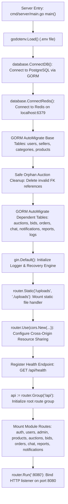
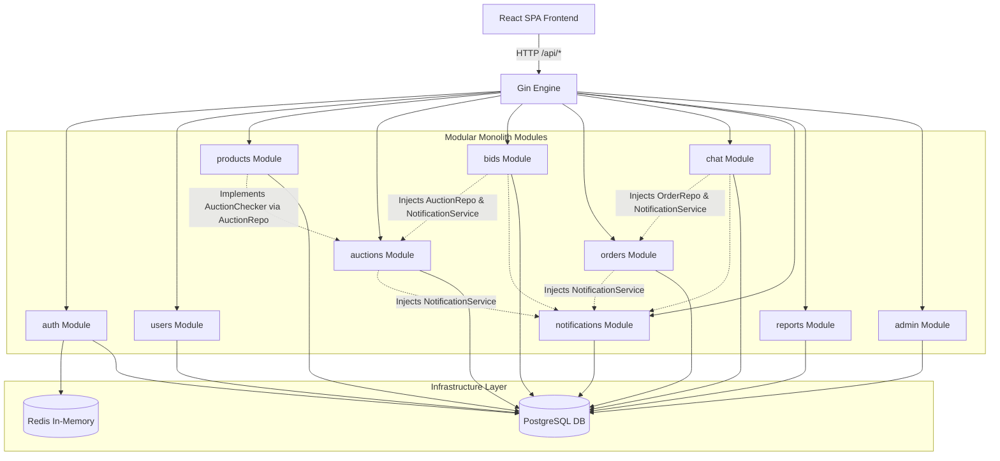
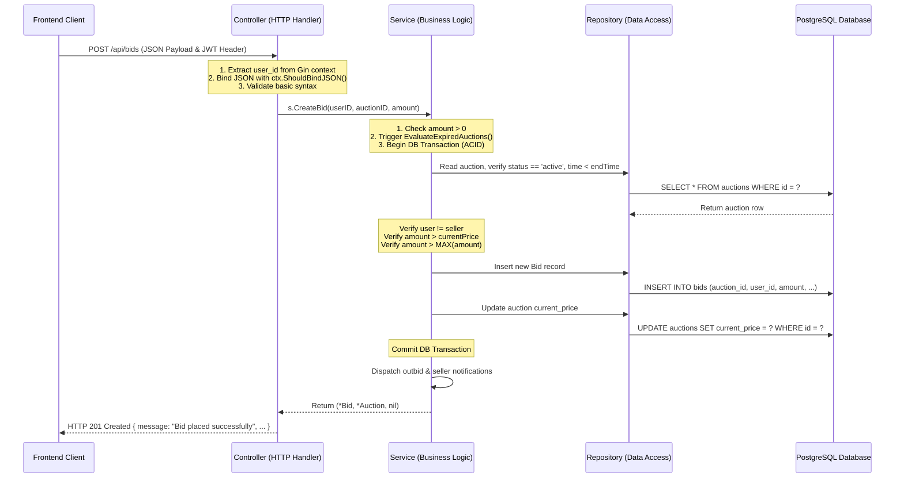
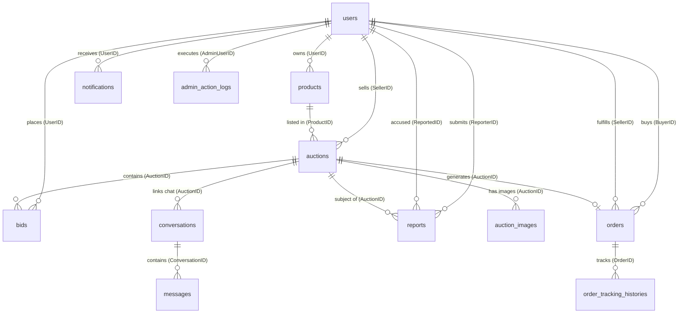
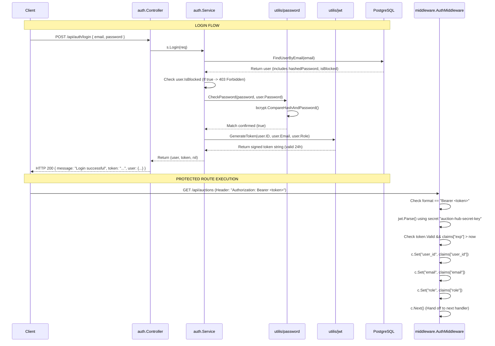
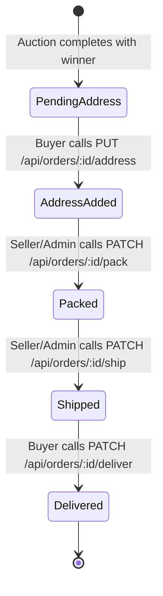
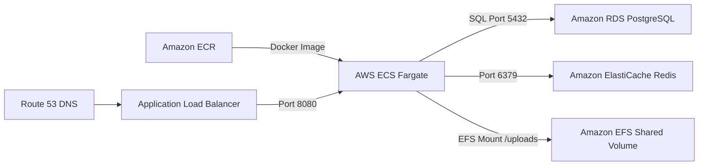

# Auction Hub - Complete Backend Architecture & Technical Documentation

> **Platform:** Auction Hub (Online Auction Marketplace)  
> **Backend Stack:** Go (`go 1.26.2`), Gin Web Framework (`github.com/gin-gonic/gin` v1.12.0)  
> **Database:** PostgreSQL via GORM (`gorm.io/gorm` v1.31.2, `gorm.io/driver/postgres` v1.6.2)  
> **In-Memory Store / Cache:** Redis (`github.com/redis/go-redis/v9` v9.22.0) for 5-minute OTP lifecycle management  
> **Authentication:** Signed JWT (HMAC-SHA256 via `github.com/golang-jwt/jwt/v5` v5.3.1) & Bcrypt password hashing (`golang.org/x/crypto/bcrypt`)  
> **Architecture Pattern:** Modular Monolithic Architecture with a 3-Tier Layered Design (Controller &rarr; Service &rarr; Repository)  

---

## Table of Contents

1. [Part 1: Backend Overview](#part-1-backend-overview)
2. [Part 2: Complete Backend Folder Structure](#part-2-complete-backend-folder-structure)
3. [Part 3: Server Startup Flow](#part-3-server-startup-flow)
4. [Part 4: Modular Monolith Architecture](#part-4-modular-monolith-architecture)
5. [Part 5: Controller, Service, and Repository Layers](#part-5-controller-service-and-repository-layers)
6. [Part 6: Complete API Reference Table](#part-6-complete-api-reference-table)
7. [Part 7: Database and GORM Models (with ER Diagram)](#part-7-database-and-gorm-models)
8. [Part 8: Authentication and Authorization Flow](#part-8-authentication-and-authorization-flow)
9. [Part 9: Auction Creation and Lifecycle Management](#part-9-auction-creation-and-lifecycle-management)
10. [Part 10: Bidding Logic and Concurrency Analysis](#part-10-bidding-logic-and-concurrency-analysis)
11. [Part 11: Auction Completion and Winner Selection](#part-11-auction-completion-and-winner-selection)
12. [Part 12: Order Processing and Fulfillment](#part-12-order-processing-and-fulfillment)
13. [Part 13: Notification System and Event Matrix](#part-13-notification-system-and-event-matrix)
14. [Part 14: Direct Buyer-Seller Chat Implementation](#part-14-direct-buyer-seller-chat-implementation)
15. [Part 15: Redis Usage and Lifecycle](#part-15-redis-usage-and-lifecycle)
16. [Part 16: Error Handling, Validation, and Transactions](#part-16-error-handling-validation-and-transactions)
17. [Part 17: Security and Vulnerability Audit](#part-17-security-and-vulnerability-audit)
18. [Part 18: Line-by-Line Code Walkthrough (Key Functions)](#part-18-line-by-line-code-walkthrough)
19. [Part 19: Backend Interview Questions (50 Detailed Q&A)](#part-19-backend-interview-questions)
20. [Part 20: AWS Production Deployment Guide](#part-20-aws-production-deployment-guide)
21. [Part 21: Project Status, Limitations, and Potential Risks](#part-21-project-status-limitations-and-potential-risks)
22. [Part 22: Technical Glossary](#part-22-technical-glossary)

---

## Part 1: Backend Overview

### 1. What the Backend Does
The **Auction Hub** backend is a high-performance RESTful API service responsible for the business logic, transaction management, data persistence, and administrative controls of an online auction marketplace. It coordinates:
- **Identity & Access Management:** User registration with 6-digit email OTP verification, password hashing with Bcrypt, role-based authorization (`user` vs `admin`), account blocking, and JWT session issuance.
- **Product Inventory:** Seller inventory tracking with image uploads saved to local disk storage (`/uploads`).
- **Auction Engine:** Creation of auctions with configurable durations, starting bid minimums, real-time current price tracking, early manual termination by sellers, and lazy expiry evaluation.
- **Transactional Bidding:** ACID database transactions for bid placements, outbid validations, auction price updates, and automated notification triggers.
- **Order Fulfillment Pipeline:** Automatic conversion of winning bids into fulfillment orders with multi-step status tracking (`Pending Address` &rarr; `Address Added` &rarr; `Packed` &rarr; `Shipped` &rarr; `Delivered`).
- **Communication:** Ephemeral OTP caching in Redis, persistent buyer-seller in-order chat messaging, and persistent notification event feeds.
- **Platform Administration:** Administrative dashboard metrics, user account suspension, forced product takedowns with mandatory audit reason logging, auction pause/resume/cancellation, and user report resolution.

### 2. Why Go is Used
- **Execution Speed & Low Latency:** Go compiles directly to native machine code without the overhead of an interpreter or virtual machine (unlike Python or Node.js), ensuring rapid request turnaround critical for high-frequency auction bidding.
- **Memory Efficiency:** Go's static typing and compact memory layout enable the server binary to run comfortably with minimal RAM footprint.
- **Concurrency Support:** Native goroutines and channels allow the runtime to handle thousands of concurrent network connections efficiently.
- **Self-Contained Deployment:** Compiles into a single standalone binary (`server.exe` on Windows or ELF executable on Linux) containing all application code.

### 3. Why Gin is Used
- **Routing Performance:** Gin utilizes a custom radix-tree-based HTTP router (adapted from `httprouter`), offering zero dynamic memory allocation during route matching.
- **Middleware Pipeline:** Simplifies the injection of global concerns like CORS, JWT authentication, and role checking via standard `gin.HandlerFunc` chains (`c.Next()`, `c.Abort()`).
- **Data Binding & Validation:** Built-in integration with `go-playground/validator` allows declarative request validation via struct tags (`binding:"required,email,min=6"`).
- **JSON Serialization:** Provides optimized JSON response rendering via `c.JSON()`.

### 4. Why GORM is Used
- **Productivity & ORM Abstraction:** Automatically maps Go structs to PostgreSQL relational tables, eliminating verbose repetitive SQL queries.
- **Automated Schema Migrations:** `db.AutoMigrate()` ensures database columns, foreign keys, and indexes stay synchronized with Go models without requiring external manual migration scripts during development.
- **Eager Association Loading:** Features like `.Preload("Product")` and `.Preload("Seller")` solve N+1 query problems by loading relational data in structured SQL batches.
- **Transaction Safety:** Supports managed transactions via `db.Transaction(func(tx *gorm.DB) error { ... })` that automatically roll back on errors.

### 5. Why PostgreSQL is Used
- **ACID Transaction Guarantees:** Ensures that financial bids, price updates, and order generation either commit in their entirety or abort cleanly without leaving inconsistent records.
- **Relational Integrity:** Enforces relational constraints (Foreign Keys with cascade behaviors, unique indexes on user emails and order auctions).
- **Complex Querying:** Easily handles relational joins, aggregation (`MAX(amount)`), and table filtering across users, products, auctions, and orders.

### 6. How Redis is Used
- **Temporary OTP Store:** Redis is integrated via `github.com/redis/go-redis/v9`. It stores 6-digit numeric OTP codes during user registration and password reset workflows.
- **Automatic TTL Expiration:** Keys are stored with a strict 5-minute Time-To-Live (`5 * time.Minute`), offloading cache invalidation and expiration cleanup from the primary PostgreSQL database.

### 7. How JWT Authentication Works
- **Token Generation:** Handled by `utilis.GenerateToken(userID, email, role)`. Signs claims (`user_id`, `email`, `role`, `exp = 24 hours`) using HMAC-SHA256 with a secret key.
- **Token Verification:** Handled by `middleware.AuthMiddleware()`. Parses incoming `Authorization: Bearer <token>` headers, validates the cryptographic signature, checks expiration, and attaches identity fields into the Gin request context (`c.Set("user_id", ...)`).

### 8. Actual Backend Architecture
The backend follows a **Modular Monolith** pattern with a **3-Tier Layered Architecture**:
1. **HTTP / Controller Layer:** Unmarshals HTTP requests, binds JSON/form payloads, reads context parameters, calls service methods, and writes HTTP status codes and JSON responses.
2. **Business / Service Layer:** Implements core business logic, permissions, domain validation, multi-module coordination, and transaction orchestration.
3. **Data Access / Repository Layer:** Executes GORM queries against PostgreSQL, managing records, preloads, joins, and database mutations.

### 9. How Modules are Organized
Each functional domain is encapsulated inside its own directory within [`backend/modules/`](file:///c:/Auction_Hub/backend/modules/):
`admin`, `auctions`, `auth`, `bids`, `categories`, `chat`, `notifications`, `orders`, `products`, `reports`, `sellers`, and `users`.
Each module maintains its own `model.go`, `repository.go`, `service.go`, `controller.go`, and `routes.go`.

### 10. How the Backend Communicates with the Frontend
The backend exposes a JSON REST API over HTTP on port `8080`.
Static uploaded assets are served directly from the physical filesystem via `router.Static("/uploads", "./uploads")`.
CORS is explicitly configured using `github.com/gin-contrib/cors` allowing credentials, standard HTTP verbs (`GET`, `POST`, `PUT`, `PATCH`, `DELETE`, `OPTIONS`), and authorization headers from the React SPA on port `5173`.

---

## Part 2: Complete Backend Folder Structure

```
c:\Auction_Hub\backend\
├── .env                            # Environment variables (DB credentials, SMTP, Port)
├── .gitignore                      # Git ignore file for binaries and environment configs
├── go.mod                          # Go module definition and direct/indirect dependencies
├── go.sum                          # Checksums for Go package verification
├── main.exe                        # Compiled server executable (historical artifact)
├── README.md                       # Backend overview readme
├── server.exe                      # Compiled current application binary
├── cmd\
│   └── server\
│       └── main.go                 # Application entry point & router bootstrap
├── config\
│   └── config.go                   # Configuration placeholder package
├── database\
│   ├── database.go                 # GORM PostgreSQL connection initializer
│   └── redis.go                    # Go-Redis client connection initializer
├── middleware\
│   ├── auth.go                     # JWT validation and user identity context injector
│   └── role.go                     # Role-based route guard middleware (e.g. admin)
├── modules\
│   ├── admin\                      # Administrative oversight domain
│   │   ├── controller.go           # HTTP handlers for analytics, audits, and moderation
│   │   ├── model.go                # AdminActionLog struct definition
│   │   ├── repository.go           # Direct database queries across all entity tables
│   │   ├── routes.go               # Admin route registration (/api/admin/*)
│   │   └── service.go              # Business validation and action log persistence
│   ├── auctions\                   # Auction lifecycle domain
│   │   ├── controller.go           # HTTP handlers for auction queries and creation
│   │   ├── model.go                # Auction and AuctionImage structs
│   │   ├── repository.go           # Auction queries and lazy EvaluateExpiredAuctions()
│   │   ├── routes.go               # Auction route registration (/api/auctions/*)
│   │   └── service.go              # Validation of starting prices, durations, and products
│   ├── auth\                       # Authentication & verification domain
│   │   ├── controller.go           # Handlers for login, register, OTP, forgot/reset password
│   │   ├── email.go                # SMTP email dispatcher for OTP delivery
│   │   ├── model.go                # Request DTOs for registration, login, and OTP
│   │   ├── otp.go                  # Random 6-digit OTP generator & Redis helpers
│   │   ├── repository.go           # Database operations on users table for auth
│   │   ├── routes.go               # Auth route registration (/api/auth/*)
│   │   └── service.go              # User registration, bcrypt checks, and token generation
│   ├── bids\                       # Competitive bidding domain
│   │   ├── controller.go           # Handlers for bid placement and bidding history
│   │   ├── model.go                # Bid struct and MyBidItem response DTO
│   │   ├── repository.go           # GORM queries for bid history and max amounts
│   │   ├── routes.go               # Bid route registration (/api/bids/*)
│   │   └── service.go              # Transactional bid placement & notification dispatch
│   ├── categories\                 # Category taxonomy domain (Schema only)
│   │   ├── controller.go           # Category HTTP handler placeholder
│   │   ├── model.go                # Category struct definition
│   │   ├── repository.go           # Category data access
│   │   ├── routes.go               # Empty routes placeholder
│   │   └── service.go              # Category business service
│   ├── chat\                       # Direct messaging domain
│   │   ├── controller.go           # Handlers for conversations and chat messages
│   │   ├── model.go                # Conversation and Message structs
│   │   ├── repository.go           # GORM queries for conversation lookups & messages
│   │   ├── routes.go               # Chat route registration (/api/chat/*)
│   │   └── service.go              # Access authorization and chat notification triggers
│   ├── notifications\              # User alert feed domain
│   │   ├── controller.go           # Handlers for unread counts and read mutations
│   │   ├── model.go                # Notification struct definition
│   │   ├── repository.go           # Notification queries and mark-read mutations
│   │   ├── routes.go               # Notification route registration (/api/notifications/*)
│   │   └── service.go              # Notification creation and dispatch logic
│   ├── orders\                     # Post-auction order fulfillment domain
│   │   ├── controller.go           # Handlers for address updates and order status steps
│   │   ├── model.go                # Order and OrderTrackingHistory structs
│   │   ├── repository.go           # GORM queries for buyer/seller orders & tracking
│   │   ├── routes.go               # Order route registration (/api/orders/*)
│   │   └── service.go              # Status transition validation & tracking log recorder
│   ├── products\                   # Inventory domain
│   │   ├── controller.go           # Multipart form handlers for product CRUD
│   │   ├── model.go                # Product struct definition
│   │   ├── repository.go           # Product catalog GORM queries
│   │   ├── routes.go               # Product route registration (/api/products/*)
│   │   └── service.go              # AuctionChecker integration & active auction guards
│   ├── reports\                    # User dispute & fraud report domain
│   │   ├── controller.go           # Handlers for filing reports & admin triage
│   │   ├── model.go                # Report struct definition
│   │   ├── repository.go           # Report CRUD and filter queries
│   │   ├── routes.go               # Report route registration (/api/reports/*)
│   │   └── service.go              # Report submission validation and status transitions
│   ├── sellers\                    # Seller profile domain (Schema only)
│   │   ├── controller.go           # Seller profile handlers
│   │   ├── model.go                # Seller struct definition
│   │   ├── repository.go           # Seller data access
│   │   ├── routes.go               # Empty routes placeholder
│   │   └── service.go              # Seller profile business logic
│   └── users\                      # User account domain
│       ├── controller.go           # Handlers for profile inspection and name updates
│       ├── model.go                # User and Watchlist structs
│       ├── repository.go           # User queries by ID and name updates
│       ├── routes.go               # User route registration (/api/users/*)
│       └── service.go              # Profile business logic
├── uploads\                        # Local disk storage for uploaded product images
└── utilis\                         # Custom utilities package (Note the spelling)
    ├── jwt.go                      # JWT signing logic via HMAC-SHA256
    ├── password.go                 # Password hashing & comparison via bcrypt
    └── response.go                 # Response utility placeholder
```

---

## Part 3: Server Startup Flow



### Detailed Order of Operations & Failure Modes

1. **Environment Loading:** `main()` executes `godotenv.Load()`. If the `.env` file is missing, it logs a non-fatal warning (`"Warning: .env file not found"`) and falls back to system environment variables.
2. **PostgreSQL Database Connection:** Calls `database.ConnectDB()`. It reads `DB_HOST`, `DB_USER`, `DB_PASSWORD`, `DB_NAME`, and `DB_PORT`, constructs the DSN string, and invokes `gorm.Open(postgres.Open(dsn))`.  
   *Failure Mode:* If PostgreSQL is unreachable or credentials fail, it executes `log.Fatal("Failed to connect to database:", err)`, immediately terminating the process with exit code 1.
3. **Redis Connection:** Calls `database.ConnectRedis()`. It initializes a Redis client pointing to `localhost:6379` and issues `RedisClient.Ping(RedisContext).Result()`.  
   *Failure Mode:* If Redis is offline or not installed on port 6379, it triggers `log.Fatal("Failed to connect to Redis:", err)` and crashes the application.
4. **Schema Migrations (Two-Phase):**
   - **Phase 1 (Base Tables):** Migrates `User`, `Seller`, `Category`, and `Product`. This ensures foreign key targets exist before dependent tables attempt to bind constraints.
   - **Phase 2 (Orphan Cleanup):** Runs raw SQL to delete any legacy auction records pointing to non-existent product IDs before foreign key constraints are locked in.
   - **Phase 3 (Dependent Tables):** Migrates `Auction`, `Bid`, `AuctionImage`, `Conversation`, `Message`, `Notification`, `Order`, `OrderTrackingHistory`, `AdminActionLog`, and `Report`.  
   *Failure Mode:* Database constraint errors trigger `log.Fatal()`.
5. **Gin Engine Bootstrap:** `router := gin.Default()` attaches the standard Gin `Logger()` and `Recovery()` middleware.
6. **Static File Server:** `router.Static("/uploads", "./uploads")` routes incoming HTTP requests for image thumbnails directly to the local directory.
7. **CORS Middleware Configuration:** Injects `cors.New(...)` with `AllowOriginFunc` returning `true`, enabling cross-origin requests from the React development server.
8. **Module Route Registration:** Every active module registers its endpoints under `/api`.
9. **Server Listener:** `router.Run(":8080")` starts the HTTP server.

---

## Part 4: Modular Monolith Architecture



### Architectural Principles Implemented in Auction Hub

1. **Domain Boundary Encapsulation:** Each module manages its own data structures, routes, and business invariants inside a dedicated folder. Code in `modules/bids` does not directly execute raw SQL queries on `orders`.
2. **Decoupled Dependency Injection:** Dependencies are explicitly passed through constructor functions (e.g., `NewService(repository, auctionRepository)`).
3. **Cross-Module Interfaces:** In [`modules/products/service.go`](file:///c:/Auction_Hub/backend/modules/products/service.go), rather than importing the entire auctions service, products defines a lightweight interface:
   ```go
   type AuctionChecker interface {
       EvaluateExpiredAuctions()
       IsProductInActiveAuction(productID uint) (bool, error)
   }
   ```
   The `auctions.Repository` struct implements these two methods, satisfying the interface and decoupling products from auction internal logic.
4. **Differences from Microservices:** All modules compile into a single Go binary, run in a single operating system process, share a single PostgreSQL database connection pool (`database.DB`), and share memory space. There is zero network latency between modules.

---

## Part 5: Controller, Service, and Repository Layers



### Concrete Responsibilities per Layer

| Layer | Responsibility | Actual Code Example |
| :--- | :--- | :--- |
| **Controller** | - Reads path params (`ctx.Param("id")`)<br/>- Reads query params (`ctx.Query("search")`)<br/>- Binds JSON bodies (`ctx.ShouldBindJSON(&req)`)<br/>- Extracts JWT context (`ctx.Get("user_id")`)<br/>- Translates domain errors to HTTP status codes (`400`, `401`, `403`, `404`, `409`, `500`) | Lines 19-60 in [`modules/bids/controller.go`](file:///c:/Auction_Hub/backend/modules/bids/controller.go) |
| **Service** | - Enforces domain invariants (e.g., sellers cannot bid on their own items)<br/>- Manages database transaction blocks (`tx.Transaction`)<br/>- Validates time expiration against `time.Now()`<br/>- Coordinates multiple repositories (e.g. Bids calling Notifications) | Lines 45-196 in [`modules/bids/service.go`](file:///c:/Auction_Hub/backend/modules/bids/service.go) |
| **Repository** | - Executes GORM query methods (`.First()`, `.Find()`, `.Create()`, `.Save()`, `.Where()`, `.Order()`, `.Preload()`)<br/>- Performs raw SQL operations when necessary (`tx.Exec()`, `.Scan()`)<br/>- Isolates all database schema access | Lines 25-103 in [`modules/bids/repository.go`](file:///c:/Auction_Hub/backend/modules/bids/repository.go) |

---

## Part 6: Complete API Reference Table

The following table documents all endpoints registered on the Gin router.

| HTTP Method | Route Path | Auth Required | Role Required | Controller Handler | Database Tables Involved | Primary Functionality |
| :--- | :--- | :--- | :--- | :--- | :--- | :--- |
| `GET` | `/api/health` | No | None | Anonymous inline handler | None | Server liveness health probe |
| `POST` | `/api/auth/send-otp` | No | None | `auth.Controller.SendOTP` | `users`, Redis `otp:*` | Validates email, stores OTP in Redis, sends SMTP email |
| `POST` | `/api/auth/verify-otp` | No | None | `auth.Controller.VerifyOTP` | Redis `otp:*`, `verified:*` | Compares OTP from Redis, marks email verified |
| `POST` | `/api/auth/register` | No | None | `auth.Controller.Register` | `users`, Redis `verified:*` | Checks verified flag, hashes password, inserts user |
| `POST` | `/api/auth/login` | No | None | `auth.Controller.Login` | `users` | Verifies bcrypt password, checks `is_blocked`, issues JWT |
| `POST` | `/api/auth/forgot-password`| No | None | `auth.Controller.ForgotPassword` | `users`, Redis `otp:*` | Verifies user exists, dispatches reset OTP |
| `POST` | `/api/auth/reset-password` | No | None | `auth.Controller.ResetPassword` | `users`, Redis `otp:*` | Verifies reset OTP, updates hashed password in DB |
| `GET` | `/api/users/profile` | Yes (JWT) | None | `users.Controller.GetProfile` | `users` | Returns authenticated user details |
| `PUT` | `/api/users/profile` | Yes (JWT) | None | `users.Controller.UpdateProfile` | `users` | Updates user display name |
| `GET` | `/api/products/my` | Yes (JWT) | None | `products.Controller.GetMyProducts` | `products` | Fetches products owned by authenticated user |
| `POST` | `/api/products` | Yes (JWT) | None | `products.Controller.CreateProduct` | `products` | Parses multipart form, uploads image, inserts record |
| `GET` | `/api/products/:id` | Yes (JWT) | None | `products.Controller.GetProductByID`| `products` | Fetches product details by ID |
| `PUT` | `/api/products/:id` | Yes (JWT) | None | `products.Controller.UpdateProduct` | `products`, `auctions` | Updates product name/desc/image if not in active auction |
| `DELETE`| `/api/products/:id` | Yes (JWT) | None | `products.Controller.DeleteProduct` | `products`, `auctions` | Deletes product if not in active auction and no history |
| `POST` | `/api/auctions` | Yes (JWT) | None | `auctions.Controller.CreateAuction` | `auctions`, `products` | Creates an auction and sets product status to 'In Auction' |
| `GET` | `/api/auctions` | Yes (JWT) | None | `auctions.Controller.GetActiveAuctions`| `auctions`, `products`, `users`, `bids` | Evaluates expiry, returns active/paused auctions |
| `GET` | `/api/auctions/my-auctions`| Yes (JWT) | None | `auctions.Controller.GetMyAuctions` | `auctions`, `products`, `bids` | Returns seller's own auctions |
| `GET` | `/api/auctions/seller` | Yes (JWT) | None | `auctions.Controller.GetMyAuctions` | `auctions`, `products`, `bids` | Alias for seller's own auctions |
| `GET` | `/api/auctions/won` | Yes (JWT) | None | `auctions.Controller.GetWonAuctions`| `orders`, `auctions`, `products` | Returns auctions won by buyer |
| `GET` | `/api/auctions/:id` | Yes (JWT) | None | `auctions.Controller.GetAuctionByID` | `auctions`, `products`, `users`, `bids`, `admin_action_logs` | Returns single auction with live bids & pause reasons |
| `PATCH`| `/api/auctions/:id/end` | Yes (JWT) | None | `auctions.Controller.EndAuction` | `auctions`, `orders`, `bids`, `products`, `notifications` | Seller manually closes auction, creates order for winner |
| `POST` | `/api/bids` | Yes (JWT) | None | `bids.Controller.CreateBid` | `bids`, `auctions`, `notifications` | Places bid in ACID transaction, updates price, notifies |
| `GET` | `/api/bids/my` | Yes (JWT) | None | `bids.Controller.GetMyBids` | `bids`, `auctions`, `products` | Returns user's bidding history with win/outbid status |
| `GET` | `/api/bids/my-bids` | Yes (JWT) | None | `bids.Controller.GetMyBids` | `bids`, `auctions`, `products` | Alias for user's bidding history |
| `GET` | `/api/bids/auction/:auctionId`| Yes (JWT)| None | `bids.Controller.GetBidsByAuctionID`| `bids`, `users` | Returns all bids placed on a specific auction |
| `GET` | `/api/orders` | Yes (JWT) | None | `orders.Controller.GetUserOrders` | `orders`, `auctions`, `users` | Returns orders where user is buyer or seller |
| `GET` | `/api/orders/my-orders`| Yes (JWT) | None | `orders.Controller.GetMyOrders` | `orders`, `auctions`, `users` | Returns separated `buyerOrders` and `sellerOrders` |
| `GET` | `/api/orders/seller` | Yes (JWT) | None | `orders.Controller.GetSellerOrders` | `orders`, `auctions`, `users` | Returns orders where user is the seller |
| `GET` | `/api/orders/buyer` | Yes (JWT) | None | `orders.Controller.GetBuyerOrders` | `orders`, `auctions`, `users` | Returns orders where user is the buyer |
| `GET` | `/api/orders/:id` | Yes (JWT) | None | `orders.Controller.GetOrderByID` | `orders`, `auctions`, `users`, `order_tracking_histories` | Returns order details with full tracking timeline |
| `PUT` | `/api/orders/:id/address`| Yes (JWT)| None | `orders.Controller.UpdateDeliveryAddress`| `orders`, `order_tracking_histories`, `notifications` | Buyer sets shipping address (only before shipped) |
| `PUT` | `/api/orders/:id/status`| Yes (JWT) | `admin` | `orders.Controller.UpdateOrderStatus`| `orders`, `order_tracking_histories`, `notifications` | Admin overrides order status with mandatory reason |
| `PATCH`| `/api/orders/:id/pack` | Yes (JWT) | None | `orders.Controller.MarkAsPacked` | `orders`, `order_tracking_histories`, `notifications` | Seller/Admin marks order as Packed |
| `PATCH`| `/api/orders/:id/ship` | Yes (JWT) | None | `orders.Controller.MarkAsShipped` | `orders`, `order_tracking_histories`, `notifications` | Seller/Admin marks order as Shipped |
| `PATCH`| `/api/orders/:id/deliver`| Yes (JWT)| None | `orders.Controller.MarkAsDelivered` | `orders`, `order_tracking_histories`, `notifications` | Buyer marks order as Delivered |
| `GET` | `/api/chat/auction/:auctionId`| Yes (JWT)| None | `chat.Controller.GetOrCreateConversation`| `conversations`, `orders` | Gets or initializes private chat for an auction |
| `GET` | `/api/chat/conversation/:id/messages`| Yes (JWT)| None | `chat.Controller.GetMessages` | `messages`, `conversations` | Fetches message history for a conversation |
| `POST` | `/api/chat/conversation/:id/messages`| Yes (JWT)| None | `chat.Controller.SendMessage` | `messages`, `conversations`, `notifications` | Posts chat message, creates notification for recipient |
| `GET` | `/api/notifications` | Yes (JWT) | None | `notifications.Controller.GetNotifications`| `notifications` | Fetches notification feed for user |
| `GET` | `/api/notifications/unread-count`| Yes (JWT)| None | `notifications.Controller.GetUnreadCount`| `notifications` | Returns integer count of unread notifications |
| `PATCH`| `/api/notifications/:id/read`| Yes (JWT)| None | `notifications.Controller.MarkAsRead` | `notifications` | Marks individual notification as read |
| `PATCH`| `/api/notifications/read-all`| Yes (JWT)| None | `notifications.Controller.MarkAllAsRead`| `notifications` | Marks all notifications for user as read |
| `POST` | `/api/reports` | Yes (JWT) | None | `reports.Controller.CreateReport` | `reports`, `auctions` | User submits abuse/fraud report against an auction |
| `GET` | `/api/reports/my-reports`| Yes (JWT)| None | `reports.Controller.GetUserReports` | `reports`, `auctions` | Returns reports submitted by authenticated user |
| `GET` | `/api/admin/reports` | Yes (JWT) | `admin` | `reports.Controller.GetAllReports` | `reports`, `users`, `auctions` | Admin audits reports with status & search filters |
| `GET` | `/api/admin/reports/:id` | Yes (JWT) | `admin` | `reports.Controller.GetReportByID` | `reports`, `users`, `auctions` | Admin views single report detail |
| `PATCH`| `/api/admin/reports/:id/status`| Yes (JWT)| `admin`| `reports.Controller.UpdateReportStatus`| `reports` | Admin updates report status with audit note |
| `GET` | `/api/admin/dashboard` | Yes (JWT) | `admin` | `admin.Controller.GetDashboardAnalytics`| `users`, `products`, `auctions`, `bids`, `orders` | Aggregates system-wide counts and statistics |
| `GET` | `/api/admin/users` | Yes (JWT) | `admin` | `admin.Controller.GetAllUsers` | `users` | Admin user directory with search and status filters |
| `PATCH`| `/api/admin/users/:id/block`| Yes (JWT)| `admin` | `admin.Controller.BlockUser` | `users`, `admin_action_logs` | Suspends user account and writes audit log |
| `PATCH`| `/api/admin/users/:id/unblock`| Yes (JWT)| `admin`| `admin.Controller.UnblockUser` | `users`, `admin_action_logs` | Reinstates user account and writes audit log |
| `GET` | `/api/admin/products` | Yes (JWT) | `admin` | `admin.Controller.GetAllProducts` | `products`, `users` | Admin product directory with search and filters |
| `DELETE`| `/api/admin/products/:id`| Yes (JWT)| `admin`| `admin.Controller.DeleteProduct` | `products`, `admin_action_logs`, `auctions` | Force deletes product with mandatory reason log |
| `GET` | `/api/admin/auctions` | Yes (JWT) | `admin` | `admin.Controller.GetAllAuctions` | `auctions`, `products`, `users`, `bids` | Admin auction audit list |
| `PATCH`| `/api/admin/auctions/:id/cancel`| Yes (JWT)| `admin`| `admin.Controller.CancelAuction` | `auctions`, `admin_action_logs`, `products` | Cancels auction and resets product status |
| `PATCH`| `/api/admin/auctions/:id/pause`| Yes (JWT)| `admin` | `admin.Controller.PauseAuction` | `auctions`, `admin_action_logs` | Halts bidding with mandatory reason log |
| `PATCH`| `/api/admin/auctions/:id/resume`| Yes (JWT)| `admin`| `admin.Controller.ResumeAuction` | `auctions`, `admin_action_logs` | Resumes bidding with mandatory reason log |
| `GET` | `/api/admin/bids` | Yes (JWT) | `admin` | `admin.Controller.GetAllBids` | `bids`, `users`, `auctions`, `products` | Global platform bid audit log with sorting |
| `GET` | `/api/admin/orders` | Yes (JWT) | `admin` | `admin.Controller.GetAllOrders` | `orders`, `auctions`, `products`, `users` | Global platform orders list |
| `GET` | `/api/admin/orders/:id` | Yes (JWT) | `admin` | `admin.Controller.GetAdminOrderByID`| `orders`, `auctions`, `products`, `users`, `tracking` | Detailed order inspection for administrator |

---

## Part 7: Database and GORM Models



### Database Schema Specification

#### 1. `users` Table
- `id` (uint, Primary Key, Auto Increment)
- `name` (varchar, not null)
- `email` (varchar, unique, not null)
- `password` (varchar, not null) &mdash; Store of bcrypt hash (`$2a$10$...`)
- `role` (varchar, default: `'user'`, not null) &mdash; Allowed values: `'user'`, `'admin'`
- `is_blocked` (boolean, default: `false`, not null)
- `created_at`, `updated_at` (timestamptz)

#### 2. `products` Table
- `id` (uint, Primary Key, Auto Increment)
- `user_id` (uint, not null, index) &mdash; FK references `users.id`
- `name` (varchar, not null)
- `description` (text, not null)
- `image_url` (varchar, not null) &mdash; Relative path like `/uploads/prod_10_1791958314468738000.jpg`
- `status` (varchar, default: `'Ready for Auction'`, not null) &mdash; Transitions to `'In Auction'` and `'Completed'`
- `created_at`, `updated_at` (timestamptz)

#### 3. `auctions` Table
- `id` (uint, Primary Key, Auto Increment)
- `seller_id` (uint, not null, index) &mdash; FK references `users.id`
- `product_id` (uint, not null, index) &mdash; FK references `products.id`
- `category_id` (uint, default: `1`, index)
- `title` (varchar, not null)
- `description` (text)
- `starting_price` (double precision, not null)
- `current_price` (double precision, not null)
- `start_time` (timestamptz, not null, index)
- `end_time` (timestamptz, not null, index)
- `status` (varchar, default: `'active'`, index) &mdash; Values: `'active'`, `'paused'`, `'completed'`, `'cancelled'`
- `paused_at` (timestamptz, nullable, index)
- `created_at`, `updated_at` (timestamptz)

#### 4. `bids` Table
- `id` (uint, Primary Key, Auto Increment)
- `auction_id` (uint, not null, index) &mdash; FK references `auctions.id`
- `user_id` (uint, not null, index) &mdash; FK references `users.id`
- `amount` (double precision, not null)
- `created_at`, `updated_at` (timestamptz)

#### 5. `orders` Table
- `id` (uint, Primary Key, Auto Increment)
- `auction_id` (uint, not null, uniqueIndex) &mdash; Strict 1:1 relationship with `auctions.id`
- `buyer_id` (uint, not null, index) &mdash; FK references `users.id`
- `seller_id` (uint, not null, index) &mdash; FK references `users.id`
- `final_amount` (double precision, not null) &mdash; Winning bid price
- `delivery_address` (text) &mdash; Submitted by buyer post-auction
- `status` (varchar, default: `'Pending Address'`, index) &mdash; Values: `'Pending Address'`, `'Address Added'`, `'Packed'`, `'Shipped'`, `'Delivered'`
- `created_at`, `updated_at` (timestamptz)

#### 6. `order_tracking_histories` Table
- `id` (uint, Primary Key, Auto Increment)
- `order_id` (uint, not null, index) &mdash; FK references `orders.id`
- `status` (varchar, not null)
- `updated_by` (varchar, not null) &mdash; e.g. `'System'`, `'Buyer'`, `'Seller'`, `'Admin'`
- `updated_by_id` (uint, not null)
- `reason` (text)
- `created_at` (timestamptz)

#### 7. `conversations` Table
- `id` (uint, Primary Key, Auto Increment)
- `auction_id` (uint, not null, index)
- `buyer_id` (uint, not null, index)
- `seller_id` (uint, not null, index)
- `created_at`, `updated_at` (timestamptz)

#### 8. `messages` Table
- `id` (uint, Primary Key, Auto Increment)
- `conversation_id` (uint, not null, index)
- `sender_id` (uint, not null, index)
- `message` (text, not null)
- `is_read` (boolean, default: `false`, index)
- `created_at`, `updated_at` (timestamptz)

#### 9. `notifications` Table
- `id` (uint, Primary Key, Auto Increment)
- `user_id` (uint, not null, index)
- `type` (varchar, not null) &mdash; Values: `'new_bid'`, `'outbid'`, `'auction_won'`, `'auction_ended'`, `'order_update'`, `'chat_message'`
- `title` (varchar, not null)
- `message` (varchar, not null)
- `is_read` (boolean, default: `false`, index)
- `created_at`, `updated_at` (timestamptz)

#### 10. `reports` Table
- `id` (uint, Primary Key, Auto Increment)
- `reporter_id` (uint, not null, index)
- `reported_id` (uint, not null, index)
- `auction_id` (uint, not null, index)
- `reason` (varchar, not null)
- `description` (text, not null)
- `status` (varchar, default: `'pending'`, index) &mdash; Values: `'pending'`, `'reviewing'`, `'resolved'`, `'rejected'`
- `admin_reason` (text, nullable)
- `admin_id` (uint, nullable, index)
- `created_at`, `updated_at` (timestamptz)

#### 11. `admin_action_logs` Table
- `id` (uint, Primary Key, Auto Increment)
- `admin_user_id` (uint, not null, index)
- `action_type` (varchar, not null, index) &mdash; Values: `'BLOCK_USER'`, `'UNBLOCK_USER'`, `'REMOVE_PRODUCT'`, `'CANCEL_AUCTION'`, `'PAUSE_AUCTION'`, `'RESUME_AUCTION'`
- `entity_type` (varchar, not null, index) &mdash; Values: `'USER'`, `'PRODUCT'`, `'AUCTION'`, `'ORDER'`
- `entity_id` (uint, not null, index)
- `reason` (text, not null) &mdash; Mandatory audit justification
- `created_at` (timestamptz)

---

## Part 8: Authentication and Authorization Flow



### Password Hashing Details
In [`backend/utilis/password.go`](file:///c:/Auction_Hub/backend/utilis/password.go), password security is managed using Openwall's Bcrypt adaptive hashing algorithm:
```go
func HashPassword(password string) (string, error) {
    hashedPassword, err := bcrypt.GenerateFromPassword([]byte(password), bcrypt.DefaultCost)
    return string(hashedPassword), err
}
```
`bcrypt.DefaultCost` (cost factor 10) executes $2^{10} = 1,024$ key expansion rounds, introducing a calculated computational delay to thwart offline dictionary and rainbow table attacks.

### Authorization & Role Verification
Role verification is handled by [`middleware/role.go`](file:///c:/Auction_Hub/backend/middleware/role.go).
Endpoints mounted on `adminRoutes.Use(middleware.RoleMiddleware("admin"))` execute:
```go
role, exists := c.Get("role")
if !exists {
    c.JSON(401, gin.H{"message": "User role not found"})
    c.Abort()
    return
}
if role != requiredRole {
    c.JSON(403, gin.H{"message": "Access denied"})
    c.Abort()
    return
}
c.Next()
```
This guarantees that non-admin authenticated users attempting to access `/api/admin/*` are rejected with HTTP 403 Forbidden.

---

## Part 9: Auction Creation and Lifecycle Management

### Auction Duration Parsing
In [`modules/auctions/service.go`](file:///c:/Auction_Hub/backend/modules/auctions/service.go), duration strings from the frontend are converted into discrete time intervals:
- `"1h"` &rarr; `1 * time.Hour`
- `"6h"` &rarr; `6 * time.Hour`
- `"12h"` &rarr; `12 * time.Hour`
- `"1d"` &rarr; `24 * time.Hour`
- `"3d"` &rarr; `3 * 24 * time.Hour`
- `"7d"` &rarr; `7 * 24 * time.Hour`
The auction start time is set to `now = time.Now()`, and end time is set to `endTime = now.Add(duration)`.

### Product Availability Verification
Before creating an auction, the service performs two domain checks:
1. Verifies that the product exists and belongs to the authenticated user (`product.UserID == sellerID`).
2. Calls `auctionRepo.IsProductInActiveAuction(productID)` to verify that the item is not already involved in an ongoing, unexpired auction.
Once created, the product status is updated to `'In Auction'`.

### State Machine of an Auction
An auction can occupy one of four states:
1. `active`: Normal open bidding state. Bids are accepted if `time.Now() < endTime`.
2. `paused`: Administrative pause state. Triggered by `PATCH /api/admin/auctions/:id/pause`. Bidding is rejected with `ErrAuctionPaused`.
3. `completed`: Bidding closed. Triggered automatically when `end_time` expires during `EvaluateExpiredAuctions()` or manually when the seller calls `PATCH /api/auctions/:id/end`.
4. `cancelled`: Administratively voided by `PATCH /api/admin/auctions/:id/cancel`. Product status is reset to `'Ready for Auction'`.

---

## Part 10: Bidding Logic and Concurrency Analysis

### Deep Dive into `bids.Service.CreateBid()`
Located in [`backend/modules/bids/service.go`](file:///c:/Auction_Hub/backend/modules/bids/service.go#L45-L196):

```go
func (s *Service) CreateBid(userID uint, auctionID uint, amount float64) (*Bid, *auctions.Auction, error) {
    if amount <= 0 {
        return nil, nil, ErrInvalidBidAmount
    }
    s.AuctionRepository.EvaluateExpiredAuctions()

    var newBid *Bid
    var updatedAuction *auctions.Auction
    var previousHighestBidderID uint
    var previousHighestAmount float64

    err := s.Repository.DB.Transaction(func(tx *gorm.DB) error {
        var auction auctions.Auction
        if err := tx.First(&auction, auctionID).Error; err != nil {
            if errors.Is(err, gorm.ErrRecordNotFound) {
                return ErrAuctionNotFound
            }
            return err
        }
        if strings.ToLower(auction.Status) == "paused" {
            return ErrAuctionPaused
        }
        if strings.ToLower(auction.Status) != "active" {
            return ErrAuctionNotActive
        }
        if time.Now().After(auction.EndTime) || time.Now().Equal(auction.EndTime) {
            return ErrAuctionEnded
        }
        if auction.SellerID == userID {
            return ErrSellerCannotBid
        }
        if amount <= auction.CurrentPrice {
            return ErrBidAmountTooLow
        }

        // Query top existing bid to check outbid status
        var previousBid Bid
        err := tx.Where("auction_id = ?", auctionID).
            Order("amount DESC, created_at ASC").
            First(&previousBid).Error
        if err == nil {
            previousHighestBidderID = previousBid.UserID
            previousHighestAmount = previousBid.Amount
        }

        // Double check against MAX(amount)
        var highestExisting float64
        if err := tx.Table("bids").Where("auction_id = ?", auctionID).
            Select("COALESCE(MAX(amount), 0)").Scan(&highestExisting).Error; err != nil {
            return err
        }
        if amount <= highestExisting {
            return ErrBidAmountTooLow
        }

        // Insert Bid record
        newBid = &Bid{AuctionID: auctionID, UserID: userID, Amount: amount}
        if err := tx.Create(newBid).Error; err != nil {
            return err
        }

        // Update Auction current price
        auction.CurrentPrice = amount
        if err := tx.Save(&auction).Error; err != nil {
            return err
        }
        updatedAuction = &auction
        return nil
    })

    if err != nil {
        return nil, nil, err
    }

    // Non-blocking notifications
    // Notify seller & previous highest bidder
    ...
}
```

### Concurrency & Race Condition Analysis
- **What is protected:** By wrapping operations in `s.Repository.DB.Transaction(func(tx *gorm.DB) error { ... })`, GORM guarantees atomicity: both the bid insertion and current price update commit together, or neither commits.
- **Potential Concurrency Vulnerability (Read-Modify-Write Race):**  
  In PostgreSQL, a standard `SELECT ...` inside a `READ COMMITTED` transaction does not acquire row-level locks. If User A and User B both submit a bid of ₹500 at the exact same millisecond:
  1. Transaction A reads `auction.CurrentPrice = 400`.
  2. Transaction B reads `auction.CurrentPrice = 400`.
  3. Both transactions evaluate `500 > 400` as valid.
  4. Both insert a bid of 500, resulting in duplicate bid values at the same price point.
- **Recommended Architectural Fix:**  
  Pessimistic row locking should be acquired during the initial lookup:
  ```go
  tx.Clauses(clause.Locking{Strength: "UPDATE"}).First(&auction, auctionID)
  ```
  This forces PostgreSQL to serialize concurrent transactions on that specific auction row, ensuring only one transaction evaluates the current price at a time.

---

## Part 11: Auction Completion and Winner Selection

### The Lazy Evaluation Mechanism: `EvaluateExpiredAuctions()`
In [`backend/modules/auctions/repository.go`](file:///c:/Auction_Hub/backend/modules/auctions/repository.go#L68-L208):
Auction Hub implements **lazy expiration**. The server does not maintain an active background timer or cron scheduler. Instead, whenever any query requests auction data (`GetActiveAuctions`, `GetAuctionByID`, `GetMyAuctions`, `GetWonAuctions`, `CreateBid`), `r.EvaluateExpiredAuctions()` is executed first:

```go
func (r *Repository) EvaluateExpiredAuctions() {
    var targetAuctions []Auction
    now := time.Now()

    // 1. Find all active auctions that have expired, or completed auctions lacking fulfillment
    err := r.DB.Where("(status = ? AND end_time <= ?) OR status = ?", "active", now, "completed").
        Find(&targetAuctions).Error
    if err != nil || len(targetAuctions) == 0 {
        return
    }

    for _, auction := range targetAuctions {
        // Mark active as completed
        if auction.Status == "active" {
            r.DB.Model(&Auction{}).Where("id = ? AND status = ?", auction.ID, "active").
                Update("status", "completed")
        }

        // Check if Order already created
        var orderCount int64
        r.DB.Table("orders").Where("auction_id = ?", auction.ID).Count(&orderCount)

        // Find highest bidder
        type HighestBidResult struct {
            UserID uint
            Amount float64
        }
        var topBid HighestBidResult
        bidErr := r.DB.Table("bids").Select("user_id, amount").
            Where("auction_id = ?", auction.ID).
            Order("amount DESC, created_at ASC").
            First(&topBid).Error

        if errors.Is(bidErr, gorm.ErrRecordNotFound) {
            // No bids placed: return product status to 'Ready for Auction'
            r.DB.Table("products").Where("id = ?", auction.ProductID).
                Update("status", "Ready for Auction")
            continue
        }

        // Order Creation (Idempotent)
        if orderCount == 0 && topBid.UserID != 0 {
            r.DB.Exec(`INSERT INTO orders 
                (auction_id, buyer_id, seller_id, final_amount, delivery_address, status, created_at, updated_at) 
                VALUES (?, ?, ?, ?, ?, ?, ?, ?)`,
                auction.ID, topBid.UserID, auction.SellerID, topBid.Amount, "", "Pending Address", now, now)

            r.DB.Table("products").Where("id = ?", auction.ProductID).
                Update("status", "Completed")
        }

        // Send 'auction_won' notification to buyer (deduplicated)
        // Send 'auction_ended' notification to seller (deduplicated)
    }
}
```

---

## Part 12: Order Processing and Fulfillment

### Order Status Progression
Fulfillment follows a linear milestone sequence recorded in both `orders` and `order_tracking_histories`:



### Authorization Rules per Order Milestone
1. **Address Submission (`PUT /api/orders/:id/address`):**
   - **Allowed Role:** Buyer only (`order.BuyerID == userID`).
   - **Condition:** Order must not have progressed to `Shipped` or `Delivered`.
2. **Mark as Packed (`PATCH /api/orders/:id/pack`):**
   - **Allowed Role:** Seller (`order.SellerID == userID`) or Platform Administrator (`userRole == 'admin'`).
3. **Mark as Shipped (`PATCH /api/orders/:id/ship`):**
   - **Allowed Role:** Seller or Platform Administrator.
4. **Mark as Delivered (`PATCH /api/orders/:id/deliver`):**
   - **Allowed Role:** Buyer only (`order.BuyerID == userID`).
5. **Administrative Status Override (`PUT /api/orders/:id/status`):**
   - **Allowed Role:** Admin only. Requires a non-empty `reason` string logged in `order_tracking_histories`.

---

## Part 13: Notification System and Event Matrix

### Notification Model Analysis
In [`backend/modules/notifications/model.go`](file:///c:/Auction_Hub/backend/modules/notifications/model.go):
```go
type Notification struct {
    ID        uint   `gorm:"primaryKey"`
    UserID    uint   `gorm:"not null;index"`
    Type      string `gorm:"not null"`
    Title     string `gorm:"not null"`
    Message   string `gorm:"not null"`
    IsRead    bool   `gorm:"default:false;index"`
    CreatedAt time.Time
    UpdatedAt time.Time
}
```
> [!NOTE]
> Because `Notification` struct fields omit explicit `json:"..."` struct tags, the Go JSON serializer outputs them in **PascalCase** (`ID`, `UserID`, `Title`, `IsRead`). The frontend handles this seamlessly via `normalizeNotification()`.

### System Event & Notification Matrix

| Triggering Event | Recipient | Notification `Type` | Notification Title | Message Template |
| :--- | :--- | :--- | :--- | :--- |
| **New Bid Placed** | Auction Seller | `new_bid` | New Bid Received | `"A new bid has been placed on your auction: <Title>"` |
| **User Outbid** | Previous Highest Bidder | `outbid` | You Have Been Outbid | `"Someone placed a higher bid on <Title>. Your previous bid was <Old>. The current bid is <New>."` |
| **Auction Expired / Ended** | Winning Buyer | `auction_won` | Auction Won | `"You won the auction: <Title>"` |
| **Auction Expired / Ended** | Auction Seller | `auction_ended` | Auction Ended | `"Your auction has ended: <Title>"` |
| **Order Address Submitted** | Auction Seller | `order_update` | Delivery Address Added | `"Buyer added delivery address for order #<ID>"` |
| **Order Packed** | Winning Buyer | `order_update` | Order Packed | `"Your order #<ID> has been packed"` |
| **Order Shipped** | Winning Buyer | `order_update` | Order Shipped | `"Your order #<ID> has been shipped"` |
| **Order Delivered** | Auction Seller | `order_update` | Order Delivered | `"Order #<ID> has been confirmed as delivered by buyer"` |
| **Admin Status Override** | Buyer & Seller | `order_update` | Order Status Updated | `"Order #<ID> status updated to <Status> by admin. Reason: <Reason>"` |
| **Chat Message Sent** | Other Participant | `chat_message` | New Message | `"You have a new message regarding auction <Title>"` |

---

## Part 14: Direct Buyer-Seller Chat Implementation

### Chat Architecture
- **Scope:** Private, 1-to-1 conversation per auction.
- **Access Check:** In [`backend/modules/chat/service.go`](file:///c:/Auction_Hub/backend/modules/chat/service.go), when accessing `GetOrCreateConversation(userID, auctionID)`:
  ```go
  if userID != order.BuyerID && userID != order.SellerID {
      return nil, errors.New("unauthorized: user not participant in order")
  }
  ```
  Users who are neither the winning buyer nor the seller of the auction cannot create or view messages.
- **Retrieval:** `GET /api/chat/conversation/:id/messages` retrieves all messages ordered by `created_at ASC`.
- **Sending:** `POST /api/chat/conversation/:id/messages` inserts the message and triggers an unread notification to the other participant.
- **Transport Mechanism:** Operates strictly over **HTTP GET / POST**. The backend does not implement WebSocket upgrades (`gorilla/websocket` or similar is not present).

---

## Part 15: Redis Usage and Lifecycle

### Redis Implementation Summary
1. **Connection Initialization:** Established in [`backend/database/redis.go`](file:///c:/Auction_Hub/backend/database/redis.go). Connects to address `"localhost:6379"` without authentication password or custom DB index.
2. **Commands Executed:**
   - `SET key otp EX 300`: Stores OTP with 5-minute expiration (`5 * time.Minute`).
   - `GET key`: Retrieves active OTP for comparison.
   - `DEL key`: Invalidates OTP immediately after successful verification to prevent replay attacks.
   - `SET verified:<email> "true" EX 600`: Flags email as verified for 10 minutes, allowing `auth.Service.Register()` to complete.
3. **Is Redis Essential?**
   **Yes.** In the current implementation, if Redis is offline during server startup, `database.ConnectRedis()` executes `log.Fatal()`, preventing the server from starting. Additionally, user registration and password reset workflows depend on Redis for OTP verification.

---

## Part 16: Error Handling, Validation, and Transactions

### GORM Transaction Pattern
Transactions are executed using GORM's managed closure API:
```go
err := s.Repository.DB.Transaction(func(tx *gorm.DB) error {
    if err := tx.Create(&record).Error; err != nil {
        return err // Causes automatic ROLLBACK
    }
    return nil // Causes automatic COMMIT
})
```

### HTTP Error Mapping in Controllers
Controllers check error return values and map them to explicit HTTP status codes:
- `ErrRecordNotFound` &rarr; `HTTP 404 Not Found`
- `ErrBidAmountTooLow`, `ErrInvalidBidAmount`, `binding validation failure` &rarr; `HTTP 400 Bad Request`
- `Unauthorized access`, `Invalid token` &rarr; `HTTP 401 Unauthorized`
- `ErrSellerCannotBid`, `User is blocked`, `Role mismatch` &rarr; `HTTP 403 Forbidden`
- `Email already registered`, `Seller profile exists` &rarr; `HTTP 409 Conflict`
- Unhandled internal errors &rarr; `HTTP 500 Internal Server Error`

---

## Part 17: Security and Vulnerability Audit

### Confirmed Security Strengths
1. **Parameterized Queries:** GORM uses PostgreSQL parameterized queries (`$1, $2, ...`), preventing SQL injection attacks across all endpoints.
2. **Bcrypt Password Storage:** Passwords are never stored in plaintext and cannot be reverse-engineered from database dumps.
3. **Strict Role-Based Middleware:** Admin endpoints enforce `RoleMiddleware("admin")`, preventing regular users from executing administrative actions.

### Potential Vulnerabilities & Production Risks
1. **Hardcoded JWT Secret Key:**  
   In [`middleware/auth.go`](file:///c:/Auction_Hub/backend/middleware/auth.go#L51) and [`utilis/jwt.go`](file:///c:/Auction_Hub/backend/utilis/jwt.go#L23):
   ```go
   secret := []byte("auction-hub-secret-key")
   ```
   *Risk:* The HMAC signing key is hardcoded in the source code. Anyone with access to the source code can forge administrator JWT tokens.  
   *Fix:* Must be loaded from an environment variable: `os.Getenv("JWT_SECRET")`.
2. **Hardcoded Redis Address:**  
   `database/redis.go` hardcodes `"localhost:6379"`, which will fail when deployed to AWS ECS or Kubernetes without localhost networking.
3. **Permissive CORS Policy:**  
   In `main.go`, `AllowOriginFunc: func(origin string) bool { return true }` permits any website to make credentialed requests to the API. In production, this should be restricted to the specific frontend domain.

---

## Part 18: Line-by-Line Code Walkthrough

### 1. JWT Authentication Middleware: `middleware/auth.go`
```go
// Line 11: Exported middleware function returning a Gin handler
func AuthMiddleware() gin.HandlerFunc {
    return func(c *gin.Context) {
        // Line 16: Extract Authorization header from incoming HTTP request
        authHeader := c.GetHeader("Authorization")
        if authHeader == "" {
            c.JSON(http.StatusUnauthorized, gin.H{"message": "Authorization token is required"})
            c.Abort() // Stop downstream handlers
            return
        }

        // Line 28: Split "Bearer <token>" string
        parts := strings.Split(authHeader, " ")
        if len(parts) != 2 || parts[0] != "Bearer" {
            c.JSON(http.StatusUnauthorized, gin.H{"message": "Invalid authorization format"})
            c.Abort()
            return
        }
        tokenString := parts[1]

        // Line 41: Parse token using jwt/v5 library
        token, err := jwt.Parse(tokenString, func(token *jwt.Token) (interface{}, error) {
            // Line 46: Verify algorithm is HMAC
            if _, ok := token.Method.(*jwt.SigningMethodHMAC); !ok {
                return nil, jwt.ErrSignatureInvalid
            }
            return []byte("auction-hub-secret-key"), nil
        })

        if err != nil || !token.Valid {
            c.JSON(http.StatusUnauthorized, gin.H{"message": "Invalid or expired token"})
            c.Abort()
            return
        }

        // Line 64: Type assert claims to jwt.MapClaims
        claims, ok := token.Claims.(jwt.MapClaims)
        if !ok {
            c.JSON(http.StatusUnauthorized, gin.H{"message": "Invalid token claims"})
            c.Abort()
            return
        }

        // Line 75: Attach identity claims to Gin context
        c.Set("user_id", claims["user_id"])
        c.Set("email", claims["email"])
        c.Set("role", claims["role"])

        // Line 80: Pass control to next handler in the chain
        c.Next()
    }
}
```

---

### 2. User Login Service: `modules/auth/service.go`
```go
// Lines 134-171: Login function
func (s *Service) Login(request LoginRequest) (*users.User, string, error) {
    // Sanitize email input
    request.Email = strings.ToLower(strings.TrimSpace(request.Email))

    // Query database for user record
    user, err := s.Repository.FindUserByEmail(request.Email)
    if err != nil {
        if errors.Is(err, gorm.ErrRecordNotFound) {
            return nil, "", errors.New("invalid email or password")
        }
        return nil, "", err
    }

    // Check account status
    if user.IsBlocked {
        return nil, "", errors.New("user is blocked")
    }

    // Compare submitted password against stored Bcrypt hash
    if !utilis.CheckPassword(request.Password, user.Password) {
        return nil, "", errors.New("invalid email or password")
    }

    // Generate signed JWT token
    token, err := utilis.GenerateToken(user.ID, user.Email, user.Role)
    if err != nil {
        return nil, "", err
    }

    return user, token, nil
}
```

---

## Part 19: Backend Interview Questions

#### Q1: What architecture does the Auction Hub backend follow?
**Answer:** It follows a **Modular Monolith** architecture with a 3-tier layered design (`Controller` &rarr; `Service` &rarr; `Repository`). Each business domain (`auth`, `bids`, `auctions`, `orders`, etc.) is isolated in its own package inside `modules/`.

#### Q2: How is database migration handled in Go?
**Answer:** In `main.go`, GORM's `db.AutoMigrate()` is executed in two phases: base independent tables (`users`, `sellers`, `categories`, `products`) are migrated first, followed by dependent tables (`auctions`, `bids`, `orders`, etc.) to ensure foreign key targets exist.

#### Q3: How is password security implemented?
**Answer:** Using `golang.org/x/crypto/bcrypt` in [`backend/utilis/password.go`](file:///c:/Auction_Hub/backend/utilis/password.go). Passwords are hashed using `bcrypt.GenerateFromPassword()` with `bcrypt.DefaultCost` (10 rounds). Verification uses `bcrypt.CompareHashAndPassword()`.

#### Q4: How does `AuthMiddleware` validate incoming requests?
**Answer:** It extracts the `Authorization: Bearer <token>` header, verifies the HMAC-SHA256 signature using `jwt.Parse()`, checks expiration, and sets `"user_id"`, `"email"`, and `"role"` in the Gin context via `c.Set()`.

#### Q5: How are role-based routes protected?
**Answer:** Using `middleware.RoleMiddleware(requiredRole)`. It reads `c.Get("role")` from the context. If the role does not match, it returns HTTP 403 Forbidden and halts the handler chain via `c.Abort()`.

#### Q6: How does the backend prevent sellers from bidding on their own auctions?
**Answer:** In `bids.Service.CreateBid()`:
```go
if auction.SellerID == userID {
    return ErrSellerCannotBid
}
```
If the seller's user ID matches the auction's `SellerID`, the transaction aborts with an error mapped to HTTP 403.

#### Q7: How does the backend ensure a bid is higher than the current price?
**Answer:** Inside the transaction in `bids.Service.CreateBid()`, it performs two checks:
1. `amount <= auction.CurrentPrice`
2. `amount <= highestExisting` (calculated via `SELECT COALESCE(MAX(amount), 0) FROM bids WHERE auction_id = ?`)
If either check fails, `ErrBidAmountTooLow` is returned.

#### Q8: What database transaction management does `CreateBid` use?
**Answer:** It uses `s.Repository.DB.Transaction(func(tx *gorm.DB) error { ... })`. Both the bid record creation and the auction `current_price` update are executed within this transaction block. If an error occurs, GORM automatically rolls back all changes.

#### Q9: How are expired auctions identified and ended?
**Answer:** Through lazy evaluation in `auctions.Repository.EvaluateExpiredAuctions()`. When auction queries are made, it queries auctions where `(status = 'active' AND end_time <= now) OR status = 'completed'`, updates expired active auctions to `'completed'`, finds the highest bidder, and generates an order record.

#### Q10: What happens if an auction expires with zero bids?
**Answer:** In `EvaluateExpiredAuctions()`, when `r.DB.Table("bids").First(&topBid)` returns `gorm.ErrRecordNotFound`, the auction transitions to `'completed'`, and the underlying product status is reset to `'Ready for Auction'` so the seller can list it again.

#### Q11: How does the backend prevent duplicate order generation for winning bidders?
**Answer:** Before inserting an order, `EvaluateExpiredAuctions()` checks `r.DB.Table("orders").Where("auction_id = ?", auction.ID).Count(&orderCount)`. If `orderCount > 0`, order insertion is skipped. Additionally, the `orders` table defines a unique index on `auction_id`.

#### Q12: How are notifications created when a user is outbid?
**Answer:** Inside `bids.Service.CreateBid()`, before inserting the new bid, it queries the previous top bidder:
```go
tx.Where("auction_id = ?", auctionID).Order("amount DESC, created_at ASC").First(&previousBid)
```
After the transaction commits, if `previousHighestBidderID != userID`, it dispatches an `'outbid'` notification to the previous bidder.

#### Q13: Does notification failure cause a bid to fail?
**Answer:** **No.** Notifications are dispatched outside the database transaction. If notification creation returns an error, it is logged via `log.Printf()`, and the bid still commits successfully.

#### Q14: How does Redis manage registration OTPs?
**Answer:** In [`modules/auth/otp.go`](file:///c:/Auction_Hub/backend/modules/auth/otp.go), OTPs are saved using `database.RedisClient.Set(ctx, "otp:"+email, otp, 5*time.Minute)`. Redis automatically expires the key after 5 minutes.

#### Q15: How does the backend prevent OTP replay attacks?
**Answer:** In `auth.Service.VerifyOTP()`, once the entered OTP matches `storedOTP`, `DeleteOTP(email)` is called immediately, deleting the key from Redis before marking the email as verified.

#### Q16: How is product image upload handled?
**Answer:** In `products.Controller.CreateProduct()`, it reads the file with `ctx.Request.FormFile("image")`. It generates a unique filename using `fmt.Sprintf("prod_%d_%d%s", userID, time.Now().UnixNano(), ext)` and saves the file to disk using `ctx.SaveUploadedFile(file, path)`. The relative URL path is saved in the database.

#### Q17: How does the backend prevent a product from being deleted while in an auction?
**Answer:** `products.Service.DeleteProduct()` calls `s.AuctionChecker.IsProductInActiveAuction(productID)`. If true, it returns `ErrProductInActiveAuctionDelete`. It also checks historical auction records to maintain data integrity.

#### Q18: What is the `AuctionChecker` interface and why is it used?
**Answer:** In `products.Service`, rather than importing the entire auctions service, it defines an interface with `EvaluateExpiredAuctions()` and `IsProductInActiveAuction()`. This decouples the products module from auction implementation details.

#### Q19: How are chat conversations retrieved or created?
**Answer:** In `chat.Service.GetOrCreateConversation()`, it looks for an existing conversation for the auction. If not found, it verifies the user is either the buyer or seller of the order and creates a new conversation row.

#### Q20: How are chat messages polled?
**Answer:** The frontend issues `GET /api/chat/conversation/:id/messages` every 3 seconds. The backend queries `SELECT * FROM messages WHERE conversation_id = ? ORDER BY created_at ASC`. WebSockets are not used.

#### Q21: What order fulfillment milestones are supported?
**Answer:**
1. `Pending Address`
2. `Address Added`
3. `Packed`
4. `Shipped`
5. `Delivered`

#### Q22: What happens when an order status changes?
**Answer:** The `orders` record is updated, a row is inserted into `order_tracking_histories` (capturing `status`, `updated_by`, `updated_by_id`, and `reason`), and a notification is dispatched to the other party.

#### Q23: Who is allowed to mark an order as Delivered?
**Answer:** In `orders.Controller.MarkAsDelivered()`, only the buyer (`order.BuyerID == userID`) can confirm delivery.

#### Q24: What audit logging is performed for administrative actions?
**Answer:** In `modules/admin/service.go`, actions like blocking users, deleting products, cancelling auctions, or pausing auctions insert a record into `admin_action_logs` capturing `admin_user_id`, `action_type`, `entity_type`, `entity_id`, `reason`, and `created_at`.

#### Q25: Why does deleting a product via admin require a reason?
**Answer:** To maintain accountability. `admin.Controller.DeleteProduct()` validates that `req.Reason` is non-empty before calling the service.

#### Q26: How does admin auction pause work?
**Answer:** In `admin.Service.PauseAuction()`, it updates `auction.status = "paused"`, sets `paused_at = time.Now()`, and logs the reason. When paused, `CreateBid()` rejects new bids with `ErrAuctionPaused`.

#### Q27: How does admin auction resume work?
**Answer:** In `admin.Service.ResumeAuction()`, it calculates the paused duration (`diff = time.Now().Sub(*auction.PausedAt)`), extends `auction.EndTime = auction.EndTime.Add(diff)`, sets `status = "active"`, and clears `paused_at`. This ensures bidders do not lose auction time while it was paused.

#### Q28: How does the backend handle blocked users trying to log in?
**Answer:** In `auth.Service.Login()`:
```go
if user.IsBlocked {
    return nil, "", errors.New("user is blocked")
}
```
The controller maps this to HTTP 403 Forbidden with `{"message": "Your account has been blocked"}`.

#### Q29: How does the backend aggregate dashboard analytics?
**Answer:** In `admin.Repository.GetDashboardAnalytics()`, it executes parallel GORM count queries (`Count(&totalUsers)`, `Count(&activeUsers)`, `Count(&totalProducts)`, etc.) and returns an aggregated DTO.

#### Q30: How does `MyReports` work for users?
**Answer:** In `reports.Controller.GetUserReports()`, it queries `reports` where `reporter_id = userID`, preloading the associated `Auction`.

#### Q31: How does admin report triage work?
**Answer:** Admins call `PATCH /api/admin/reports/:id/status` with `status` (`reviewing`, `resolved`, `rejected`) and `adminReason`.

#### Q32: What is the purpose of `database.RedisContext`?
**Answer:** It provides a root `context.Background()` passed to Redis commands to manage timeouts and cancellation.

#### Q33: How does the backend handle email verification status before registration?
**Answer:** When OTP is verified, `MarkEmailVerified(email)` writes `verified:<email> = "true"` to Redis with a 10-minute TTL. `auth.Service.Register()` checks `IsEmailVerified(email)` before creating the user.

#### Q34: What is the purpose of `Preload` in GORM?
**Answer:** It instructs GORM to load related records (e.g. `Preload("Product").Preload("Seller")`) in a separate query, avoiding N+1 performance issues.

#### Q35: How does `bids.Repository.GetMyBids()` calculate `userStatus`?
**Answer:** It queries distinct auctions where the user has bid, finds the user's highest bid and the auction's top bid, and compares them:
- If auction is active: `"highest"` if user's bid == top bid, else `"outbid"`.
- If auction is ended: `"won"` if user's bid == top bid and user won, else `"lost"`.

#### Q36: Why are foreign key constraints safe from orphaned auctions during startup?
**Answer:** `main.go` runs cleanup SQL queries before migrating dependent tables:
```sql
DELETE FROM auctions WHERE product_id NOT IN (SELECT id FROM products);
```

#### Q37: How are static uploads served?
**Answer:** Through `router.Static("/uploads", "./uploads")` in `main.go`, allowing clients to request images directly via `/uploads/<filename>`.

#### Q38: How does the backend protect against SQL injection?
**Answer:** GORM parameterizes all queries by default (e.g. `Where("email = ?", email)` uses `$1` placeholders), preventing user input from escaping into the SQL grammar.

#### Q39: What is the return structure of `apiService.getAdminUsers()`?
**Answer:** Returns `{"users": [...]}` with user fields (`id`, `name`, `email`, `role`, `isBlocked`, `createdAt`).

#### Q40: What happens if `godotenv.Load()` fails?
**Answer:** It logs a warning and proceeds. On platforms like Docker, Kubernetes, or AWS, environment variables are injected directly into the container environment rather than read from a `.env` file.

#### Q41: How does `orders.Repository.GetMyOrders()` separate buyer and seller orders?
**Answer:** It executes two separate queries: one with `Where("buyer_id = ?", userID)` and one with `Where("seller_id = ?", userID)`, returning a combined response with `buyerOrders` and `sellerOrders`.

#### Q42: What happens if an admin cancels an auction with active bids?
**Answer:** In `admin.Service.CancelAuction()`, the auction status is set to `'cancelled'`, an audit log is recorded, and the underlying product status is reset to `'Ready for Auction'`.

#### Q43: How does `users.Repository.FindUserByID()` handle different integer types?
**Answer:** It uses a type switch on `interface{}` to safely handle `float64` (from JSON unmarshaling), `int`, and `uint`:
```go
switch v := userID.(type) {
case float64: err = r.DB.First(&user, uint(v)).Error
case int:     err = r.DB.First(&user, uint(v)).Error
case uint:    err = r.DB.First(&user, v).Error
default:      err = r.DB.First(&user, userID).Error
}
```

#### Q44: Why is `response.go` empty in `utilis`?
**Answer:** The team decided to construct responses directly in each controller using `ctx.JSON()` and `gin.H{...}` rather than routing through a generic wrapper.

#### Q45: How does `notifications.Repository.GetUnreadCount()` count unread alerts?
**Answer:** Executes `r.DB.Model(&Notification{}).Where("user_id = ? AND is_read = ?", userID, false).Count(&count)`.

#### Q46: How does `MarkAllAsRead` work in notifications?
**Answer:** Executes `r.DB.Model(&Notification{}).Where("user_id = ? AND is_read = ?", userID, false).Update("is_read", true)`.

#### Q47: What is the difference between GORM `.First()` and `.Find()`?
**Answer:** `.First()` orders by primary key and adds `LIMIT 1`, returning `gorm.ErrRecordNotFound` if no row matches. `.Find()` returns an empty slice without error if no rows match.

#### Q48: How does the backend prevent concurrent bid collisions currently?
**Answer:** It checks `amount <= highestExisting` inside a database transaction, but without pessimistic row locking (`SELECT ... FOR UPDATE`), near-simultaneous bids can still collide.

#### Q49: Why is `paused_at` stored as a pointer `*time.Time`?
**Answer:** To allow `nil` values in Go when the auction is not paused, which maps to SQL `NULL`.

#### Q50: How would you summarize the backend architecture to an interviewer?
**Answer:** *"It's a Modular Monolith built in Go with Gin and GORM. It separates concerns across Controller, Service, and Repository layers within 12 domain packages. Authentication uses JWT and Bcrypt, Redis handles 5-minute OTP expirations, PostgreSQL ensures relational ACID integrity, and bidding uses transactions with lazy expiration evaluation."*

---

## Part 20: AWS Production Deployment Guide



### 1. Dockerfile for Backend
```dockerfile
# Build Stage
FROM golang:1.24-alpine AS builder
WORKDIR /app
COPY go.mod go.sum ./
RUN go mod download
COPY . .
RUN CGO_ENABLED=0 GOOS=linux go build -o server ./cmd/server/main.go

# Production Stage
FROM alpine:3.19
RUN apk --no-cache add ca-certificates tzdata
WORKDIR /root/
COPY --from=builder /app/server .
RUN mkdir -p uploads
EXPOSE 8080
CMD ["./server"]
```

### 2. AWS Architecture Components
1. **Compute:** AWS ECS (Elastic Container Service) with AWS Fargate (serverless containers).
2. **Database:** Amazon RDS for PostgreSQL (Multi-AZ for high availability).
3. **Cache:** Amazon ElastiCache for Redis (Single node or replication group).
4. **Shared File Storage:** Amazon EFS (Elastic File System) mounted to `/root/uploads` across container tasks so product images survive container restarts and scale horizontally.
5. **Load Balancing & SSL:** AWS Application Load Balancer (ALB) with SSL/TLS certificate from AWS Certificate Manager (ACM).

### 3. Production Environment Variables Configuration
In AWS ECS Task Definition (injected via AWS Secrets Manager):
```ini
DB_HOST=auctionhub-db.xxxxxx.us-east-1.rds.amazonaws.com
DB_PORT=5432
DB_USER=auctionadmin
DB_PASSWORD={{resolve:secretsmanager:auctionhub/db:SecretString:password}}
DB_NAME=auctionhub
REDIS_ADDR=auctionhub-redis.xxxxxx.cache.amazonaws.com:6379
JWT_SECRET={{resolve:secretsmanager:auctionhub/jwt:SecretString:secret}}
SMTP_HOST=smtp.gmail.com
SMTP_PORT=587
SMTP_USERNAME=notifications@auctionhub.com
SMTP_PASSWORD={{resolve:secretsmanager:auctionhub/smtp:SecretString:password}}
```

---

## Part 21: Project Status, Limitations, and Potential Risks

### 1. Fully Implemented Features
- User registration with Redis-backed 6-digit email OTP.
- User login with bcrypt password verification and JWT token issuance.
- Product CRUD with local disk image uploads.
- Auction creation with start/end time calculations and status transitions.
- Transactional bid placement with price updates.
- Automatic winner identification, lazy expiration, and order creation.
- Order fulfillment state machine with tracking history.
- Notification feed with read/unread tracking.
- Buyer-seller chat messaging with 3-second polling support.
- Comprehensive admin dashboard, user blocking, product takedown, and auction pause/resume.

### 2. Partially Implemented Features
- **Sellers Module:** Structs, repositories, services, and controllers exist in `modules/sellers`, but routes are unmounted in `main.go`. Sellers currently use the standard `user` role.
- **Categories Module:** Models and repositories exist in `modules/categories`, but category management routes are unmounted.
- **Lazy Expiration:** Auctions expire only when a read/write operation triggers `EvaluateExpiredAuctions()`, rather than at the exact second of expiration.

### 3. Confirmed Technical Risks
1. **Hardcoded Secrets:** JWT secret is hardcoded in `middleware/auth.go` and `utilis/jwt.go`. Must be moved to an environment variable.
2. **Missing Row Locking in Bids:** `CreateBid()` does not use `SELECT ... FOR UPDATE`, allowing potential race conditions during near-simultaneous bids.
3. **Hardcoded Redis Host:** `database/redis.go` hardcodes `"localhost:6379"`, which must be configurable for containerized environments.
4. **Local Disk Uploads:** Images saved to local `./uploads` will be lost when containers restart unless backed by persistent storage like Amazon EFS or migrated to Amazon S3.

---

## Part 22: Technical Glossary

- **Modular Monolith:** A software architecture where all functional modules share a single codebase, runtime process, and database, but maintain strict code-level boundaries.
- **Layered Architecture:** Structuring software into distinct tiers (Controller, Service, Repository) with strict one-way communication.
- **Controller:** The entry point for HTTP requests. Handles request parsing, parameter extraction, and HTTP response rendering.
- **Service:** The layer that implements core business rules, validation, and transaction boundaries.
- **Repository:** The layer responsible for all database queries and persistence logic.
- **Struct:** Go's composite data type used to define models, requests, and DTOs.
- **Interface:** A set of method signatures that a struct can implement, enabling loose coupling between modules.
- **Pointer (`*`):** A variable that stores the memory address of another value, used to pass structs by reference and represent nullable fields.
- **Middleware:** A function in the Gin request pipeline that inspects or mutates requests before they reach the controller.
- **Context (`gin.Context`):** Carries request-scoped data (like `user_id` and `role`) across middleware and controllers.
- **Goroutine:** A lightweight, independently executing thread managed by the Go runtime.
- **REST API:** An architectural style using standard HTTP verbs (`GET`, `POST`, `PUT`, `PATCH`, `DELETE`) and stateless JSON exchanges.
- **JWT (JSON Web Token):** A cryptographically signed token containing base64-encoded claims used for stateless authentication.
- **GORM:** An Object-Relational Mapping library for Go that maps Go structs to SQL tables.
- **AutoMigrate:** GORM's automatic schema synchronization tool that creates missing tables, columns, and indexes.
- **Primary Key:** A unique identifier column for each row in a database table.
- **Foreign Key:** A column constraint that references the primary key of another table, ensuring relational integrity.
- **Transaction (ACID):** A sequence of database operations executed as a single atomic unit that either fully commits or fully rolls back.
- **Redis:** An in-memory key-value data store used here for fast, self-expiring OTP storage.
- **CORS (Cross-Origin Resource Sharing):** HTTP headers that tell the browser whether frontend code on one origin can access resources on another.

---
*End of Complete Backend Architecture Documentation.*
