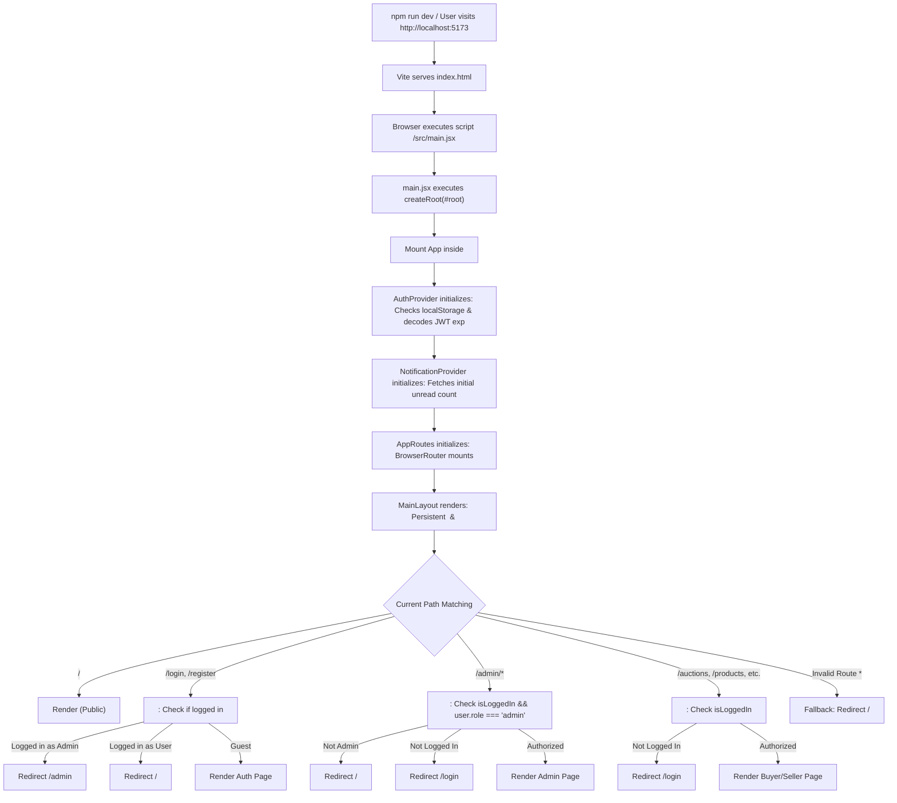
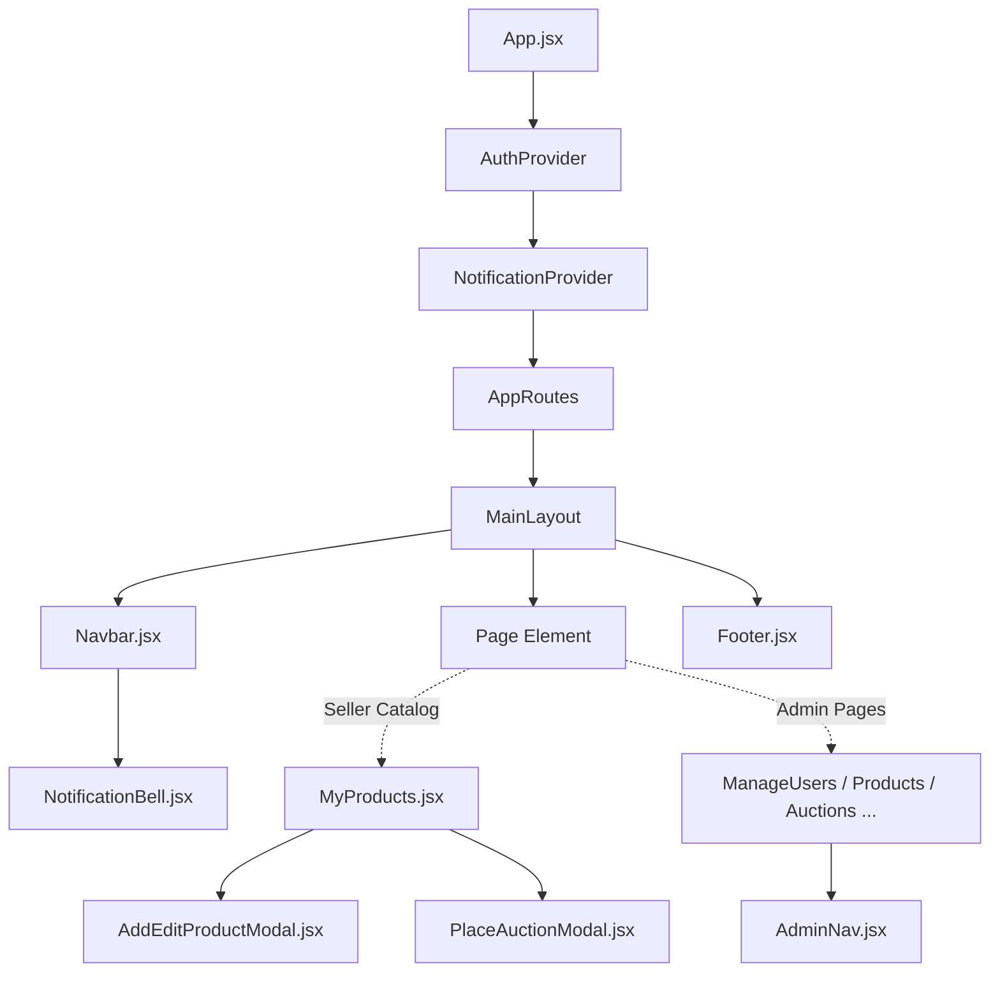
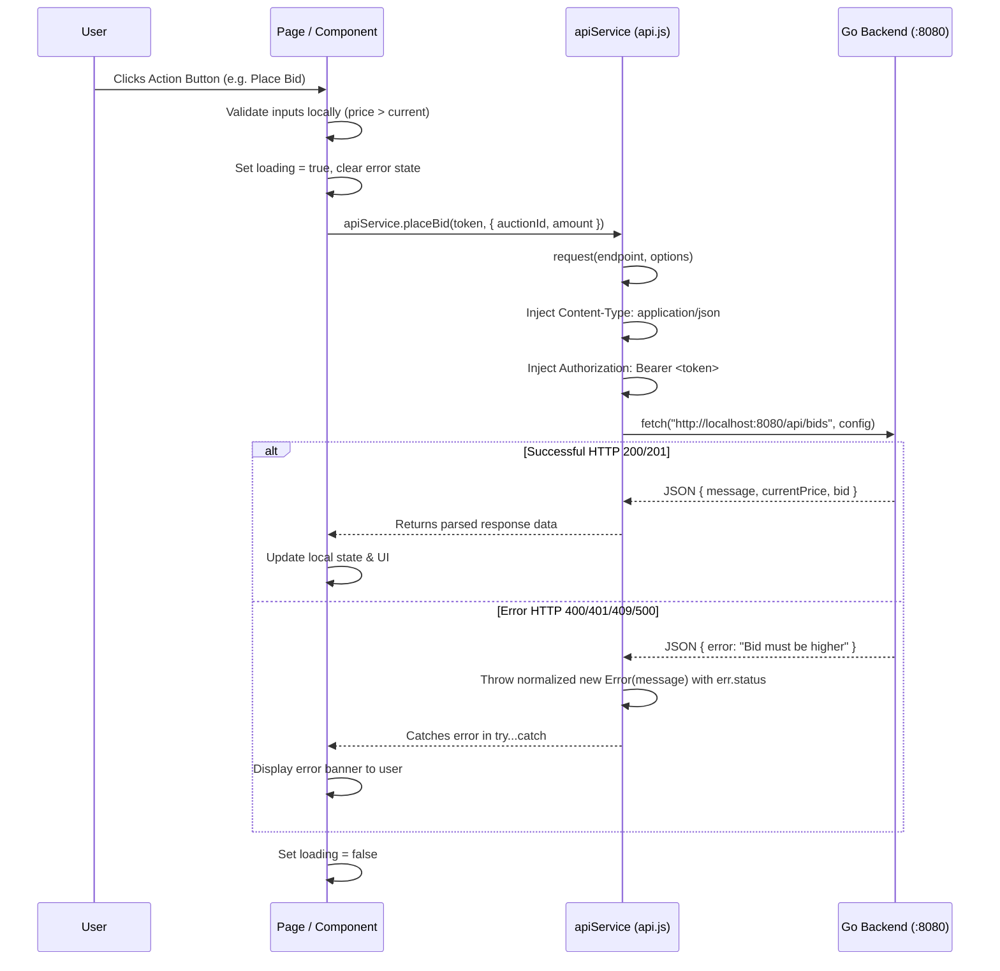
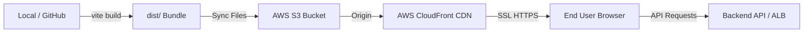

# Auction Hub - Complete Frontend Architecture & Technical Documentation

> **Platform:** Auction Hub (Online Auction Marketplace)  
> **Frontend Stack:** React 19 (`react` ^19.2.8, `react-dom` ^19.2.8), React Router v7 (`react-router-dom` ^7.18.3), Vite 8 (`vite` ^8.2.2)  
> **Language:** JavaScript (ES6+ / JSX)  
> **Styling:** Custom Vanilla CSS (Design Tokens, Glassmorphism, Dark Theme, Micro-animations)  
> **API Layer:** Native browser `fetch` abstraction with JWT Bearer authentication (`src/services/api.js`)  
> **State Management:** React Context API (`AuthContext`, `NotificationContext`) and local component hooks (`useState`, `useEffect`, `useCallback`, `useMemo`, `useRef`)  

---

## Table of Contents

1. [Part 1: Frontend Overview](#part-1-frontend-overview)
2. [Part 2: Complete Frontend Folder Structure](#part-2-complete-frontend-folder-structure)
3. [Part 3: Frontend Application Startup Flow](#part-3-frontend-application-startup-flow)
4. [Part 4: Complete Page-by-Page Documentation](#part-4-complete-page-by-page-documentation)
   - [Auth Pages](#auth-pages)
   - [Buyer Pages](#buyer-pages)
   - [Seller Pages](#seller-pages)
   - [Admin Pages](#admin-pages)
5. [Part 5: Component-to-Component Flow](#part-5-component-to-component-flow)
6. [Part 6: Frontend Routing](#part-6-frontend-routing)
7. [Part 7: API Calls from the Frontend](#part-7-api-calls-from-the-frontend)
8. [Part 8: Authentication on the Frontend](#part-8-authentication-on-the-frontend)
9. [Part 9: State Management and React Concepts](#part-9-state-management-and-react-concepts)
10. [Part 10: Forms and Validation](#part-10-forms-and-validation)
11. [Part 11: Notifications and Chat UI](#part-11-notifications-and-chat-ui)
12. [Part 12: Frontend Errors and Debugging](#part-12-frontend-errors-and-debugging)
13. [Part 13: Frontend Code Explanation (Deep Dive)](#part-13-frontend-code-explanation-deep-dive)
14. [Part 14: Frontend Interview Questions (35+ Detailed Q&A)](#part-14-frontend-interview-questions)
15. [Part 15: Frontend Deployment (AWS Production Guide)](#part-15-frontend-deployment)
16. [Part 16: Frontend Limitations & Technical Observations](#part-16-frontend-limitations--technical-observations)

---

## Part 1: Frontend Overview

### 1. What the Frontend Does in Auction Hub
The frontend of **Auction Hub** is a Single-Page Application (SPA) designed to deliver an interactive real-time auction marketplace experience. It serves three distinct user roles:
1. **Public / Unauthenticated Visitors:** Can view the landing page, register via email OTP verification, log into their accounts, or request password resets.
2. **Authenticated Users (Buyers & Sellers):**
   - **As a Buyer:** Browse active auctions with live countdown timers, view comprehensive product details, submit real-time competitive bids, track placed bids and auction outcomes ("Highest Bid", "Outbid", "Won", "Lost"), view won items, provide shipping addresses, confirm order deliveries, report suspicious auctions, and participate in direct buyer-seller order chats.
   - **As a Seller:** Manage a personal product inventory (Add, Edit, Delete with image uploads via `multipart/form-data`), launch active auctions by setting starting prices and durations (`1h`, `6h`, `12h`, `1d`, `3d`, `7d`), manually end active auctions early to lock the winning bidder, pack and ship completed customer orders, and chat directly with buyers.
3. **Platform Administrators (`role === 'admin'`):**
   - Monitor real-time platform metrics (Total Users, Active/Blocked Users, Total Products, Total/Active Auctions, Total Bids, Total Orders).
   - Suspend or restore user accounts (Block / Unblock).
   - Audit products and force-delete items with mandatory admin reason logs.
   - Cancel fraudulent auctions or pause/resume ongoing bidding with mandatory audit notes.
   - Monitor all platform bids and view orders.
   - Review user abuse reports (Pending, Reviewing, Resolved, Rejected) and take administrative action against auctions directly from reports.

### 2. Technologies and Libraries Used
An inspection of [`frontend/package.json`](file:///c:/Auction_Hub/frontend/package.json) confirms the following actual technologies:
- **Core Library:** `react` (^19.2.8) and `react-dom` (^19.2.8) — React 19 modern component model.
- **Build Tool & Dev Server:** `vite` (^8.2.2) with `@vitejs/plugin-react` (^6.1.0) — Fast Hot Module Replacement (HMR) and optimized Rollup bundling.
- **Client-Side Routing:** `react-router-dom` (^7.18.3) — Declarative routing, browser history, navigation hooks, and URL parameters.
- **HTTP Client:** Native browser `window.fetch` wrapped inside a custom centralized request helper (`src/services/api.js`). **Axios is NOT used.**
- **Styling:** Pure Vanilla CSS in [`frontend/src/index.css`](file:///c:/Auction_Hub/frontend/src/index.css) utilizing CSS variables, responsive CSS Grid/Flexbox, CSS backdrop-filter glassmorphism, and custom UI components. **No Tailwind CSS, Bootstrap, or component UI libraries are installed.**
- **State Management:** Native React Hooks (`useState`, `useEffect`, `useCallback`, `useMemo`, `useRef`) paired with React Context API (`AuthContext`, `NotificationContext`). **Redux, Zustand, or MobX are NOT used.**
- **Icons:** Inline SVG vector graphics embedded directly within JSX components.
- **Fonts:** Google Font *Plus Jakarta Sans* imported via `@import url(...)` in `index.css`.

### 3. How React and Vite are Used
- **Vite** serves as the next-generation frontend tooling. It compiles JSX on-the-fly using ES modules in development mode, ensuring instant startup times without bundling every file upfront. During production (`npm run build`), Vite triggers Rollup to produce highly optimized, minified CSS and JS bundles placed in `frontend/dist/`.
- **React 19** renders declarative UI components using modern functional programming patterns, strictly decoupled from legacy class components. React manages the Virtual DOM and reconciles state changes seamlessly.

### 4. How the Application Starts
1. The browser requests `http://localhost:5173/`.
2. Vite serves [`frontend/index.html`](file:///c:/Auction_Hub/frontend/index.html).
3. `index.html` contains `<div id="root"></div>` and loads `<script type="module" src="/src/main.jsx"></script>`.
4. [`main.jsx`](file:///c:/Auction_Hub/frontend/src/main.jsx) calls `createRoot(document.getElementById('root')).render(...)`.
5. The application is rendered inside `<StrictMode>`, mounting [`App.jsx`](file:///c:/Auction_Hub/frontend/src/App.jsx).
6. `App.jsx` establishes the top-level React Context providers: `<AuthProvider>` wrapping `<NotificationProvider>`, which in turn wraps `<AppRoutes />`.

### 5. How Pages are Displayed
Pages are functional React components located in `frontend/src/pages/`. When a user navigates to a URL, `react-router-dom` matches the browser pathname against route definitions in [`AppRoute.jsx`](file:///c:/Auction_Hub/frontend/src/routes/AppRoute.jsx). The matching page component is instantiated and rendered inside the `<MainLayout>` layout wrapper, which provides the shared persistent `<Navbar />` and `<Footer />`.

### 6. How Navigation Works
- **Declarative Navigation:** Handled via `<Link to="...">` components imported from `react-router-dom`, avoiding browser page refreshes and maintaining SPA speed.
- **Programmatic Navigation:** Triggered via the `const navigate = useNavigate()` hook (e.g., redirecting after successful login, bidding, or order selection).
- **Route Guards & Redirects:** Custom route wrappers (`ProtectedRoute`, `AdminRoute`, `GuestRoute`) inspect the authenticated user's state and conditionally render either child page components or `<Navigate to="..." replace />` redirect elements.

### 7. How Frontend State is Managed
1. **Global Authentication State:** Managed by [`AuthContext.jsx`](file:///c:/Auction_Hub/frontend/src/context/AuthContext.jsx). Provides `user`, `token`, `isLoggedIn`, `login()`, `logout()`, and `updateUser()`. Persisted in browser `localStorage`.
2. **Global Notification State:** Managed by [`NotificationContext.jsx`](file:///c:/Auction_Hub/frontend/src/context/NotificationContext.jsx). Stores notification lists, unread counters, loading flags, and mutation handlers (`markAsRead`, `markAllAsRead`).
3. **Local Component State:** Handled via `useState` inside individual pages for forms, modal toggles, search terms, table filters, countdown clocks, and chat message lists.

### 8. How the Frontend Communicates with APIs
All network requests are centralized inside [`frontend/src/services/api.js`](file:///c:/Auction_Hub/frontend/src/services/api.js).
- Calls are dispatched to `http://localhost:8080` (or configured backend URL).
- The internal `request(endpoint, options)` helper attaches JSON headers (or handles browser-managed boundary headers for `FormData`), adds the `Authorization: Bearer <token>` header when provided, executes `window.fetch`, parses JSON responses, and throws descriptive `Error` objects on non-2xx HTTP status codes.

### 9. How Authentication Works on the Frontend
- When a user logs in via [`Login.jsx`](file:///c:/Auction_Hub/frontend/src/pages/auth/Login.jsx), the backend returns a JSON object containing `{ token: string, user: object }`.
- `AuthContext.login(token, user)` saves `token` as a plain string in `localStorage.setItem('token', token)` and serializes user details into `localStorage.setItem('user', JSON.stringify(user))`.
- On application boot or page refresh, `AuthContext` checks if a saved token exists and decodes its payload using `atob()` to verify whether `payload.exp * 1000 < Date.now()`. If expired, it automatically purges the stored credentials.
- When logging out, `localStorage.removeItem('token')` and `localStorage.removeItem('user')` are called, instantly setting `isLoggedIn` to `false`.

### 10. How Errors and Loading States are Handled
- **Loading Indicators:** Spinners (styled via `.spinner` and `.loading-spinner-container` in `index.css`) render conditionally whenever asynchronous operations are in flight.
- **Error Banners:** Errors caught in `try...catch` blocks are displayed to users via alert boxes styled with `.alert .alert-error`.
- **Empty States:** When API queries return zero records, dedicated cards (`.empty-state-card`) present friendly icons and descriptive messages with quick-action links.

---

## Part 2: Complete Frontend Folder Structure

```
c:\Auction_Hub\frontend\
├── .gitignore                      # Git ignore patterns for dependencies and build outputs
├── eslint.config.js                # ESLint flat configuration for React 19 & React Hooks
├── index.html                      # HTML5 entry template mounting #root
├── package-lock.json               # NPM dependency lockfile
├── package.json                    # Project metadata, scripts, and dependencies
├── README.md                       # Vite default project documentation
├── vite.config.js                  # Vite configuration enabling @vitejs/plugin-react
├── public\
│   ├── favicon.svg                 # Application favicon
│   └── icons.svg                   # Vector icon asset definition
└── src\
    ├── App.jsx                     # Root application component wrapping context providers
    ├── index.css                   # Global design tokens, dark theme, and utility styles
    ├── main.jsx                    # React 19 client entry initializing React DOM
    ├── components\
    │   ├── admin\
    │   │   └── AdminNav.jsx        # Sub-navigation bar for admin dashboard pages
    │   ├── common\
    │   │   ├── Footer.jsx          # Shared application footer
    │   │   ├── Navbar.jsx          # Universal header navigation bar with user/admin views
    │   │   └── NotificationBell.jsx# Interactive notification bell, badge & dropdown drawer
    │   └── products\
    │       ├── AddEditProductModal.jsx # Modal dialog for creating and updating inventory products
    │       └── PlaceAuctionModal.jsx   # Modal dialog for launching an auction on a product
    ├── context\
    │   ├── AuthContext.jsx         # Context provider for JWT authentication and user session
    │   └── NotificationContext.jsx # Context provider for system notifications and unread badges
    ├── hooks\
    │   └── useNotifications.js     # Custom convenience hook re-exporting NotificationContext
    ├── pages\
    │   ├── admin\
    │   │   ├── AdminProfile.jsx    # Admin account profile inspection and name updates
    │   │   ├── Dashboard.jsx       # High-level platform statistics and metrics cards
    │   │   ├── ManageAuctions.jsx  # Admin auction search, cancellation, pause, and resume
    │   │   ├── ManageBids.jsx      # Admin global bid audit log with sorting & filters
    │   │   ├── ManageOrders.jsx    # Admin platform order fulfillment monitor
    │   │   ├── ManageProducts.jsx  # Admin product inventory review and forced deletion
    │   │   ├── ManageReports.jsx   # Admin abuse/fraud report triage and status updates
    │   │   └── ManageUsers.jsx     # Admin user management (Block / Unblock accounts)
    │   ├── auth\
    │   │   ├── ForgotPassword.jsx  # Multi-step password reset via email OTP
    │   │   ├── Login.jsx           # User and Admin credentials authentication form
    │   │   ├── Register.jsx        # Step 1 of account creation: details & OTP dispatch
    │   │   └── VerifyOTP.jsx       # Step 2 of account creation: 6-digit OTP verification
    │   ├── buyer\
    │   │   ├── AuctionDetails.jsx  # Live auction view, bid placement form, and report modal
    │   │   ├── Auctions.jsx        # Active public auctions listing grid with countdowns
    │   │   ├── Home.jsx            # Landing page showcasing platform features
    │   │   ├── MyBids.jsx          # Personal bidding history table with win/outbid statuses
    │   │   ├── MyOrders.jsx        # Dual-tab view for Buyer and Seller orders
    │   │   ├── MyReports.jsx       # User view of submitted abuse reports and review statuses
    │   │   ├── OrderDetails.jsx    # Order fulfillment timeline, address form, and direct chat
    │   │   ├── Profile.jsx         # User profile details, name edit, and activity shortcuts
    │   │   └── WonAuctions.jsx     # Quick access table for auctions won by the buyer
    │   └── seller\
    │       ├── MyAuctions.jsx      # Seller auctions overview with early close action
    │       └── MyProducts.jsx      # Seller product catalog with CRUD and auction creation
    ├── routes\
    │   └── AppRoute.jsx            # Master routing configuration and route guard wrappers
    └── services\
        └── api.js                  # Centralized HTTP API client with 38 service methods
```

> [!NOTE]
> **Clarification on the "utilis" Folder:**  
> The backend of Auction Hub contains a custom-named directory [`backend/utilis/`](file:///c:/Auction_Hub/backend/utilis/) housing Go utility files (`jwt.go`, `password.go`, `response.go`). **The frontend does NOT possess an `utilis` or `utils` directory.** In the frontend, all shared HTTP helpers, parameter serializers, and date formatting utilities are directly encapsulated inside [`src/services/api.js`](file:///c:/Auction_Hub/frontend/src/services/api.js), [`src/context/NotificationContext.jsx`](file:///c:/Auction_Hub/frontend/src/context/NotificationContext.jsx), or page-level components.

---

## Detailed File-by-File Analysis

### 1. `frontend/package.json`
- **Exact Path:** [`frontend/package.json`](file:///c:/Auction_Hub/frontend/package.json)
- **Purpose:** Declares project manifest, scripts, production dependencies, and developer dependencies.
- **Why Required:** Defines how Vite builds and runs the application and locks dependency semver ranges.
- **Key Scripts:**
  - `dev`: `vite` (starts local development server on port 5173).
  - `build`: `vite build` (compiles to production bundle in `dist/`).
  - `preview`: `vite preview` (serves the production `dist/` directory locally).
- **Core Dependencies:** `react` (^19.2.8), `react-dom` (^19.2.8), `react-router-dom` (^7.18.3).

### 2. `frontend/vite.config.js`
- **Exact Path:** [`frontend/vite.config.js`](file:///c:/Auction_Hub/frontend/vite.config.js)
- **Purpose:** Configures Vite bundler and development server.
- **Why Required:** Integrates `@vitejs/plugin-react` to support Fast Refresh and JSX transformation.

### 3. `frontend/index.html`
- **Exact Path:** [`frontend/index.html`](file:///c:/Auction_Hub/frontend/index.html)
- **Purpose:** Single HTML page of the SPA.
- **Why Required:** Contains the `<div id="root"></div>` mount point and imports `/src/main.jsx`.

### 4. `frontend/src/main.jsx`
- **Exact Path:** [`frontend/src/main.jsx`](file:///c:/Auction_Hub/frontend/src/main.jsx)
- **Purpose:** Client entry point.
- **Why Required:** Connects the React component tree to the physical browser DOM.
- **Imports:** `StrictMode`, `createRoot`, `./index.css`, `App`.
- **Exports:** None (side-effect execution).

### 5. `frontend/src/App.jsx`
- **Exact Path:** [`frontend/src/App.jsx`](file:///c:/Auction_Hub/frontend/src/App.jsx)
- **Purpose:** Root application component.
- **Why Required:** Establishes the context provider hierarchy so all nested pages can access authentication and notifications.
- **Imports:** `AppRoutes`, `AuthProvider`, `NotificationProvider`.
- **Exports:** `App` (default export).

### 6. `frontend/src/routes/AppRoute.jsx`
- **Exact Path:** [`frontend/src/routes/AppRoute.jsx`](file:///c:/Auction_Hub/frontend/src/routes/AppRoute.jsx)
- **Purpose:** Central routing hub of the application.
- **Why Required:** Maps 23 distinct URL paths to their respective React page components and enforces authentication rules.
- **Key Functions / Wrappers:**
  - `ProtectedRoute({ children })`: Blocks unauthenticated visitors; redirects to `/login`.
  - `AdminRoute({ children })`: Restricts access to users with `user.role === 'admin'`; redirects regular users to `/` and unauthenticated visitors to `/login`.
  - `GuestRoute({ children })`: Prevents authenticated users from seeing login/register forms; redirects admins to `/admin` and regular users to `/`.
  - `MainLayout({ children })`: Wraps page content between `<Navbar />` and `<Footer />`.
- **Exports:** `AppRoutes` (default export).

### 7. `frontend/src/context/AuthContext.jsx`
- **Exact Path:** [`frontend/src/context/AuthContext.jsx`](file:///c:/Auction_Hub/frontend/src/context/AuthContext.jsx)
- **Purpose:** Centralized user authentication state manager.
- **Why Required:** Provides reactive authentication state and session persistence across page refreshes.
- **Key Functions:**
  - `isTokenExpired(tokenString)`: Decodes JWT payload via Base64 (`atob`) and checks `exp`.
  - `login(newToken, userData)`: Writes to `localStorage` and updates React state.
  - `logout()`: Clears `localStorage` and resets state to `null`.
  - `updateUser(userData)`: Syncs modified user data (e.g. updated name) to `localStorage`.
  - `useAuth()`: Custom hook returning `{ user, token, login, logout, updateUser, isLoggedIn }`.

### 8. `frontend/src/context/NotificationContext.jsx`
- **Exact Path:** [`frontend/src/context/NotificationContext.jsx`](file:///c:/Auction_Hub/frontend/src/context/NotificationContext.jsx)
- **Purpose:** Centralized notification management and state.
- **Why Required:** Tracks unread notification counters, lists notifications, and supports read operations.
- **Key Functions:**
  - `normalizeNotification(item)`: Normalizes inconsistent field casing (PascalCase vs camelCase vs snake_case).
  - `fetchUnreadCount()`: Queries `GET /api/notifications/unread-count`.
  - `fetchNotifications()`: Queries `GET /api/notifications` and sorts items by date descending.
  - `markAsRead(notificationId)`: Optimistically marks an item as read and calls `PATCH /api/notifications/:id/read`.
  - `markAllAsRead()`: Marks all items read and calls `PATCH /api/notifications/read-all`.
  - `handleIncomingNotification(incoming)`: Helper prepared for future WebSocket real-time pushes.
  - `useNotifications()`: Custom hook exposing the notification state.

### 9. `frontend/src/hooks/useNotifications.js`
- **Exact Path:** [`frontend/src/hooks/useNotifications.js`](file:///c:/Auction_Hub/frontend/src/hooks/useNotifications.js)
- **Purpose:** Convenience proxy hook.
- **Why Required:** Re-exports `useNotifications` directly from `NotificationContext.jsx` for clean import paths.

### 10. `frontend/src/services/api.js`
- **Exact Path:** [`frontend/src/services/api.js`](file:///c:/Auction_Hub/frontend/src/services/api.js)
- **Purpose:** Centralized HTTP API abstraction layer.
- **Why Required:** Decouples raw HTTP network logic, header configuration, and error normalization from UI components.
- **Exports:** `apiService` (object containing 38 asynchronous methods) and `default apiService`.

### 11. `frontend/src/components/common/Navbar.jsx`
- **Exact Path:** [`frontend/src/components/common/Navbar.jsx`](file:///c:/Auction_Hub/frontend/src/components/common/Navbar.jsx)
- **Purpose:** Persistent top navigation bar.
- **Why Required:** Provides navigation links tailored dynamically to unauthenticated guests, logged-in buyers/sellers, and administrators. Renders `<NotificationBell />` for regular users.

### 12. `frontend/src/components/common/NotificationBell.jsx`
- **Exact Path:** [`frontend/src/components/common/NotificationBell.jsx`](file:///c:/Auction_Hub/frontend/src/components/common/NotificationBell.jsx)
- **Purpose:** Interactive notification drawer and unread badge.
- **Why Required:** Allows users to view alerts, switch between All/Unread/Read tabs, and mark alerts as read.

### 13. `frontend/src/components/common/Footer.jsx`
- **Exact Path:** [`frontend/src/components/common/Footer.jsx`](file:///c:/Auction_Hub/frontend/src/components/common/Footer.jsx)
- **Purpose:** Persistent footer displaying branding and academic presentation metadata.

### 14. `frontend/src/components/admin/AdminNav.jsx`
- **Exact Path:** [`frontend/src/components/admin/AdminNav.jsx`](file:///c:/Auction_Hub/frontend/src/components/admin/AdminNav.jsx)
- **Purpose:** Tabbed secondary navigation pill menu for admin pages.

### 15. `frontend/src/components/products/AddEditProductModal.jsx`
- **Exact Path:** [`frontend/src/components/products/AddEditProductModal.jsx`](file:///c:/Auction_Hub/frontend/src/components/products/AddEditProductModal.jsx)
- **Purpose:** Modal dialog for creating and editing inventory products.
- **Why Required:** Enforces file type (`jpeg`, `jpg`, `png`, `webp`) and size limits (<= 5MB) before assembling `FormData`.

### 16. `frontend/src/components/products/PlaceAuctionModal.jsx`
- **Exact Path:** [`frontend/src/components/products/PlaceAuctionModal.jsx`](file:///c:/Auction_Hub/frontend/src/components/products/PlaceAuctionModal.jsx)
- **Purpose:** Modal dialog for putting an existing catalog product up for auction with a starting price and time duration.

---

## Part 3: Frontend Application Startup Flow



### Detailed Execution Sequence

1. **Vite Development Execution:** When `npm run dev` is executed, Vite launches a lightweight Node.js dev server, compiles plugins, and listens on port 5173 without generating intermediate bundle files on disk.
2. **HTML Loading:** The browser loads `index.html`. The DOM contains an empty element `<div id="root"></div>` and instructs the browser to load `/src/main.jsx` as an ES Module (`type="module"`).
3. **React DOM Initialization:** `main.jsx` executes `createRoot(document.getElementById('root'))` and calls `.render(<StrictMode><App /></StrictMode>)`.
4. **Context Initialization:**
   - **`AuthProvider`:** Reads `localStorage.getItem("token")` and `localStorage.getItem("user")`. It checks token expiration via Base64 payload decoding (`atob`). If expired, it flushes `localStorage` and sets state to `null`.
   - **`NotificationProvider`:** Reads the authentication token. If the user is authenticated and not an admin, it immediately dispatches `apiService.getUnreadNotificationCount(token)` to populate the notification badge.
5. **Routing Mount:** `AppRoutes` mounts `<BrowserRouter>`, wrapping the `<Routes>` hierarchy inside `<MainLayout>`.
6. **Layout Rendering:** `<Navbar />` determines whether to display guest links, user auction links, or admin dashboard links by checking `useAuth()`.
7. **Route Guard Resolution:**
   - Public paths (like `/`) render directly.
   - Protected paths evaluate `isLoggedIn`. If false, React Router issues an immediate `<Navigate to="/login" replace />`.
   - Admin paths check `user?.role === "admin"`. If false, unauthorized users are redirected to `/`.

---

## Part 4: Complete Page-by-Page Documentation

### Auth Pages

#### 1. Login Page
- **Page Name:** `Login`
- **File Path:** [`frontend/src/pages/auth/Login.jsx`](file:///c:/Auction_Hub/frontend/src/pages/auth/Login.jsx)
- **Purpose:** Authenticates existing users and platform administrators.
- **Components Used:** Native inputs, buttons, and alert cards. Wrapped by `GuestRoute`.
- **State Variables:**
  - `email` (string): User input email.
  - `password` (string): User input password.
  - `loading` (boolean): Disables form and displays inline spinner.
  - `error` (string): Stores error messages for display in an alert banner.
- **Important Functions:**
  - `handleLogin(e)`: Submits credentials to `apiService.login(email, password)`. Calls `login(token, user)` from `AuthContext`, then redirects admins to `/admin` and regular users to `/`. Handles HTTP 401 specifically with a clear error prompt.
- **User Actions:** Enter credentials, toggle "Forgot password?" link, navigate to Registration, submit login form.
- **Validation:** HTML5 `required` attributes and backend validation handling.
- **API Calls:** `POST /api/auth/login`.

#### 2. Register Page
- **Page Name:** `Register`
- **File Path:** [`frontend/src/pages/auth/Register.jsx`](file:///c:/Auction_Hub/frontend/src/pages/auth/Register.jsx)
- **Purpose:** First stage of user registration. Collects user profile details and triggers email OTP dispatch.
- **Components Used:** Native inputs, buttons, alert banners. Wrapped by `GuestRoute`.
- **State Variables:** `name`, `email`, `password`, `loading`, `error`.
- **Important Functions:**
  - `handleSendOTP(e)`: Calls `apiService.sendOTP(email)`. On success, stores `{ name, email, password }` in browser `sessionStorage.setItem("registrationData", ...)` and navigates the user to `/verify-otp`.
- **Validation:** Minimum password length of 6 characters (`minLength={6}`), valid email format, all fields required.
- **API Calls:** `POST /api/auth/send-otp`.

#### 3. Verify OTP Page
- **Page Name:** `VerifyOTP`
- **File Path:** [`frontend/src/pages/auth/VerifyOTP.jsx`](file:///c:/Auction_Hub/frontend/src/pages/auth/VerifyOTP.jsx)
- **Purpose:** Second stage of registration. Verifies the 6-digit email code and completes account creation.
- **Components Used:** Form inputs, resend action button, return link.
- **State Variables:**
  - `registrationData`: Lazy initialized from `sessionStorage.getItem("registrationData")`.
  - `otp` (string): 6-digit numeric verification code.
  - `loading`, `resending`, `error`, `success`.
- **Important Functions:**
  - `handleVerifyOTP(e)`: Executes two sequential API calls:
    1. `apiService.verifyOTP(email, otp)`
    2. `apiService.register(name, email, password)`
    On success, removes `registrationData` from `sessionStorage` and redirects to `/login` after 1.2 seconds.
  - `handleResendOTP()`: Calls `apiService.sendOTP(email)` to trigger a new OTP email.
- **Validation:** Restricts input to digits via regex `.replace(/\D/g, "")`, `maxLength={6}`, verifies existence of session data.
- **API Calls:** `POST /api/auth/verify-otp`, `POST /api/auth/register`, `POST /api/auth/send-otp`.

#### 4. Forgot Password Page
- **Page Name:** `ForgotPassword`
- **File Path:** [`frontend/src/pages/auth/ForgotPassword.jsx`](file:///c:/Auction_Hub/frontend/src/pages/auth/ForgotPassword.jsx)
- **Purpose:** Two-step account password recovery workflow.
- **Components Used:** Multi-step conditional forms, alerts.
- **State Variables:** `step` (1 = Request OTP, 2 = Verify & Reset), `email`, `otp`, `newPassword`, `confirmPassword`, `loading`, `error`, `success`.
- **Important Functions:**
  - `handleSendOTP(e)`: Calls `apiService.forgotPassword(email)` and advances `step` to 2.
  - `handleResetPassword(e)`: Validates that `newPassword === confirmPassword` and length >= 6. Calls `apiService.resetPassword(email, otp, newPassword)`. Redirects to `/login` on success.
- **API Calls:** `POST /api/auth/forgot-password`, `POST /api/auth/reset-password`.

---

### Buyer Pages

#### 5. Home Page
- **Page Name:** `Home`
- **File Path:** [`frontend/src/pages/buyer/Home.jsx`](file:///c:/Auction_Hub/frontend/src/pages/buyer/Home.jsx)
- **Purpose:** Public landing page introducing platform features and providing entry points.
- **Components Used:** Feature cards, gradient hero titles, responsive CSS Grid.
- **State Variables:** None.
- **Important Functions:** Navigate directly to `/auctions` via button click.
- **API Calls:** None.

#### 6. Auctions Listing Page
- **Page Name:** `Auctions`
- **File Path:** [`frontend/src/pages/buyer/Auctions.jsx`](file:///c:/Auction_Hub/frontend/src/pages/buyer/Auctions.jsx)
- **Purpose:** Live marketplace grid showcasing all active auctions with real-time countdown clocks.
- **Components Used:** Auction cards, status badges, image thumbnail wrappers, price boxes.
- **State Variables:**
  - `auctions` (array): List of active auction records.
  - `loading` (boolean), `error` (string).
  - `now` (number): Current timestamp in milliseconds, updated every 1,000ms via `setInterval`.
- **Important Functions:**
  - `fetchAuctions()`: Queries `apiService.getAuctions(token)`.
  - `getRemainingTime(dateStr)`: Computes difference between `endTime` and `now`, producing live formatted strings (e.g. `Ends in 2d 4h`, `Ends in 12m 30s`, or `Auction Ended`).
- **User Actions:** Browse live cards, click "View & Bid →" to navigate to `/auctions/:id`, trigger manual data refresh.
- **API Calls:** `GET /api/auctions`.

#### 7. Auction Details Page
- **Page Name:** `AuctionDetails`
- **File Path:** [`frontend/src/pages/buyer/AuctionDetails.jsx`](file:///c:/Auction_Hub/frontend/src/pages/buyer/AuctionDetails.jsx)
- **Purpose:** Detailed auction view containing high-resolution product imagery, live countdown timer, interactive bid placement form, real-time bid history feed, seller controls, and user report submission modal.
- **Components Used:** Bid history feed items, report modal dialog, breadcrumb navigation.
- **State Variables:**
  - `auction` (object), `bids` (array), `loading`, `error`.
  - `bidAmount` (string), `submitting` (boolean), `fieldError` (string), `successMsg` (string).
  - `endingAuction` (boolean): Tracks seller-initiated manual auction termination.
  - `timeLeft` (object): Formatted countdown timer string and `isExpired` boolean flag.
  - Report Modal State: `reportModalOpen`, `reportReason`, `otherReason`, `reportDesc`, `submittingReport`, `reportError`, `reportSuccess`.
- **Important Functions:**
  - `fetchData()`: Concurrently retrieves auction details and bid history via `Promise.all([apiService.getAuctionById, apiService.getAuctionBids])`.
  - `handleBidSubmit(e)`: Validates that the submitted bid is higher than `auction.currentPrice` and meets `auction.startingPrice`. Calls `apiService.placeBid(token, { auctionId, amount })`. Updates local state and refreshes bid history immediately.
  - `handleEndAuction()`: Allows the seller to end the auction early via `apiService.endAuction(token, auction.id)`.
  - `handleReportSubmit(e)`: Submits an abuse report via `apiService.createReport(token, { auctionId, reason, description })`.
- **User Actions:** Submit bids, report auction, seller ending auction, refresh bids.
- **API Calls:** `GET /api/auctions/:id`, `GET /api/bids/auction/:id`, `POST /api/bids`, `PATCH /api/auctions/:id/end`, `POST /api/reports`.

#### 8. My Bids Page
- **Page Name:** `MyBids`
- **File Path:** [`frontend/src/pages/buyer/MyBids.jsx`](file:///c:/Auction_Hub/frontend/src/pages/buyer/MyBids.jsx)
- **Purpose:** Centralized history table tracking all auctions where the current user placed bids.
- **Components Used:** Tabular list, dynamic status badges (`Highest Bid`, `Outbid`, `Won`, `Lost`, `Ended`).
- **State Variables:** `bids` (array), `loading` (boolean), `error` (string).
- **Important Functions:**
  - `fetchMyBids()`: Calls `apiService.getMyBids(token)`.
  - `getStatusBadge(item)`: Determines user's standing based on `userStatus` and whether the auction is live or ended.
- **API Calls:** `GET /api/bids/my`.

#### 9. Won Auctions Page
- **Page Name:** `WonAuctions`
- **File Path:** [`frontend/src/pages/buyer/WonAuctions.jsx`](file:///c:/Auction_Hub/frontend/src/pages/buyer/WonAuctions.jsx)
- **Purpose:** Displays ended auctions won by the buyer and links directly to order fulfillment.
- **Components Used:** Order status badges (`Address Pending`, `Address Added`, `Packed`, `Shipped`, `Delivered`).
- **State Variables:** `orders` (array), `loading`, `error`.
- **Important Functions:** `fetchWonAuctions()` calling `apiService.getUserOrders(token)`.
- **User Actions:** Click "View Order Details & Address" to navigate to `/orders/:id`.
- **API Calls:** `GET /api/orders`.

#### 10. My Orders Page
- **Page Name:** `MyOrders`
- **File Path:** [`frontend/src/pages/buyer/MyOrders.jsx`](file:///c:/Auction_Hub/frontend/src/pages/buyer/MyOrders.jsx)
- **Purpose:** Comprehensive order manager with dual tabs for purchases ("As Buyer") and sales ("As Seller").
- **Components Used:** Tab selector controls, order summary tables, status pills.
- **State Variables:**
  - `activeTab` ("buyer" | "seller"): Toggles visible order list.
  - `buyerOrders` (array), `sellerOrders` (array), `loading`, `error`.
- **Important Functions:**
  - `fetchOrders()`: Calls `apiService.getMyOrders(token)`, populating both buyer and seller order lists. Automatically activates the seller tab if the user has seller orders but no buyer orders.
- **API Calls:** `GET /api/orders/my-orders`.

#### 11. Order Details & Chat Page
- **Page Name:** `OrderDetails`
- **File Path:** [`frontend/src/pages/buyer/OrderDetails.jsx`](file:///c:/Auction_Hub/frontend/src/pages/buyer/OrderDetails.jsx)
- **Purpose:** Full order management interface: shipping address submission, fulfillment status updates, and live buyer-seller chat drawer.
- **Components Used:** Progress tracker bar, delivery address form, chat message bubbles, chat drawer.
- **State Variables:**
  - `order` (object), `loading`, `error`, `actionMsg`, `actionErr`.
  - `address` (string), `updatingAddress` (boolean).
  - `updatingStatus` (boolean).
  - Admin override state: `adminStatus`, `adminReason`, `adminReasonErr`.
  - Chat state: `conversation` (object), `messages` (array), `newMessage` (string), `sendingMsg` (boolean), `chatOpen` (boolean).
- **Important Functions:**
  - `fetchOrder()`: Queries `apiService.getOrderById(token, id)`.
  - `handleSaveAddress(e)`: Calls `apiService.updateDeliveryAddress(token, order.id, address)`. Allowed only before order is shipped.
  - `handleMarkPacked()`: Seller/Admin marks order as Packed via `apiService.markOrderPacked(token, order.id)`.
  - `handleMarkShipped()`: Seller/Admin marks order as Shipped via `apiService.markOrderShipped(token, order.id)`.
  - `handleMarkDelivered()`: Buyer marks item as Delivered via `apiService.markOrderDelivered(token, order.id)`.
  - `fetchChat()`: Fetches or creates conversation via `apiService.getChatConversation(token, order.auctionId)` and fetches messages via `apiService.getChatMessages(token, convId)`.
  - `handleSendMessage(e)`: Dispatches chat message via `apiService.sendChatMessage(token, convId, message)`.
- **Chat Mechanism:** HTTP polling every 3 seconds (`setInterval(fetchChat, 3000)`) while `chatOpen === true`.
- **API Calls:** `GET /api/orders/:id`, `PUT /api/orders/:id/address`, `PATCH /api/orders/:id/pack`, `PATCH /api/orders/:id/ship`, `PATCH /api/orders/:id/deliver`, `PUT /api/orders/:id/status`, `GET /api/chat/auction/:id`, `GET /api/chat/conversation/:id/messages`, `POST /api/chat/conversation/:id/messages`.

#### 12. My Reports Page
- **Page Name:** `MyReports`
- **File Path:** [`frontend/src/pages/buyer/MyReports.jsx`](file:///c:/Auction_Hub/frontend/src/pages/buyer/MyReports.jsx)
- **Purpose:** Allows users to track the status of abuse reports they have submitted.
- **Components Used:** Report cards, status indicators (`Pending`, `Reviewing`, `Resolved`, `Rejected`), report detail modal.
- **State Variables:** `reports` (array), `loading`, `error`, `selectedReport` (object).
- **API Calls:** `GET /api/reports/my-reports`.

#### 13. Profile Page
- **Page Name:** `Profile`
- **File Path:** [`frontend/src/pages/buyer/Profile.jsx`](file:///c:/Auction_Hub/frontend/src/pages/buyer/Profile.jsx)
- **Purpose:** User account dashboard. Displays account initials, email, role badge, account activity shortcuts, and inline name editing.
- **Components Used:** Account activity tiles, inline editing form, avatar badge.
- **State Variables:** `profile` (object), `loading`, `error`, `isEditing` (boolean), `editName` (string), `saving` (boolean), `saveError` (string).
- **Important Functions:**
  - `handleSaveProfile(e)`: Calls `apiService.updateProfile(token, editName)`. Updates `AuthContext` user state and syncs to `localStorage`.
- **API Calls:** `GET /api/users/profile`, `PUT /api/users/profile`.

---

### Seller Pages

#### 14. My Products Page
- **Page Name:** `MyProducts`
- **File Path:** [`frontend/src/pages/seller/MyProducts.jsx`](file:///c:/Auction_Hub/frontend/src/pages/seller/MyProducts.jsx)
- **Purpose:** Seller inventory management dashboard. Supports adding products, editing details, deleting unused products, and launching auctions.
- **Components Used:** `<AddEditProductModal />`, `<PlaceAuctionModal />`, delete confirmation dialog, product cards.
- **State Variables:**
  - `products` (array), `loading`, `error`, `successMsg`.
  - Modal states: `isModalOpen`, `editingProduct`, `saving`, `deletingProduct`, `isDeleting`, `placeAuctionProduct`, `savingAuction`.
- **Important Functions:**
  - `fetchProducts()`: Retrieves user's inventory via `apiService.getMyProducts(token)`.
  - `handleSaveProduct(formData)`: Routes to `apiService.createProduct` or `apiService.updateProduct` with `multipart/form-data`.
  - `handleDeleteConfirm()`: Calls `apiService.deleteProduct(token, id)`.
  - `handlePlaceAuctionSubmit(data)`: Launches an auction via `apiService.createAuction(token, data)`.
- **API Calls:** `GET /api/products/my`, `POST /api/products`, `PUT /api/products/:id`, `DELETE /api/products/:id`, `POST /api/auctions`.

#### 15. My Auctions Page
- **Page Name:** `MyAuctions`
- **File Path:** [`frontend/src/pages/seller/MyAuctions.jsx`](file:///c:/Auction_Hub/frontend/src/pages/seller/MyAuctions.jsx)
- **Purpose:** Seller dashboard for tracking active and ended auctions created by the seller.
- **Components Used:** Auction table, status badges, early end confirmation.
- **State Variables:** `auctions` (array), `loading`, `error`, `endingId` (number).
- **Important Functions:**
  - `handleEndAuction(auctionId, e)`: Closes bidding immediately via `apiService.endAuction(token, auctionId)`.
- **API Calls:** `GET /api/auctions/seller`, `PATCH /api/auctions/:id/end`.

---

### Admin Pages

#### 16. Admin Dashboard Page
- **Page Name:** `Dashboard`
- **File Path:** [`frontend/src/pages/admin/Dashboard.jsx`](file:///c:/Auction_Hub/frontend/src/pages/admin/Dashboard.jsx)
- **Purpose:** High-level executive overview of platform health and volume.
- **Components Used:** Metric stat cards (Total Users, Active Users, Blocked Users, Total Products, Active Auctions, Total Bids, Total Orders).
- **State Variables:** `analytics` (object), `loading`, `error`.
- **API Calls:** `GET /api/admin/dashboard`.

#### 17. Manage Users Page
- **Page Name:** `ManageUsers`
- **File Path:** [`frontend/src/pages/admin/ManageUsers.jsx`](file:///c:/Auction_Hub/frontend/src/pages/admin/ManageUsers.jsx)
- **Purpose:** Administrative user directory with search, status filtering, and account suspension controls.
- **Components Used:** Filter bar, confirmation modal for Block / Unblock actions, table layout.
- **State Variables:** `usersList`, `loading`, `error`, `successMessage`, `search`, `statusFilter`, `confirmModal`, `actionLoading`.
- **Important Functions:**
  - `fetchUsers(search, status)`: Debounced query to `apiService.getAdminUsers(token, search, status)`.
  - `handleConfirmAction()`: Calls `apiService.blockUser` or `apiService.unblockUser`.
- **API Calls:** `GET /api/admin/users`, `PATCH /api/admin/users/:id/block`, `PATCH /api/admin/users/:id/unblock`.

#### 18. Manage Products Page
- **Page Name:** `ManageProducts`
- **File Path:** [`frontend/src/pages/admin/ManageProducts.jsx`](file:///c:/Auction_Hub/frontend/src/pages/admin/ManageProducts.jsx)
- **Purpose:** Allows administrators to audit all products and delete non-compliant items with a mandatory reason.
- **Components Used:** Filter bar, Delete modal with mandatory reason textarea.
- **State Variables:** `productsList`, `search`, `statusFilter`, `inAuctionFilter`, `sortOrder`, `deleteModal`, `deleteReason`, `reasonError`.
- **Important Functions:**
  - `handleConfirmDelete()`: Validates that `deleteReason` is non-empty and calls `apiService.deleteAdminProduct(token, id, reason)`.
- **API Calls:** `GET /api/admin/products`, `DELETE /api/admin/products/:id`.

#### 19. Manage Auctions Page
- **Page Name:** `ManageAuctions`
- **File Path:** [`frontend/src/pages/admin/ManageAuctions.jsx`](file:///c:/Auction_Hub/frontend/src/pages/admin/ManageAuctions.jsx)
- **Purpose:** Oversight of platform auctions with emergency Pause, Resume, and Cancel actions.
- **Components Used:** Cancel modal, Pause/Resume modal with mandatory audit note.
- **State Variables:** `auctionsList`, `search`, `statusFilter`, `sortOrder`, `cancelModal`, `pauseModal`, `pauseReason`, `pauseErr`.
- **Important Functions:**
  - `handleConfirmCancel()`: Calls `apiService.cancelAdminAuction(token, id)`.
  - `handleConfirmPauseResume(e)`: Calls `apiService.pauseAdminAuction` or `apiService.resumeAdminAuction` with mandatory reason.
- **API Calls:** `GET /api/admin/auctions`, `PATCH /api/admin/auctions/:id/cancel`, `PATCH /api/admin/auctions/:id/pause`, `PATCH /api/admin/auctions/:id/resume`.

#### 20. Manage Bids Page
- **Page Name:** `ManageBids`
- **File Path:** [`frontend/src/pages/admin/ManageBids.jsx`](file:///c:/Auction_Hub/frontend/src/pages/admin/ManageBids.jsx)
- **Purpose:** Read-only audit log of all bids placed across all platform auctions.
- **Components Used:** Search and sort controls, bid history table.
- **State Variables:** `bidsList`, `search`, `sortOrder`, `loading`, `error`.
- **API Calls:** `GET /api/admin/bids`.

#### 21. Manage Orders Page
- **Page Name:** `ManageOrders`
- **File Path:** [`frontend/src/pages/admin/ManageOrders.jsx`](file:///c:/Auction_Hub/frontend/src/pages/admin/ManageOrders.jsx)
- **Purpose:** Oversight of all customer orders, delivery addresses, and fulfillment milestones.
- **Components Used:** Order filter bar, status badges, direct links to `/orders/:id`.
- **State Variables:** `ordersList`, `search`, `statusFilter`, `sortOrder`, `loading`, `error`.
- **API Calls:** `GET /api/admin/orders`.

#### 22. Admin Profile Page
- **Page Name:** `AdminProfile`
- **File Path:** [`frontend/src/pages/admin/AdminProfile.jsx`](file:///c:/Auction_Hub/frontend/src/pages/admin/AdminProfile.jsx)
- **Purpose:** Displays administrator identity and allows updating the admin display name.
- **Components Used:** Admin profile card with purple/pink gradient accents, inline edit form.
- **State Variables:** `profile`, `isEditing`, `editName`, `saving`, `saveError`.
- **API Calls:** `GET /api/users/profile`, `PUT /api/users/profile`.

#### 23. Manage Reports Page
- **Page Name:** `ManageReports`
- **File Path:** [`frontend/src/pages/admin/ManageReports.jsx`](file:///c:/Auction_Hub/frontend/src/pages/admin/ManageReports.jsx)
- **Purpose:** Administrative queue for handling user abuse and fraud reports. Allows changing report status and pausing/resuming reported auctions directly.
- **Components Used:** Status pills, Report inspection modal, Action note form, Embedded auction pause controls.
- **State Variables:** `reports`, `search`, `statusFilter`, `sortOrder`, `selectedReport`, `statusNote`, `statusErr`, `pauseModal`, `pauseReason`.
- **Important Functions:**
  - `handleUpdateStatus(newStatus)`: Updates report state to `reviewing`, `resolved`, or `rejected` with mandatory admin note via `apiService.updateAdminReportStatus`.
  - `handlePauseResumeAuction(e)`: Pauses/resumes the reported auction from inside the report modal.
- **API Calls:** `GET /api/admin/reports`, `GET /api/admin/reports/:id`, `PATCH /api/admin/reports/:id/status`, `PATCH /api/admin/auctions/:id/pause`, `PATCH /api/admin/auctions/:id/resume`.

---

## Part 5: Component-to-Component Flow



### Component Relationships and Props

| Component File | Rendered By | Props Received | State Maintained | Events Emitted / Handled | Key Children Components |
| :--- | :--- | :--- | :--- | :--- | :--- |
| [`Navbar.jsx`](file:///c:/Auction_Hub/frontend/src/components/common/Navbar.jsx) | `MainLayout` | None | None (reads `AuthContext`, `useLocation`) | Logout click, route changes | `<NotificationBell />` (only for non-admin logged in users) |
| [`NotificationBell.jsx`](file:///c:/Auction_Hub/frontend/src/components/common/NotificationBell.jsx) | `Navbar.jsx` | None | `isOpen`, `activeTab`, `actionError` (consumes `NotificationContext`) | Click outside (ref), Escape key, Tab filter, Mark as read | None (renders internal SVG icons) |
| [`Footer.jsx`](file:///c:/Auction_Hub/frontend/src/components/common/Footer.jsx) | `MainLayout` | None | None | None | None |
| [`AdminNav.jsx`](file:///c:/Auction_Hub/frontend/src/components/admin/AdminNav.jsx) | Admin Pages | None | None (reads `useLocation`) | Navigation clicks | None |
| [`AddEditProductModal.jsx`](file:///c:/Auction_Hub/frontend/src/components/products/AddEditProductModal.jsx) | `MyProducts.jsx` | `isOpen`, `onClose`, `onSave`, `product`, `saving` | `name`, `description`, `imageFile`, `imagePreview`, `error` | Form submit (`onSave(formData)`), Image file pick, Close (`onClose`) | None |
| [`PlaceAuctionModal.jsx`](file:///c:/Auction_Hub/frontend/src/components/products/PlaceAuctionModal.jsx) | `MyProducts.jsx` | `isOpen`, `onClose`, `onPlaceAuction`, `product`, `saving` | `startingPrice`, `duration`, `error` | Form submit (`onPlaceAuction(...)`), Duration pick, Close | None |

---

## Part 6: Frontend Routing

### Route Table

| Route Path | Rendered Page Component | Access Level | Route Guard Wrapper | URL Parameters / Notes |
| :--- | :--- | :--- | :--- | :--- |
| `/` | `Home` | Public | None | Landing marketplace presentation |
| `/login` | `Login` | Guest Only | `<GuestRoute>` | Redirects logged-in admins to `/admin`, users to `/` |
| `/register` | `Register` | Guest Only | `<GuestRoute>` | Step 1 of registration |
| `/verify-otp` | `VerifyOTP` | Guest Only | `<GuestRoute>` | Step 2 of registration; reads `sessionStorage` |
| `/forgot-password` | `ForgotPassword` | Guest Only | `<GuestRoute>` | Multi-step password reset workflow |
| `/profile` | `Profile` | Authenticated | `<ProtectedRoute>` | User account management |
| `/products` | `MyProducts` | Authenticated | `<ProtectedRoute>` | Seller product catalog |
| `/auctions` | `Auctions` | Authenticated | `<ProtectedRoute>` | Active public marketplace |
| `/auctions/:id` | `AuctionDetails` | Authenticated | `<ProtectedRoute>` | `:id` = Auction ID |
| `/my-bids` | `MyBids` | Authenticated | `<ProtectedRoute>` | User's bidding history |
| `/won-auctions` | `WonAuctions` | Authenticated | `<ProtectedRoute>` | Auctions won by the buyer |
| `/my-auctions` | `MyAuctions` | Authenticated | `<ProtectedRoute>` | Auctions created by the seller |
| `/my-orders` | `MyOrders` | Authenticated | `<ProtectedRoute>` | Dual-tab Buyer and Seller orders |
| `/orders/:id` | `OrderDetails` | Authenticated | `<ProtectedRoute>` | `:id` = Order ID (fulfillment & chat) |
| `/my-reports` | `MyReports` | Authenticated | `<ProtectedRoute>` | User submitted abuse reports |
| `/admin` | `Dashboard` | Admin Only | `<AdminRoute>` | High-level analytics metrics |
| `/admin/users` | `ManageUsers` | Admin Only | `<AdminRoute>` | User accounts management |
| `/admin/products` | `ManageProducts` | Admin Only | `<AdminRoute>` | Product inventory oversight |
| `/admin/auctions` | `ManageAuctions` | Admin Only | `<AdminRoute>` | Auction cancellation & pause/resume |
| `/admin/bids` | `ManageBids` | Admin Only | `<AdminRoute>` | Global bid audit log |
| `/admin/orders` | `ManageOrders` | Admin Only | `<AdminRoute>` | Global order fulfillment oversight |
| `/admin/profile` | `AdminProfile` | Admin Only | `<AdminRoute>` | Administrator profile details |
| `/admin/reports` | `ManageReports` | Admin Only | `<AdminRoute>` | Abuse report triage |
| `*` | `<Navigate to="/" replace />` | Catch-all | None | Fallback redirect for invalid routes |

---

## Part 7: API Calls from the Frontend

All API calls are performed through [`frontend/src/services/api.js`](file:///c:/Auction_Hub/frontend/src/services/api.js) using native browser `fetch`.



### Complete API Methods Reference Table

| Method in `api.js` | HTTP Method | Endpoint | Request Body | Headers Added | Used By Page / Component |
| :--- | :--- | :--- | :--- | :--- | :--- |
| `sendOTP(email)` | `POST` | `/api/auth/send-otp` | `{ email }` | `Content-Type: application/json` | `Register.jsx`, `VerifyOTP.jsx` |
| `verifyOTP(email, otp)` | `POST` | `/api/auth/verify-otp` | `{ email, otp }` | `Content-Type: application/json` | `VerifyOTP.jsx` |
| `register(name, email, password)` | `POST` | `/api/auth/register` | `{ name, email, password }` | `Content-Type: application/json` | `VerifyOTP.jsx` |
| `login(email, password)` | `POST` | `/api/auth/login` | `{ email, password }` | `Content-Type: application/json` | `Login.jsx` |
| `forgotPassword(email)` | `POST` | `/api/auth/forgot-password` | `{ email }` | `Content-Type: application/json` | `ForgotPassword.jsx` |
| `resetPassword(email, otp, password)` | `POST` | `/api/auth/reset-password` | `{ email, otp, password }` | `Content-Type: application/json` | `ForgotPassword.jsx` |
| `getProfile(token)` | `GET` | `/api/users/profile` | None | `Authorization: Bearer <token>` | `Profile.jsx`, `AdminProfile.jsx` |
| `updateProfile(token, name)` | `PUT` | `/api/users/profile` | `{ name }` | `Authorization`, `Content-Type` | `Profile.jsx`, `AdminProfile.jsx` |
| `getAdminDashboard(token)` | `GET` | `/api/admin/dashboard` | None | `Authorization: Bearer <token>` | `Dashboard.jsx` |
| `getAdminUsers(token, search, status)` | `GET` | `/api/admin/users?...` | None | `Authorization: Bearer <token>` | `ManageUsers.jsx` |
| `blockUser(token, userId)` | `PATCH` | `/api/admin/users/:id/block` | None | `Authorization: Bearer <token>` | `ManageUsers.jsx` |
| `unblockUser(token, userId)` | `PATCH` | `/api/admin/users/:id/unblock`| None | `Authorization: Bearer <token>` | `ManageUsers.jsx` |
| `getAdminProducts(token, ...)` | `GET` | `/api/admin/products?...` | None | `Authorization: Bearer <token>` | `ManageProducts.jsx` |
| `deleteAdminProduct(token, id, reason)` | `DELETE` | `/api/admin/products/:id` | `{ reason }` | `Authorization`, `Content-Type` | `ManageProducts.jsx` |
| `getAdminAuctions(token, ...)` | `GET` | `/api/admin/auctions?...` | None | `Authorization: Bearer <token>` | `ManageAuctions.jsx` |
| `cancelAdminAuction(token, id)` | `PATCH` | `/api/admin/auctions/:id/cancel` | None | `Authorization: Bearer <token>` | `ManageAuctions.jsx` |
| `pauseAdminAuction(token, id, reason)` | `PATCH` | `/api/admin/auctions/:id/pause` | `{ reason }` | `Authorization`, `Content-Type` | `ManageAuctions.jsx`, `ManageReports.jsx` |
| `resumeAdminAuction(token, id, reason)`| `PATCH` | `/api/admin/auctions/:id/resume`| `{ reason }` | `Authorization`, `Content-Type` | `ManageAuctions.jsx`, `ManageReports.jsx` |
| `getAdminBids(token, ...)` | `GET` | `/api/admin/bids?...` | None | `Authorization: Bearer <token>` | `ManageBids.jsx` |
| `getAdminOrders(token, ...)` | `GET` | `/api/admin/orders?...` | None | `Authorization: Bearer <token>` | `ManageOrders.jsx` |
| `getAdminOrderById(token, id)` | `GET` | `/api/admin/orders/:id` | None | `Authorization: Bearer <token>` | Available for order audit |
| `getMyProducts(token)` | `GET` | `/api/products/my` | None | `Authorization: Bearer <token>` | `MyProducts.jsx` |
| `createProduct(token, formData)` | `POST` | `/api/products` | `FormData` (`multipart/form-data`)| `Authorization` (No Content-Type set) | `MyProducts.jsx` |
| `getProductById(token, id)` | `GET` | `/api/products/:id` | None | `Authorization: Bearer <token>` | Product details |
| `updateProduct(token, id, formData)` | `PUT` | `/api/products/:id` | `FormData` | `Authorization` | `MyProducts.jsx` |
| `deleteProduct(token, id)` | `DELETE` | `/api/products/:id` | None | `Authorization: Bearer <token>` | `MyProducts.jsx` |
| `getAuctions(token)` | `GET` | `/api/auctions` | None | `Authorization: Bearer <token>` | `Auctions.jsx` |
| `createAuction(token, { ... })` | `POST` | `/api/auctions` | `{ product_id, starting_price, duration }` | `Authorization`, `Content-Type` | `MyProducts.jsx` |
| `getAuctionById(token, id)` | `GET` | `/api/auctions/:id` | None | `Authorization: Bearer <token>` | `AuctionDetails.jsx` |
| `endAuction(token, id)` | `PATCH` | `/api/auctions/:id/end` | None | `Authorization: Bearer <token>` | `AuctionDetails.jsx`, `MyAuctions.jsx` |
| `getMyAuctions(token)` | `GET` | `/api/auctions/seller` | None | `Authorization: Bearer <token>` | `MyAuctions.jsx` |
| `getWonAuctions(token)` | `GET` | `/api/auctions/won` | None | `Authorization: Bearer <token>` | Buyer won items |
| `placeBid(token, { ... })` | `POST` | `/api/bids` | `{ auction_id, amount }` | `Authorization`, `Content-Type` | `AuctionDetails.jsx` |
| `getAuctionBids(token, auctionId)` | `GET` | `/api/bids/auction/:id` | None | `Authorization: Bearer <token>` | `AuctionDetails.jsx` |
| `getMyBids(token)` | `GET` | `/api/bids/my` | None | `Authorization: Bearer <token>` | `MyBids.jsx` |
| `getUserOrders(token)` | `GET` | `/api/orders` | None | `Authorization: Bearer <token>` | `WonAuctions.jsx` |
| `getMyOrders(token)` | `GET` | `/api/orders/my-orders` | None | `Authorization: Bearer <token>` | `MyOrders.jsx` |
| `getOrderById(token, id)` | `GET` | `/api/orders/:id` | None | `Authorization: Bearer <token>` | `OrderDetails.jsx` |
| `updateDeliveryAddress(token, id, addr)`| `PUT` | `/api/orders/:id/address` | `{ deliveryAddress: addr }` | `Authorization`, `Content-Type` | `OrderDetails.jsx` |
| `markOrderPacked(token, id)` | `PATCH` | `/api/orders/:id/pack` | None | `Authorization: Bearer <token>` | `OrderDetails.jsx` |
| `markOrderShipped(token, id)` | `PATCH` | `/api/orders/:id/ship` | None | `Authorization: Bearer <token>` | `OrderDetails.jsx` |
| `markOrderDelivered(token, id)` | `PATCH` | `/api/orders/:id/deliver` | None | `Authorization: Bearer <token>` | `OrderDetails.jsx` |
| `updateOrderStatus(token, id, status, reason)`| `PUT`| `/api/orders/:id/status` | `{ status, reason }` | `Authorization`, `Content-Type` | `OrderDetails.jsx` |
| `getChatConversation(token, auctionId)`| `GET` | `/api/chat/auction/:auctionId` | None | `Authorization: Bearer <token>` | `OrderDetails.jsx` |
| `getChatMessages(token, convId)` | `GET` | `/api/chat/conversation/:id/messages` | None | `Authorization: Bearer <token>` | `OrderDetails.jsx` |
| `sendChatMessage(token, convId, msg)` | `POST` | `/api/chat/conversation/:id/messages` | `{ message }` | `Authorization`, `Content-Type` | `OrderDetails.jsx` |
| `createReport(token, { ... })` | `POST` | `/api/reports` | `{ auctionId, reason, description }` | `Authorization`, `Content-Type` | `AuctionDetails.jsx` |
| `getMyReports(token)` | `GET` | `/api/reports/my-reports` | None | `Authorization: Bearer <token>` | `MyReports.jsx` |
| `getAdminReports(token, ...)` | `GET` | `/api/admin/reports?...` | None | `Authorization: Bearer <token>` | `ManageReports.jsx` |
| `getAdminReportById(token, id)` | `GET` | `/api/admin/reports/:id` | None | `Authorization: Bearer <token>` | `ManageReports.jsx` |
| `updateAdminReportStatus(token, id, ...)`| `PATCH`| `/api/admin/reports/:id/status`| `{ status, adminReason }` | `Authorization`, `Content-Type` | `ManageReports.jsx` |
| `getNotifications(token)` | `GET` | `/api/notifications` | None | `Authorization: Bearer <token>` | `NotificationContext.jsx` |
| `getUnreadNotificationCount(token)` | `GET` | `/api/notifications/unread-count` | None | `Authorization: Bearer <token>` | `NotificationContext.jsx` |
| `markNotificationAsRead(token, id)` | `PATCH` | `/api/notifications/:id/read` | None | `Authorization: Bearer <token>` | `NotificationContext.jsx` |
| `markAllNotificationsAsRead(token)` | `PATCH` | `/api/notifications/read-all` | None | `Authorization: Bearer <token>` | `NotificationContext.jsx` |

---

## Part 8: Authentication on the Frontend

### Token Lifecycle
1. **Creation:** After valid authentication (`/login`), the backend generates a signed HMAC-SHA256 JWT containing `user_id`, `role`, and expiration `exp`.
2. **Storage:**
   ```javascript
   localStorage.setItem("token", newToken);
   localStorage.setItem("user", JSON.stringify(userData));
   ```
3. **Retrieval & Expiration Verification:**
   On initial boot inside `AuthProvider`:
   ```javascript
   function isTokenExpired(tokenString) {
     if (!tokenString) return true;
     try {
       const parts = tokenString.split(".");
       if (parts.length !== 3) return true;
       const payload = JSON.parse(atob(parts[1]));
       if (payload.exp && payload.exp * 1000 < Date.now()) {
         return true;
       }
       return false;
     } catch {
       return true;
     }
   }
   ```
   If expired, `localStorage.removeItem("token")` and `localStorage.removeItem("user")` are called immediately, preventing stale sessions.
4. **Header Injection:** Every authenticated request extracts the token and supplies:
   `headers["Authorization"] = "Bearer " + token`.
5. **Unauthorized Handling:** In components such as [`Profile.jsx`](file:///c:/Auction_Hub/frontend/src/pages/buyer/Profile.jsx) and [`MyReports.jsx`](file:///c:/Auction_Hub/frontend/src/pages/buyer/MyReports.jsx), catching `err.status === 401 || err.status === 403` triggers `logout()` and `navigate("/login")`.

---

## Part 9: State Management and React Concepts

### React Hooks Actual Usage in Auction Hub

- **`useState`:** Ubiquitously used across all pages for local component reactivity (e.g. tracking form inputs, loading flags, error text, search strings, active tabs, modal open flags).
- **`useEffect`:**
  - *Data fetching on mount/update:* Triggered when `token`, `id`, or search parameters change.
  - *Live Timers:* In [`Auctions.jsx`](file:///c:/Auction_Hub/frontend/src/pages/buyer/Auctions.jsx) and [`AuctionDetails.jsx`](file:///c:/Auction_Hub/frontend/src/pages/buyer/AuctionDetails.jsx), `setInterval` runs every second and cleans up via `clearInterval` in the return callback.
  - *Chat Polling:* In [`OrderDetails.jsx`](file:///c:/Auction_Hub/frontend/src/pages/buyer/OrderDetails.jsx), polls `fetchChat` every 3,000ms while the drawer is open.
  - *Click Outside / Escape listener:* In [`NotificationBell.jsx`](file:///c:/Auction_Hub/frontend/src/components/common/NotificationBell.jsx), attaches event listeners to `document` and detaches them on unmount.
- **`useContext`:** Consumed via `useAuth()` and `useNotifications()` to read session tokens and notification counts in any component without prop drilling.
- **`useCallback`:** Used in [`AuthContext.jsx`](file:///c:/Auction_Hub/frontend/src/context/AuthContext.jsx), [`NotificationContext.jsx`](file:///c:/Auction_Hub/frontend/src/context/NotificationContext.jsx), and Admin pages (`fetchUsers`, `fetchProducts`, `fetchAuctions`) to stabilize function references across re-renders and avoid unnecessary effect triggers.
- **`useMemo`:** In [`NotificationBell.jsx`](file:///c:/Auction_Hub/frontend/src/components/common/NotificationBell.jsx), computes `filteredNotifications` and `readCount` so filtering is only recalculated when the notifications array or active tab changes.
- **`useRef`:** In [`NotificationBell.jsx`](file:///c:/Auction_Hub/frontend/src/components/common/NotificationBell.jsx), holds a reference to the container DOM node (`containerRef`) to detect clicks outside the drawer element.

---

## Part 10: Forms and Validation

1. **Authentication Forms:**
   - Email format validation (`type="email"`).
   - Password minimum length enforcement (`minLength={6}`).
   - Password confirmation equality matching before dispatch.
2. **Product Creation / Edit Form (`AddEditProductModal.jsx`):**
   - Name and description trimmed of leading/trailing whitespace.
   - Image file format validation against `["image/jpeg", "image/jpg", "image/png", "image/webp"]`.
   - File size restriction: `file.size <= 5 * 1024 * 1024` (5MB).
   - Dynamic `FormData` creation: if an existing product is being edited and no new file was selected, the existing image is preserved.
3. **Auction Creation Form (`PlaceAuctionModal.jsx`):**
   - Starting bid validation: `parseFloat(startingPrice) > 0` and `min="0.01"`.
   - Duration selector dropdown: Enforces standard intervals (`1h`, `6h`, `12h`, `1d`, `3d`, `7d`).
4. **Bid Placement Form (`AuctionDetails.jsx`):**
   - Enforces numeric bid greater than current bid (`numericBid > auction.currentPrice`).
   - If first bid, enforces bid at or above starting price (`numericBid >= auction.startingPrice`).
5. **Order Delivery Address Form (`OrderDetails.jsx`):**
   - Requires non-empty delivery address. Disabled once the order status advances to `Shipped` or `Delivered`.
6. **Admin Audit Forms:**
   - Forced product deletion requires non-empty `deleteReason`.
   - Auction cancellation and pause/resume require mandatory reason logs.
   - Report status changes require an administrative note.

---

## Part 11: Notifications and Chat UI

### Notification Implementation
- **Data Flow:** Notification state is stored globally in `NotificationContext`.
- **Badge & Unread Counter:** Mounted in `Navbar`. Fetches unread count via `GET /api/notifications/unread-count` upon authentication. Displays `99+` if count exceeds 99.
- **Dropdown Panel:**
  - Clicking the bell triggers `fetchNotifications()` (`GET /api/notifications`).
  - Three filter tabs: **All** (total count), **Unread** (highlighted pill count), and **Read**.
  - Clicking an unread item immediately executes `markAsRead(item.id)` (`PATCH /api/notifications/:id/read`), updates the item's read status in local state, and decrements the unread count.
  - "Mark All as Read" executes `markAllAsRead()` (`PATCH /api/notifications/read-all`) and resets the counter to 0.
  - Notification items show type-specific SVG icons (Bid, Win, Order, Alert).

### Chat UI Implementation
- **Location:** Hosted inside [`frontend/src/pages/buyer/OrderDetails.jsx`](file:///c:/Auction_Hub/frontend/src/pages/buyer/OrderDetails.jsx) as a slide-out conversation drawer between buyer and seller.
- **Connection Mechanism:** **HTTP Polling.** The frontend uses standard HTTP requests; **it does NOT use WebSockets.**
- **Polling Loop:**
  ```javascript
  useEffect(() => {
    if (chatOpen && order?.auctionId) {
      fetchChat();
      const interval = setInterval(fetchChat, 3000); // Polls every 3 seconds
      return () => clearInterval(interval);
    }
  }, [chatOpen, order?.auctionId]);
  ```
- **Conversation Flow:**
  - `GET /api/chat/auction/:auctionId`: Retrieves or initializes the shared conversation record.
  - `GET /api/chat/conversation/:id/messages`: Fetches chronological message history.
  - `POST /api/chat/conversation/:id/messages`: Dispatches `{ message }`.
  - Message bubbles are aligned dynamically: messages sent by the logged-in user appear on the right in primary indigo, while incoming messages appear on the left in dark slate.

---

## Part 12: Frontend Errors and Debugging

### Common Scenarios and Mitigations

| Error Scenario | Root Cause in Frontend | Manifestation | Code Handling / Resolution |
| :--- | :--- | :--- | :--- |
| **"Unable to connect to backend server"** | Backend Go server offline or port 8080 unreachable | `fetch` throws `TypeError: Failed to fetch` | `request()` in `api.js` catches missing `err.status` and transforms message to `"Unable to connect to backend server (http://localhost:8080)"`. |
| **401 Unauthorized / Token Expired** | JWT expired or invalid signature | API returns HTTP 401 | Handled in `Login.jsx` ("Invalid email or password"); in protected pages, calls `logout()` and redirects to `/login`. |
| **409 Conflict (Duplicate Email)** | Registering with an already existing email address | API returns HTTP 409 | `Register.jsx` catches 409 and displays `"This email address is already registered. Please log in instead."`. |
| **CORS Errors in Console** | Backend Gin router lacks CORS headers | Browser blocks response | Verify Gin CORS middleware allows `Origin: http://localhost:5173`, `Credentials: true`, and `Headers: Authorization, Content-Type`. |
| **Image Upload Failures** | File > 5MB or invalid MIME type | Client validation fires before network call | `AddEditProductModal.jsx` validates `file.size` and `ALLOWED_TYPES` locally before appending to `FormData`. |
| **React Router 404 / Blank Screen** | Accessing unmapped URL path | None matched | Catch-all route `<Route path="*" element={<Navigate to="/" replace />} />` safely redirects to `/`. |

---

## Part 13: Frontend Code Explanation (Deep Dive)

### 1. Central Request Dispatcher: `request()` in `src/services/api.js`
```javascript
// Lines 6-41 in api.js
async function request(endpoint, options = {}) {
  const url = `${API_BASE_URL}${endpoint}`;
  
  const headers = { ...options.headers };
  // Check if body is FormData; if NOT, default to application/json
  if (!(options.body instanceof FormData)) {
    headers["Content-Type"] = headers["Content-Type"] || "application/json";
  }

  const config = {
    ...options,
    headers,
  };

  try {
    const response = await fetch(url, config);
    // Parse JSON safely; fallback to empty object if response is non-JSON
    const data = await response.json().catch(() => ({}));

    if (!response.ok) {
      const errorMessage = data.message || data.error || `Request failed with status ${response.status}`;
      const error = new Error(errorMessage);
      error.status = response.status;
      error.data = data;
      throw error;
    }

    return data;
  } catch (err) {
    if (!err.status) {
      // Network error (DNS failure, server down, CORS preflight block)
      err.message = err.message === "Failed to fetch" 
        ? "Unable to connect to backend server (http://localhost:8080)"
        : err.message;
    }
    throw err;
  }
}
```
**Explanation:**  
- **Why it exists:** Eliminates boilerplate across all 38 service methods.
- **FormData Guard:** Essential for file uploads. If `options.body` is an instance of `FormData`, the browser must automatically set the `Content-Type: multipart/form-data; boundary=...` header. Setting it manually would break the boundary delimiter.
- **Error Normalization:** Checks `response.ok`. If false, creates a standard JavaScript `Error`, enriches it with `error.status = response.status`, and throws it so callers can catch it.

---

### 2. JWT Expiration Guard: `isTokenExpired()` in `src/context/AuthContext.jsx`
```javascript
// Lines 6-19 in AuthContext.jsx
function isTokenExpired(tokenString) {
  if (!tokenString) return true;
  try {
    const parts = tokenString.split(".");
    if (parts.length !== 3) return true;
    const payload = JSON.parse(atob(parts[1]));
    if (payload.exp && payload.exp * 1000 < Date.now()) {
      return true;
    }
    return false;
  } catch {
    return true;
  }
}
```
**Explanation:**  
- **Why it exists:** Performs client-side JWT expiration verification without needing an external library (like `jwt-decode`).
- **How it works:** A standard JWT consists of `header.payload.signature`. Splitting by `.` and selecting index 1 yields the payload. `atob()` decodes the Base64 string into a JSON string. The expiration timestamp (`exp`) is given in seconds, which is multiplied by 1,000 and compared to `Date.now()`.

---

### 3. Bid Submission Handler: `handleBidSubmit()` in `src/pages/buyer/AuctionDetails.jsx`
```javascript
// Lines 201-251 in AuctionDetails.jsx
const handleBidSubmit = async (e) => {
  e.preventDefault();
  setSuccessMsg("");
  setFieldError("");

  const numericBid = parseFloat(bidAmount);

  if (isNaN(numericBid) || numericBid <= 0) {
    setFieldError("Please enter a valid bid amount.");
    return;
  }

  // Frontend validation vs current price
  if (numericBid <= auction.currentPrice) {
    setFieldError(`Your bid must be greater than the current bid of ${formatPrice(auction.currentPrice)}.`);
    return;
  }

  if (bids.length === 0 && numericBid < auction.startingPrice) {
    setFieldError(`Your bid must be at least the starting price of ${formatPrice(auction.startingPrice)}.`);
    return;
  }

  setSubmitting(true);

  try {
    const res = await apiService.placeBid(token, {
      auctionId: auction.id,
      amount: numericBid,
    });

    setSuccessMsg(`🎉 Bid of ${formatPrice(numericBid)} placed successfully!`);
    setBidAmount("");
    
    // Update local auction state
    const updatedPrice = res.currentPrice || numericBid;
    setAuction((prev) => ({
      ...prev,
      currentPrice: updatedPrice,
      bidCount: (prev.bidCount || bids.length) + 1,
    }));

    // Refresh bids history
    const bidsRes = await apiService.getAuctionBids(token, auction.id);
    setBids(bidsRes.bids || []);
  } catch (err) {
    setFieldError(err.message || "Unable to place your bid. Please try again.");
  } finally {
    setSubmitting(false);
  }
};
```
**Explanation:**  
- **Input Validation:** Prevents sending bids lower than `auction.currentPrice` or below `auction.startingPrice`.
- **Optimistic State Reconciliation:** Updates the current price and bid count in React state immediately using the API response, then fetches the complete bid history list to reflect the new ranking.

---

## Part 14: Frontend Interview Questions

### Core React & Architecture

#### Q1: What version of React does Auction Hub use, and what are its key architectural advantages?
**Answer:** Auction Hub uses **React 19** (`^19.2.8`) with Vite 8. React 19 provides enhanced functional component rendering, optimized Virtual DOM reconciliation, and modern hooks. The application uses functional components throughout, relying on custom hooks and context providers rather than class components.

#### Q2: Why does the project use Vite instead of Create React App (CRA)?
**Answer:** Vite uses native browser ES modules during development, compiling only the files requested by the browser. This eliminates the heavy bundling step of CRA (Webpack), resulting in near-instant server startup and rapid Hot Module Replacement (HMR). In production, Vite uses Rollup for efficient tree-shaking and minification.

#### Q3: Which HTTP client is used in the frontend, and why was it chosen?
**Answer:** The project uses native browser `fetch` wrapped in a centralized `request()` helper in [`src/services/api.js`](file:///c:/Auction_Hub/frontend/src/services/api.js). `axios` is not installed. Native `fetch` avoids external dependency bloat, handles both JSON and `multipart/form-data`, and allows consistent status code checking and error formatting.

#### Q4: How is state managed globally without Redux or Zustand?
**Answer:** The project uses the **React Context API** through two providers:
1. `AuthProvider`: Manages user credentials, JWT session token, login/logout actions, and role state.
2. `NotificationProvider`: Manages notification alerts, unread counts, and read/unread mutations.
Local state is handled via `useState` and `useEffect` within individual pages.

#### Q5: How is CSS and styling implemented in Auction Hub?
**Answer:** Styling is 100% custom Vanilla CSS located in [`src/index.css`](file:///c:/Auction_Hub/frontend/src/index.css). It defines CSS variables (`:root`) for colors, shadows, border radiuses, and transitions, creating a dark glassmorphism theme (`backdrop-filter: blur(16px)`). No utility frameworks like Tailwind or component libraries like Material UI are used.

---

### Routing & Route Protection

#### Q6: How does the application protect routes from unauthenticated users?
**Answer:** Using the `ProtectedRoute` wrapper component in [`src/routes/AppRoute.jsx`](file:///c:/Auction_Hub/frontend/src/routes/AppRoute.jsx). It checks `isLoggedIn` from `useAuth()`. If false, it renders `<Navigate to="/login" replace />`, preventing unauthenticated rendering of private pages.

#### Q7: How are Admin-only routes secured on the client?
**Answer:** Using `AdminRoute` in [`src/routes/AppRoute.jsx`](file:///c:/Auction_Hub/frontend/src/routes/AppRoute.jsx). It first verifies `isLoggedIn`. If true, it checks `user?.role !== "admin"`. If the user is not an administrator, it redirects them to `/`.

#### Q8: What does `GuestRoute` do?
**Answer:** It wraps authentication pages (`/login`, `/register`, `/verify-otp`, `/forgot-password`). If an already-authenticated user tries to visit these paths, `GuestRoute` redirects admins to `/admin` and regular users to `/`, preventing redundant logins.

#### Q9: What happens when a user navigates to an undefined URL?
**Answer:** In [`src/routes/AppRoute.jsx`](file:///c:/Auction_Hub/frontend/src/routes/AppRoute.jsx), the catch-all route `<Route path="*" element={<Navigate to="/" replace />} />` catches any unregistered route and redirects the user back to the landing page `/`.

---

### Authentication & Token Management

#### Q10: Where is the JWT token stored, and how does session persistence work?
**Answer:** The token is stored in `localStorage.getItem("token")`, and user details are in `localStorage.getItem("user")`. On page refresh, `AuthProvider` reads these values into React state, maintaining the user session.

#### Q11: How does the frontend handle expired JWT tokens on page load?
**Answer:** [`AuthContext.jsx`](file:///c:/Auction_Hub/frontend/src/context/AuthContext.jsx) defines an `isTokenExpired(tokenString)` helper. During state initialization, it extracts the payload with `atob(parts[1])` and checks `payload.exp * 1000 < Date.now()`. If expired, it deletes the items from `localStorage` and initializes state to `null`.

#### Q12: How are API requests authenticated with the backend?
**Answer:** Each API method in [`src/services/api.js`](file:///c:/Auction_Hub/frontend/src/services/api.js) accepts `token` as an argument. The internal `request()` helper attaches it to the request header as `Authorization: Bearer <token>`.

#### Q13: What happens on the frontend if an API call returns a 401 Unauthorized status?
**Answer:** The `request()` helper in `api.js` captures non-2xx status codes, attaches `error.status = response.status`, and throws the error. Pages like `Profile.jsx` check `if (err.status === 401 || err.status === 403)`, call `logout()`, and redirect to `/login`.

---

### Forms & File Uploads

#### Q14: How does product image uploading work in `AddEditProductModal.jsx`?
**Answer:** It uses an `<input type="file" accept="image/jpeg,image/jpg,image/png,image/webp">`. When selected, the file is validated against allowed MIME types and a 5MB size limit (`file.size <= 5 * 1024 * 1024`). A local preview URL is generated with `URL.createObjectURL(file)`. On submit, fields are appended to a `FormData` object and posted to `/api/products`.

#### Q15: Why doesn't `api.js` set `Content-Type: application/json` for `FormData` requests?
**Answer:** In [`src/services/api.js`](file:///c:/Auction_Hub/frontend/src/services/api.js):
```javascript
if (!(options.body instanceof FormData)) {
  headers["Content-Type"] = headers["Content-Type"] || "application/json";
}
```
When sending `FormData`, the browser must automatically set the `Content-Type` header to `multipart/form-data` with the appropriate boundary delimiter. Setting it manually would omit the boundary, causing the backend parser to fail.

#### Q16: How is the two-step registration flow handled?
**Answer:**
1. Step 1 (`Register.jsx`): User submits Name, Email, and Password. `apiService.sendOTP(email)` is called. On success, the inputs are temporarily saved in `sessionStorage.setItem("registrationData", ...)`, and the user is redirected to `/verify-otp`.
2. Step 2 (`VerifyOTP.jsx`): User enters the 6-digit code. `apiService.verifyOTP(email, otp)` verifies the code, followed by `apiService.register(...)` to finalize account creation. `sessionStorage` is cleared, and the user is redirected to `/login`.

---

### Real-Time Features, Notifications & Chat

#### Q17: Does the frontend use WebSockets for live bidding, chat, or notifications?
**Answer:** **No.** Inspection of the source code confirms WebSockets are not used. Chat and live updates use **HTTP polling**:
- `OrderDetails.jsx` polls `getChatMessages` every 3 seconds (`setInterval(fetchChat, 3000)`).
- Auction timers use client-side clocks (`setInterval` updating `now = Date.now()` every 1s).
- Notifications fetch on mount and on bell click via standard HTTP GET requests.

#### Q18: How does the notification system obtain unread counts?
**Answer:** On user login or page refresh, `NotificationProvider` in [`src/context/NotificationContext.jsx`](file:///c:/Auction_Hub/frontend/src/context/NotificationContext.jsx) calls `apiService.getUnreadNotificationCount(token)` (`GET /api/notifications/unread-count`). The resulting count is displayed as a badge on `<NotificationBell />`.

#### Q19: How does marking a notification as read work in `NotificationBell.jsx`?
**Answer:** When a user clicks an unread notification, `markAsRead(notification.id)` is called. It updates the notification in the local state array (`isRead: true`), decrements `unreadCount` by 1, and dispatches `PATCH /api/notifications/:id/read` to update the backend database.

#### Q20: How does buyer-seller chat work on the frontend?
**Answer:** In [`src/pages/buyer/OrderDetails.jsx`](file:///c:/Auction_Hub/frontend/src/pages/buyer/OrderDetails.jsx), when the user opens the chat drawer, `fetchChat()` calls `apiService.getChatConversation(token, order.auctionId)`. It then retrieves messages via `apiService.getChatMessages(token, conversation.id)`. A 3-second interval polls for new messages until the drawer is closed.

---

### Auction & Bidding Business Logic

#### Q21: How does the live countdown timer on auction cards work?
**Answer:** In [`Auctions.jsx`](file:///c:/Auction_Hub/frontend/src/pages/buyer/Auctions.jsx), a state variable `now` is updated every 1,000ms using `setInterval`. The helper function `getRemainingTime(endTime)` calculates `diff = new Date(endTime).getTime() - now` and returns formatted strings like `"Ends in 2d 4h"` or `"Auction Ended"`.

#### Q22: What validations occur before submitting a bid in `AuctionDetails.jsx`?
**Answer:**
1. Bid must be a valid positive number (`numericBid > 0`).
2. Bid must strictly exceed `auction.currentPrice`.
3. If no bids exist yet, the bid must be greater than or equal to `auction.startingPrice`.

#### Q23: How can a seller end their auction before the scheduled duration expires?
**Answer:** On both [`AuctionDetails.jsx`](file:///c:/Auction_Hub/frontend/src/pages/buyer/AuctionDetails.jsx) and [`MyAuctions.jsx`](file:///c:/Auction_Hub/frontend/src/pages/seller/MyAuctions.jsx), if `user.id === auction.sellerId`, an "End Auction Early" button is displayed. Clicking it triggers a confirmation prompt and calls `apiService.endAuction(token, auction.id)` (`PATCH /api/auctions/:id/end`), locking in the winning bidder immediately.

#### Q24: How does a user report an auction for suspicious activity?
**Answer:** In [`AuctionDetails.jsx`](file:///c:/Auction_Hub/frontend/src/pages/buyer/AuctionDetails.jsx), clicking the "🚩 Report" button opens a modal. The user selects a reason (Fraud, Misleading, Fake Product, Inappropriate Content, Suspicious Auction, or Other) and provides details. Submitting calls `apiService.createReport(token, { auctionId, reason, description })`. The user can later track their report on `/my-reports`.

---

### Order Fulfillment & Admin Workflows

#### Q25: What are the order fulfillment statuses supported by the frontend?
**Answer:** Orders progress through:
1. `Pending Address`: Buyer must provide a delivery address.
2. `Address Added`: Buyer submitted address; awaiting seller packing.
3. `Packed`: Seller marked order packed.
4. `Shipped`: Seller dispatched the shipment.
5. `Delivered`: Buyer confirmed delivery receipt.

#### Q26: What administrative actions can be taken on auctions in `ManageAuctions.jsx`?
**Answer:**
1. **Cancel Auction:** Calls `PATCH /api/admin/auctions/:id/cancel`.
2. **Pause Auction:** Halts bidding by calling `PATCH /api/admin/auctions/:id/pause` with a mandatory reason.
3. **Resume Auction:** Resumes a paused auction via `PATCH /api/admin/auctions/:id/resume` with a mandatory reason.

#### Q27: How does an administrator block or unblock users in `ManageUsers.jsx`?
**Answer:** Clicking Block or Unblock opens a confirmation modal. Confirming calls `apiService.blockUser(token, user.id)` or `apiService.unblockUser(token, user.id)` (`PATCH /api/admin/users/:id/block` or `/unblock`), updating the user's status.

#### Q28: Why does deleting a product in `ManageProducts.jsx` require a reason?
**Answer:** To maintain an administrative audit trail. The delete confirmation modal requires a non-empty text input (`deleteReason`) before dispatching `DELETE /api/admin/products/:id` with `{ reason }` in the request body.

---

### Performance, Security & Best Practices

#### Q29: How are search inputs debounced across Admin tables?
**Answer:** In `ManageUsers.jsx`, `ManageProducts.jsx`, `ManageAuctions.jsx`, `ManageBids.jsx`, and `ManageOrders.jsx`, search inputs use a `setTimeout` debounce within `useEffect`:
```javascript
useEffect(() => {
  const timer = setTimeout(() => {
    fetchData(search);
  }, 300);
  return () => clearTimeout(timer);
}, [search]);
```
This delays the API request by 300ms until the user pauses typing, preventing excessive backend queries.

#### Q30: What is a potential security risk of storing JWTs in `localStorage`?
**Answer:** `localStorage` is accessible to JavaScript running on the same domain, making tokens vulnerable if an Cross-Site Scripting (XSS) vulnerability exists. A more secure production alternative is storing tokens in `HttpOnly`, `Secure`, `SameSite` cookies, which cannot be accessed by client-side scripts.

#### Q31: How does `NotificationBell.jsx` prevent memory leaks when listening for outside clicks?
**Answer:** Inside `useEffect`, event listeners for `mousedown` and `keydown` are registered on `document`. A cleanup function is returned:
```javascript
return () => {
  document.removeEventListener("mousedown", handleClickOutside);
  document.removeEventListener("keydown", handleKeyDown);
};
```
This ensures event listeners are removed when the dropdown closes or unmounts.

#### Q32: What happens if an image URL in the database is a relative path?
**Answer:** All image rendering components use an `getImageSrc(url)` helper:
```javascript
const getImageSrc = (url) => {
  if (!url) return "";
  if (url.startsWith("http")) return url;
  return `http://localhost:8080${url}`;
};
```
If the image begins with `http` (such as an external URL), it is used as-is; otherwise, it is prefixed with the backend server host `http://localhost:8080`.

#### Q33: How does `NotificationContext` handle inconsistent field naming from the backend?
**Answer:** Go backend models sometimes serialize to PascalCase (`ID`, `CreatedAt`, `IsRead`) while other endpoints return camelCase (`id`, `createdAt`, `isRead`). The `normalizeNotification(item)` helper normalizes these differences using nullish coalescing:
`id: item.ID ?? item.id`, `isRead: Boolean(item.IsRead ?? item.isRead ?? false)`.

#### Q34: How is responsive layout handled without Tailwind or Bootstrap?
**Answer:** Responsive design is implemented using CSS Flexbox, CSS Grid (`grid-template-columns: repeat(auto-fit, minmax(...))`), and media queries (`@media (max-width: 900px)`, `@media (max-width: 600px)`) defined in `index.css` and scoped `<style>` blocks.

#### Q35: If the reviewer asks you to explain the flow of placing a bid from start to finish, how would you describe it?
**Answer:**
1. The user navigates to `/auctions/:id`. `AuctionDetails.jsx` fetches auction data and bid history via `Promise.all`.
2. The user enters an amount and submits the bid form.
3. Client-side checks confirm the bid is a valid number, higher than `currentPrice`, and meets `startingPrice`.
4. `submitting` state is set to `true`, disabling the button and showing a spinner.
5. `apiService.placeBid(token, { auctionId, amount })` sends a `POST /api/bids` request with the JWT Bearer header.
6. The backend processes the bid and returns HTTP 201 with the updated price.
7. The component updates `auction.currentPrice` and `bidCount` in React state and re-fetches the bid history.
8. A success banner is displayed, the input field is cleared, and `submitting` is set back to `false`.

---

## Part 15: Frontend Deployment

### Deploying the Existing Frontend to AWS (S3 + CloudFront)



### 1. Build the Production Bundle
Inside `c:\Auction_Hub\frontend`:
```bash
npm run build
```
This generates the optimized `dist/` directory containing minified HTML, CSS, JavaScript chunks, and SVG assets.

### 2. Configure Environment Variables
Create `.env.production` in the `frontend` folder:
```ini
VITE_API_BASE_URL=https://api.yourdomain.com
```
In [`src/services/api.js`](file:///c:/Auction_Hub/frontend/src/services/api.js), update `API_BASE_URL`:
```javascript
const API_BASE_URL = import.meta.env.VITE_API_BASE_URL || "http://localhost:8080";
```

### 3. AWS S3 Static Website Hosting
1. Create an S3 bucket (e.g. `auctionhub-frontend`).
2. Enable Static Website Hosting in bucket properties and set `Index document: index.html` and `Error document: index.html`.
3. Upload the contents of `dist/` to the S3 bucket root.

### 4. AWS CloudFront Distribution (CDN & SSL)
1. Create a CloudFront Distribution pointing to the S3 bucket origin.
2. Enable HTTPS via AWS Certificate Manager (ACM).
3. **Critical SPA Routing Configuration:** In CloudFront Error Pages, add a custom error response:
   - **HTTP Error Code:** `403: Forbidden` and `404: Not Found`
   - **Response Page Path:** `/index.html`
   - **HTTP Response Code:** `200: OK`
   *Why this is required:* In a Single-Page Application using `react-router-dom`, direct visits to routes like `/auctions/5` or `/admin/users` do not exist as physical files on S3. CloudFront must route all 404s back to `/index.html` so React Router can resolve the URL on the client side.

### 5. Backend CORS Configuration
Ensure the backend allows the production CloudFront domain in its CORS configuration:
- Allowed Origins: `https://yourdomain.com`
- Allowed Headers: `Content-Type, Authorization`
- Allow Credentials: `true`

---

## Part 16: Frontend Limitations & Technical Observations

### Confirmed Findings & Architecture Strengths
- **No Heavy External Dependencies:** The application runs cleanly on standard React 19, React Router v7, and Vite 8 without heavy UI frameworks or third-party state managers.
- **Robust Role-Based Routing:** `GuestRoute`, `ProtectedRoute`, and `AdminRoute` enforce clear authorization boundaries.
- **Client-Side Token Expiration Checking:** JWT expiration is verified before making API requests, preventing expired sessions from attempting unauthorized operations.
- **Consistent Design System:** Vanilla CSS tokens in `index.css` provide a cohesive dark glassmorphism aesthetic across all 23 pages.

### Architectural Limitations & Recommended Enhancements
1. **HTTP Polling vs WebSockets:**
   - *Current Implementation:* Chat polls `GET /api/chat/conversation/:id/messages` every 3 seconds while open. Auction countdowns run off client-side clocks rather than server push events.
   - *Improvement:* Introducing WebSockets would provide instant message delivery and real-time bid updates without periodic HTTP polling overhead.
2. **`localStorage` Token Storage:**
   - *Current Implementation:* JWT tokens are stored in browser `localStorage`.
   - *Improvement:* For production deployments handling real financial bids, migrating authentication tokens to `HttpOnly`, `SameSite=Strict` cookies provides better protection against XSS token theft.
3. **Hardcoded API Base URL:**
   - *Current Implementation:* [`src/services/api.js`](file:///c:/Auction_Hub/frontend/src/services/api.js) hardcodes `const API_BASE_URL = "http://localhost:8080";`.
   - *Improvement:* Switch to `import.meta.env.VITE_API_BASE_URL || "http://localhost:8080"` to simplify environment transitions between development, staging, and production.
4. **Product Categories Filter:**
   - *Observation:* The backend exposes categories modules, but the frontend currently relies primarily on title/keyword search and status filters without a dedicated category dropdown on the public auctions page.

---
*End of Complete Frontend Architecture Documentation.*
