# Auction Hub - Complete Full-Stack System Documentation

> **Document Type:** Master End-to-End Architectural Reference & Source Code Trace  
> **Target Audience:** College Project Evaluators, System Architects, Technical Interviewers, and Full-Stack Developers  
> **Source Verification:** Verified directly against actual React 19 Frontend and Go 1.26 Backend source code.

---

## Cross-Reference Links

- **Frontend Documentation:**
  - [Frontend Complete Documentation](../frontend/Auction_Hub_Frontend_Documentation.md)
  - [Frontend Quick Revision Guide](../frontend/Auction_Hub_Frontend_Quick_Revision.md)
- **Backend Documentation:**
  - [Backend Complete Documentation](../backend/Auction_Hub_Backend_Documentation.md)
  - [Backend Quick Revision Guide](../backend/Auction_Hub_Backend_Quick_Revision.md)

---

# Table of Contents

1. [Part 1: Complete System Architecture](#part-1-complete-system-architecture)
2. [Part 2: Complete Frontend-to-Backend Connection Map](#part-2-complete-frontend-to-backend-connection-map)
3. [Part 3: Complete Request Lifecycle](#part-3-complete-request-lifecycle)
4. [Part 4: Complete Feature-by-Feature Flows (23 Core Features)](#part-4-complete-feature-by-feature-flows-23-core-features)
5. [Part 5: Detailed Bidding Example (High-Stakes ACID Execution)](#part-5-detailed-bidding-example-high-stakes-acid-execution)
6. [Part 6: Auction Completion and Order Creation (Lazy Evaluation)](#part-6-auction-completion-and-order-creation-lazy-evaluation)
7. [Part 7: Database Data Flow & Relational Schema](#part-7-database-data-flow--relational-schema)
8. [Part 8: Authentication & Authorization Across the Entire Application](#part-8-authentication--authorization-across-the-entire-application)
9. [Part 9: Notifications and Chat End-to-End (Polling vs WebSockets)](#part-9-notifications-and-chat-end-to-end-polling-vs-websockets)
10. [Part 10: All Important System Diagrams (12 Mermaid Diagrams)](#part-10-all-important-system-diagrams-12-mermaid-diagrams)
11. [Part 11: Complete File-to-File Reference](#part-11-complete-file-to-file-reference)
12. [Part 12: Review and Technical Interview Preparation (70 High-Yield Q&As)](#part-12-review-and-technical-interview-preparation-70-high-yield-qas)
13. [Part 13: Project Limitations, Discrepancies, and Architectural Gaps](#part-13-project-limitations-discrepancies-and-architectural-gaps)
14. [Part 14: Final Full-Stack Learning Roadmap](#part-14-final-full-stack-learning-roadmap)

---

# Part 1: Complete System Architecture

Auction Hub is an online marketplace web application designed for listing products, hosting competitive English-style ascending auctions, placing real-time bids, managing post-auction order fulfillment, and facilitating direct buyer-seller messaging.

The application follows a decoupled client-server architecture consisting of a **React Single-Page Application (SPA)** and a **Go Modular Monolith Backend** backed by **PostgreSQL** for relational persistence and **Redis** for short-lived OTP transient caching.

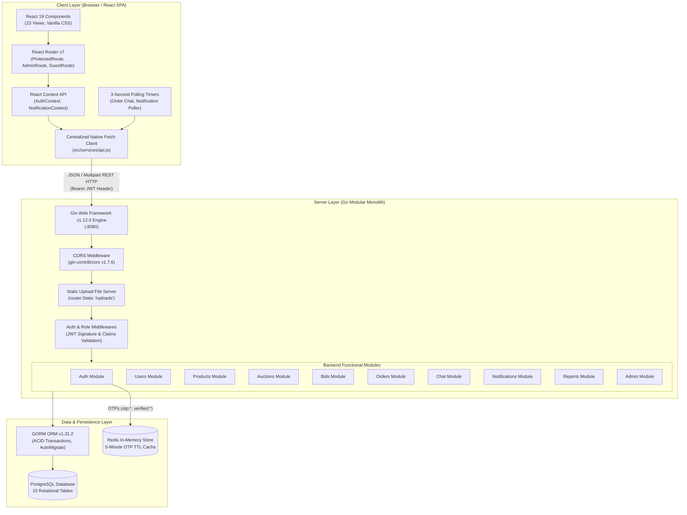

### Architectural Highlights
1. **Frontend Architecture:** Built with **React 19 (`^19.2.8`)** and bundled with **Vite 8 (`^8.2.2`)**. It manages client-side navigation via **React Router v7 (`^7.18.3`)** using declarative Route Guards (`ProtectedRoute`, `AdminRoute`, `GuestRoute`). Styling is authored in pure, responsive **Vanilla CSS** leveraging CSS Custom Properties and glassmorphic elevation without bulky CSS utility libraries.
2. **Communication Layer:** Communication is handled exclusively through a centralized native `fetch` module in [`frontend/src/services/api.js`](file:///c:/Auction_Hub/frontend/src/services/api.js). Requests serialize to standard JSON (`application/json`) or browser-boundary `multipart/form-data` for file uploads.
3. **Backend Modular Monolith:** Built in **Go (`1.26.2`)** using **Gin (`v1.12.0`)**. The application is partitioned into domain-specific packages inside [`backend/modules/`](file:///c:/Auction_Hub/backend/modules/). Each domain module enforces a 3-tier layering pattern:
   - **Controller:** HTTP unmarshaling, URL parameter extraction, query parameter parsing, and JSON response serialization.
   - **Service:** Domain business logic, input validation, permission checks, and database transaction orchestration.
   - **Repository:** GORM database queries, table joins, preloading, and persistence.
4. **Relational Persistence:** **PostgreSQL** accessed through **GORM (`v1.31.2`)**. All primary tables are automatically maintained and indexed via GORM `AutoMigrate`. Soft deletion is enabled by default across tables embedding `gorm.Model`.
5. **In-Memory Cache (Redis):** Connected via `github.com/redis/go-redis/v9`. Used specifically for transient security credentials—generating, caching, and expiring 6-digit OTP codes with a strict 5-minute Time-To-Live (TTL).
6. **Stateless Authentication:** JSON Web Tokens (JWT) signed via `golang-jwt/jwt/v5` encapsulate the user's primary key (`userID`) and authorization level (`role`). Tokens are stored in browser `localStorage` and dispatched in HTTP requests as standard `Authorization: Bearer <token>` headers.

---

# Part 2: Complete Frontend-to-Backend Connection Map

Below is the complete mapping of every frontend user action, page, and component to its exact backend route, middleware, controller, service, repository, and database table.

| # | Frontend Page & Component | Frontend Handler Function | API Service Function | HTTP Method & Endpoint | Backend Route & Middleware | Controller & Service Function | Repository & DB Table | Result & UI State Update |
| :---: | :--- | :--- | :--- | :--- | :--- | :--- | :--- | :--- |
| **1** | [`Register.jsx`](file:///c:/Auction_Hub/frontend/src/pages/auth/Register.jsx)<br/>`<RegisterForm>` | `handleSubmit()` | `apiService.sendOTP(email)` | `POST /api/auth/send-otp` | [`auth/routes.go`](file:///c:/Auction_Hub/backend/modules/auth/routes.go)<br/>*(Public)* | `controller.SendOTP`<br/>`service.SendOTP` | Reads `users` table via `repo.FindByEmail`. Writes OTP to Redis (`otp:<email>`). | Navigates user to `/verify-otp` with email stored in local state. |
| **2** | [`VerifyOTP.jsx`](file:///c:/Auction_Hub/frontend/src/pages/auth/VerifyOTP.jsx)<br/>`<VerifyOTPForm>` | `handleVerify()` | `apiService.verifyOTP(email, otp)` | `POST /api/auth/verify-otp` | [`auth/routes.go`](file:///c:/Auction_Hub/backend/modules/auth/routes.go)<br/>*(Public)* | `controller.VerifyOTP`<br/>`service.VerifyOTP` | Validates Redis key `otp:<email>`. Reads `pending_user:<email>` from Redis. | Sets `verified:<email>` in Redis; returns success code. |
| **3** | [`VerifyOTP.jsx`](file:///c:/Auction_Hub/frontend/src/pages/auth/VerifyOTP.jsx)<br/>`<VerifyOTPForm>` | `handleFinalRegister()` | `apiService.register(name, email, password)` | `POST /api/auth/register` | [`auth/routes.go`](file:///c:/Auction_Hub/backend/modules/auth/routes.go)<br/>*(Public)* | `controller.Register`<br/>`service.Register` | Hashes password with Bcrypt. Inserts row into `users` table via `repo.Create`. | Redirects to `/login` with success banner. |
| **4** | [`Login.jsx`](file:///c:/Auction_Hub/frontend/src/pages/auth/Login.jsx)<br/>`<LoginForm>` | `handleLogin()` | `apiService.login(email, password)` | `POST /api/auth/login` | [`auth/routes.go`](file:///c:/Auction_Hub/backend/modules/auth/routes.go)<br/>*(Public)* | `controller.Login`<br/>`service.Login` | Queries `users` by email. Validates bcrypt hash. Generates JWT token. | Saves `token` & `user` to `localStorage` and `AuthContext`. Redirects to `/` or `/admin`. |
| **5** | [`ForgotPassword.jsx`](file:///c:/Auction_Hub/frontend/src/pages/auth/ForgotPassword.jsx) | `handleSendResetOTP()` | `apiService.forgotPassword(email)` | `POST /api/auth/forgot-password` | [`auth/routes.go`](file:///c:/Auction_Hub/backend/modules/auth/routes.go)<br/>*(Public)* | `controller.ForgotPassword`<br/>`service.ForgotPassword` | Finds user in `users`. Generates 6-digit OTP in Redis `otp:<email>`. | Switches form to step 2: Enter OTP & New Password. |
| **6** | [`ForgotPassword.jsx`](file:///c:/Auction_Hub/frontend/src/pages/auth/ForgotPassword.jsx) | `handleResetPassword()` | `apiService.resetPassword(email, otp, newPassword)` | `POST /api/auth/reset-password` | [`auth/routes.go`](file:///c:/Auction_Hub/backend/modules/auth/routes.go)<br/>*(Public)* | `controller.ResetPassword`<br/>`service.ResetPassword` | Verifies Redis OTP. Hashes password. Updates `users` table via GORM. | Navigates to `/login` with "Password reset successfully!" |
| **7** | [`Profile.jsx`](file:///c:/Auction_Hub/frontend/src/pages/buyer/Profile.jsx)<br/>`<UserProfileCard>` | `fetchProfile()` | `apiService.getProfile(token)` | `GET /api/users/profile` | [`users/routes.go`](file:///c:/Auction_Hub/backend/modules/users/routes.go)<br/>`AuthMiddleware()` | `controller.GetProfile`<br/>`service.GetProfile` | Queries `users` table by `c.Get("userID")`. Omit password. | Populates profile fields (name, email, role, phone, address). |
| **8** | [`Profile.jsx`](file:///c:/Auction_Hub/frontend/src/pages/buyer/Profile.jsx) | `handleSaveProfile()` | `apiService.updateProfile(token, name)` | `PUT /api/users/profile` | [`users/routes.go`](file:///c:/Auction_Hub/backend/modules/users/routes.go)<br/>`AuthMiddleware()` | `controller.UpdateProfile`<br/>`service.UpdateProfile` | Updates `name` column in `users` table where `id = userID`. | Updates `AuthContext` user name and re-renders card. |
| **9** | [`MyProducts.jsx`](file:///c:/Auction_Hub/frontend/src/pages/seller/MyProducts.jsx)<br/>`<CreateProductModal>` | `handleSubmitProduct()` | `apiService.createProduct(token, formData)` | `POST /api/products` | [`products/routes.go`](file:///c:/Auction_Hub/backend/modules/products/routes.go)<br/>`AuthMiddleware()` | `controller.CreateProduct`<br/>`service.CreateProduct` | Writes files to `./uploads`. Inserts `products` row and linked `product_images` rows. | Adds product to seller's product list grid. Closes modal. |
| **10**| [`MyProducts.jsx`](file:///c:/Auction_Hub/frontend/src/pages/seller/MyProducts.jsx) | `loadMyProducts()` | `apiService.getMyProducts(token)` | `GET /api/products/my` | [`products/routes.go`](file:///c:/Auction_Hub/backend/modules/products/routes.go)<br/>`AuthMiddleware()` | `controller.GetMyProducts`<br/>`service.GetMyProducts` | Queries `products` table where `seller_id = userID`. Preloads `Images`. | Displays seller inventory cards with active auction indicators. |
| **11**| [`MyProducts.jsx`](file:///c:/Auction_Hub/frontend/src/pages/seller/MyProducts.jsx) | `handleDeleteProduct()` | `apiService.deleteProduct(token, id)` | `DELETE /api/products/:id` | [`products/routes.go`](file:///c:/Auction_Hub/backend/modules/products/routes.go)<br/>`AuthMiddleware()` | `controller.DeleteProduct`<br/>`service.DeleteProduct` | Checks if linked to active auction. Soft-deletes `products` row. | Removes card from local UI grid. |
| **12**| [`MyProducts.jsx`](file:///c:/Auction_Hub/frontend/src/pages/seller/MyProducts.jsx)<br/>`<CreateAuctionModal>` | `handleStartAuction()` | `apiService.createAuction(token, payload)` | `POST /api/auctions` | [`auctions/routes.go`](file:///c:/Auction_Hub/backend/modules/auctions/routes.go)<br/>`AuthMiddleware()` | `controller.CreateAuction`<br/>`service.CreateAuction` | Inserts row into `auctions` table with status `active`. Calculates `end_time`. | Shows success badge; product status transitions to "In Auction". |
| **13**| [`Auctions.jsx`](file:///c:/Auction_Hub/frontend/src/pages/buyer/Auctions.jsx)<br/>`<AuctionGrid>` | `fetchAuctions()` | `apiService.getAuctions(token)` | `GET /api/auctions` | [`auctions/routes.go`](file:///c:/Auction_Hub/backend/modules/auctions/routes.go)<br/>`AuthMiddleware()` | `controller.GetActiveAuctions`<br/>`service.GetActiveAuctions` | Calls `EvaluateExpiredAuctions()`. Queries `auctions` table where `status = 'active'`. | Renders public auction catalog with countdown timer badges. |
| **14**| [`AuctionDetails.jsx`](file:///c:/Auction_Hub/frontend/src/pages/buyer/AuctionDetails.jsx) | `loadAuctionDetails()` | `apiService.getAuctionById(token, id)` | `GET /api/auctions/:id` | [`auctions/routes.go`](file:///c:/Auction_Hub/backend/modules/auctions/routes.go)<br/>`AuthMiddleware()` | `controller.GetAuctionByID`<br/>`service.GetAuctionByID` | Calls `EvaluateExpiredAuctions()`. Queries `auctions` by ID. Preloads Product, Images, Seller. | Sets auction state, timer, current highest price, and bid controls. |
| **15**| [`AuctionDetails.jsx`](file:///c:/Auction_Hub/frontend/src/pages/buyer/AuctionDetails.jsx) | `loadBids()` | `apiService.getAuctionBids(token, auctionId)` | `GET /api/bids/auction/:auctionId` | [`bids/routes.go`](file:///c:/Auction_Hub/backend/modules/bids/routes.go)<br/>`AuthMiddleware()` | `bidController.GetBidsByAuctionID`<br/>`service.GetBidsByAuctionID` | Queries `bids` table where `auction_id = ?` ORDER BY `amount DESC`. Preloads User. | Renders live bid history table with bidder names and timestamps. |
| **16**| [`AuctionDetails.jsx`](file:///c:/Auction_Hub/frontend/src/pages/buyer/AuctionDetails.jsx)<br/>`<BidForm>` | `handlePlaceBid()` | `apiService.placeBid(token, {auctionId, amount})` | `POST /api/bids` | [`bids/routes.go`](file:///c:/Auction_Hub/backend/modules/bids/routes.go)<br/>`AuthMiddleware()` | `bidController.CreateBid`<br/>`service.CreateBid` | **ACID Tx:** Validates amount. Inserts `bids` record. Updates `auctions.current_price`. Creates outbid `notifications`. | Re-fetches auction and bid history. Displays confirmation toast. |
| **17**| [`MyBids.jsx`](file:///c:/Auction_Hub/frontend/src/pages/buyer/MyBids.jsx) | `fetchMyBids()` | `apiService.getMyBids(token)` | `GET /api/bids/my` | [`bids/routes.go`](file:///c:/Auction_Hub/backend/modules/bids/routes.go)<br/>`AuthMiddleware()` | `bidController.GetMyBids`<br/>`service.GetMyBids` | Queries `bids` where `user_id = userID`. Preloads Auction & Product. | Lists all auctions where user has participated and winning status. |
| **18**| [`WonAuctions.jsx`](file:///c:/Auction_Hub/frontend/src/pages/buyer/WonAuctions.jsx) | `fetchWonAuctions()` | `apiService.getWonAuctions(token)` | `GET /api/auctions/won` | [`auctions/routes.go`](file:///c:/Auction_Hub/backend/modules/auctions/routes.go)<br/>`AuthMiddleware()` | `controller.GetWonAuctions`<br/>`service.GetWonAuctions` | Queries `auctions` table where `winner_id = userID AND status = 'ended'`. | Shows cards of won items with direct "View Order" CTA buttons. |
| **19**| [`MyAuctions.jsx`](file:///c:/Auction_Hub/frontend/src/pages/seller/MyAuctions.jsx) | `fetchMyAuctions()` | `apiService.getMyAuctions(token)` | `GET /api/auctions/seller` | [`auctions/routes.go`](file:///c:/Auction_Hub/backend/modules/auctions/routes.go)<br/>`AuthMiddleware()` | `controller.GetMyAuctions`<br/>`service.GetMyAuctions` | Queries `auctions` where `seller_id = userID`. Preloads Product & Bids. | Displays seller dashboard of active, ended, and sold auctions. |
| **20**| [`MyOrders.jsx`](file:///c:/Auction_Hub/frontend/src/pages/buyer/MyOrders.jsx) | `fetchOrders()` | `apiService.getMyOrders(token)` | `GET /api/orders/my-orders` | [`orders/routes.go`](file:///c:/Auction_Hub/backend/modules/orders/routes.go)<br/>`AuthMiddleware()` | `controller.GetMyOrders`<br/>`service.GetMyOrders` | Queries `orders` where `buyer_id = userID` OR `seller_id = userID`. Preloads Auction. | Separates results into "My Purchases" (buyer) and "My Sales" (seller). |
| **21**| [`OrderDetails.jsx`](file:///c:/Auction_Hub/frontend/src/pages/buyer/OrderDetails.jsx) | `loadOrderDetails()` | `apiService.getOrderById(token, id)` | `GET /api/orders/:id` | [`orders/routes.go`](file:///c:/Auction_Hub/backend/modules/orders/routes.go)<br/>`AuthMiddleware()` | `controller.GetOrderByID`<br/>`service.GetOrderByID` | Queries `orders` table by ID. Preloads Buyer, Seller, Auction, Product. | Renders order timeline: Pending &rarr; Shipped &rarr; Delivered. |
| **22**| [`OrderDetails.jsx`](file:///c:/Auction_Hub/frontend/src/pages/buyer/OrderDetails.jsx) | `handleSaveAddress()` | `apiService.updateDeliveryAddress(token, id, address)` | `PUT /api/orders/:id/address` | [`orders/routes.go`](file:///c:/Auction_Hub/backend/modules/orders/routes.go)<br/>`AuthMiddleware()` | `controller.UpdateDeliveryAddress`<br/>`service.UpdateAddress` | Verifies buyer ownership. Updates `delivery_address` on `orders` table. | Sets address in UI; unlocks shipment eligibility for seller. |
| **23**| [`OrderDetails.jsx`](file:///c:/Auction_Hub/frontend/src/pages/buyer/OrderDetails.jsx) | `handleMarkShipped()` | `apiService.markOrderShipped(token, id)` | `PATCH /api/orders/:id/ship` | [`orders/routes.go`](file:///c:/Auction_Hub/backend/modules/orders/routes.go)<br/>`AuthMiddleware()` | `controller.MarkAsShipped`<br/>`service.MarkAsShipped` | Verifies seller ownership. Updates status to `shipped`. Sends notification to buyer. | Advances order stepper to "Shipped". |
| **24**| [`OrderDetails.jsx`](file:///c:/Auction_Hub/frontend/src/pages/buyer/OrderDetails.jsx) | `handleMarkDelivered()` | `apiService.markOrderDelivered(token, id)` | `PATCH /api/orders/:id/deliver` | [`orders/routes.go`](file:///c:/Auction_Hub/backend/modules/orders/routes.go)<br/>`AuthMiddleware()` | `controller.MarkAsDelivered`<br/>`service.MarkAsDelivered` | Verifies buyer ownership. Updates status to `delivered`. Sends notification to seller. | Advances order stepper to "Delivered"; closes order. |
| **25**| [`OrderDetails.jsx`](file:///c:/Auction_Hub/frontend/src/pages/buyer/OrderDetails.jsx)<br/>`<ChatDrawer>` | `fetchChat()` | `apiService.getChatConversation(token, auctionId)` | `GET /api/chat/auction/:auctionId` | [`chat/routes.go`](file:///c:/Auction_Hub/backend/modules/chat/routes.go)<br/>`AuthMiddleware()` | `controller.GetOrCreateConversation`<br/>`service.GetOrCreate` | Queries `conversations` where `order_id = ?` or creates it if absent. | Stores `conversation.id` for message queries. |
| **26**| [`OrderDetails.jsx`](file:///c:/Auction_Hub/frontend/src/pages/buyer/OrderDetails.jsx)<br/>`<ChatDrawer>` | `fetchChat()` *(3s Poll)* | `apiService.getChatMessages(token, convId)` | `GET /api/chat/conversation/:id/messages` | [`chat/routes.go`](file:///c:/Auction_Hub/backend/modules/chat/routes.go)<br/>`AuthMiddleware()` | `controller.GetMessages`<br/>`service.GetMessages` | Queries `messages` table where `conversation_id = ?` ORDER BY `created_at ASC`. | Updates message list in chat drawer; scrolls to bottom. |
| **27**| [`OrderDetails.jsx`](file:///c:/Auction_Hub/frontend/src/pages/buyer/OrderDetails.jsx)<br/>`<ChatDrawer>` | `handleSendMessage()` | `apiService.sendChatMessage(token, convId, message)` | `POST /api/chat/conversation/:id/messages` | [`chat/routes.go`](file:///c:/Auction_Hub/backend/modules/chat/routes.go)<br/>`AuthMiddleware()` | `controller.SendMessage`<br/>`service.SendMessage` | Inserts row into `messages`. Dispatches notification to recipient. | Appends message immediately to conversation UI. |
| **28**| [`Navbar.jsx`](file:///c:/Auction_Hub/frontend/src/components/common/Navbar.jsx)<br/>`NotificationContext` | `fetchUnreadCount()` | `apiService.getUnreadNotificationCount(token)` | `GET /api/notifications/unread-count` | [`notifications/routes.go`](file:///c:/Auction_Hub/backend/modules/notifications/routes.go)<br/>`AuthMiddleware()` | `controller.GetUnreadCount`<br/>`service.GetUnreadCount` | Counts rows in `notifications` where `user_id = ? AND is_read = false`. | Displays unread count red badge in top navbar. |
| **29**| [`Navbar.jsx`](file:///c:/Auction_Hub/frontend/src/components/common/Navbar.jsx)<br/>`<NotificationModal>` | `fetchNotifications()` | `apiService.getNotifications(token)` | `GET /api/notifications` | [`notifications/routes.go`](file:///c:/Auction_Hub/backend/modules/notifications/routes.go)<br/>`AuthMiddleware()` | `controller.GetNotifications`<br/>`service.GetNotifications` | Queries `notifications` table where `user_id = ?` ORDER BY `created_at DESC`. | Normalizes PascalCase fields and lists alerts. |
| **30**| [`Navbar.jsx`](file:///c:/Auction_Hub/frontend/src/components/common/Navbar.jsx)<br/>`<NotificationModal>` | `handleMarkAllAsRead()` | `apiService.markAllNotificationsAsRead(token)` | `PATCH /api/notifications/read-all` | [`notifications/routes.go`](file:///c:/Auction_Hub/backend/modules/notifications/routes.go)<br/>`AuthMiddleware()` | `controller.MarkAllAsRead`<br/>`service.MarkAllAsRead` | Updates `notifications` SET `is_read = true` where `user_id = userID`. | Clears unread badge count to 0; marks items as read. |
| **31**| [`AuctionDetails.jsx`](file:///c:/Auction_Hub/frontend/src/pages/buyer/AuctionDetails.jsx)<br/>`<ReportModal>` | `handleSubmitReport()` | `apiService.createReport(token, payload)` | `POST /api/reports` | [`reports/routes.go`](file:///c:/Auction_Hub/backend/modules/reports/routes.go)<br/>`AuthMiddleware()` | `controller.CreateReport`<br/>`service.CreateReport` | Inserts violation ticket into `reports` table with status `pending`. | Closes modal with success toast message. |
| **32**| [`Dashboard.jsx`](file:///c:/Auction_Hub/frontend/src/pages/admin/Dashboard.jsx) | `fetchDashboard()` | `apiService.getAdminDashboard(token)` | `GET /api/admin/dashboard` | [`admin/routes.go`](file:///c:/Auction_Hub/backend/modules/admin/routes.go)<br/>`RoleMiddleware("admin")` | `controller.GetDashboardAnalytics`<br/>`service.GetDashboard` | Counts totals from `users`, `products`, `auctions`, `bids`, `orders`. | Renders analytic metric metric cards & chart counters. |
| **33**| [`ManageUsers.jsx`](file:///c:/Auction_Hub/frontend/src/pages/admin/ManageUsers.jsx) | `handleBlockUser()` | `apiService.blockUser(token, id)` | `PATCH /api/admin/users/:id/block` | [`admin/routes.go`](file:///c:/Auction_Hub/backend/modules/admin/routes.go)<br/>`RoleMiddleware("admin")` | `controller.BlockUser`<br/>`service.BlockUser` | Sets `is_blocked = true` in `users` table for user ID. | Toggles user status tag to "Blocked"; prevents future logins. |
| **34**| [`ManageAuctions.jsx`](file:///c:/Auction_Hub/frontend/src/pages/admin/ManageAuctions.jsx) | `handlePauseAuction()` | `apiService.pauseAdminAuction(token, id, reason)` | `PATCH /api/admin/auctions/:id/pause` | [`admin/routes.go`](file:///c:/Auction_Hub/backend/modules/admin/routes.go)<br/>`RoleMiddleware("admin")` | `controller.PauseAuction`<br/>`service.PauseAuction` | Updates `auctions.status = 'paused'`. Records reason. | Updates auction status badge to "Paused". |

---

# Part 3: Complete Request Lifecycle

To understand how data flows across the entire stack, consider the complete step-by-step lifecycle of an HTTP request.

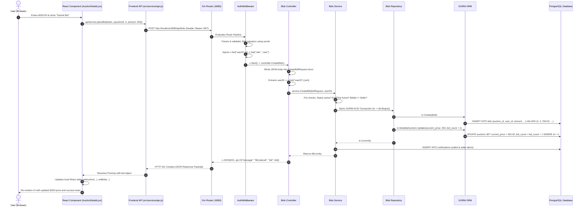

---

# Part 4: Complete Feature-by-Feature Flows (23 Core Features)

### 1. User Registration Flow
- **User Action:** User navigates to `/register`, enters name, email, password, and phone, and clicks **"Send OTP"**.
- **Frontend Handler:** `handleSubmit()` in [`Register.jsx`](file:///c:/Auction_Hub/frontend/src/pages/auth/Register.jsx) calls `apiService.sendOTP(email)`.
- **Wire Request:** `POST /api/auth/send-otp` with JSON `{ "email": "user@example.com" }`.
- **Backend Flow:** [`modules/auth/controller.go`](file:///c:/Auction_Hub/backend/modules/auth/controller.go) calls `service.SendOTP()`. The service checks that no user in the `users` table currently has that email. It generates a 6-digit cryptographic numeric string and stores it in Redis under `otp:<email>` with a **5-minute TTL**.
- **UI Transition:** The frontend caches registration inputs in session state and navigates to `/verify-otp`.

### 2. User OTP Verification & Account Creation Flow
- **User Action:** User types the 6-digit code received via email and clicks **"Verify & Create Account"**.
- **Frontend Handler:** `handleVerify()` in [`VerifyOTP.jsx`](file:///c:/Auction_Hub/frontend/src/pages/auth/VerifyOTP.jsx) calls `apiService.verifyOTP(email, otp)` followed by `apiService.register(name, email, password)`.
- **Wire Request:** `POST /api/auth/register` with JSON `{ "name": "...", "email": "...", "password": "..." }`.
- **Backend Flow:** `auth.Service.Register()` validates the OTP against Redis. It hashes the plain-text password using `bcrypt.GenerateFromPassword()` with `bcrypt.DefaultCost` (10). It calls `auth.Repository.Create()`, which executes an `INSERT INTO users` in PostgreSQL. Once committed, the Redis OTP keys are deleted.
- **UI Transition:** Displays success alert and navigates to `/login`.

### 3. User Login & Session Establishment Flow
- **User Action:** Enters registered email and password in `/login` and clicks **"Sign In"**.
- **Frontend Handler:** `handleLogin()` in [`Login.jsx`](file:///c:/Auction_Hub/frontend/src/pages/auth/Login.jsx) calls `apiService.login(email, password)`.
- **Wire Request:** `POST /api/auth/login` with `{ "email": "...", "password": "..." }`.
- **Backend Flow:** `auth.Service.Login()` fetches the user row by email. It verifies the credentials using `bcrypt.CompareHashAndPassword()`. Upon match, it constructs a JWT token with claims: `user_id`, `role`, and `exp` (24 hours).
- **Frontend Response:** The frontend receives `{ "token": "...", "user": { "id": 1, "role": "user", ... } }`. `AuthContext.login()` saves the token and user to `localStorage`. If `user.role === "admin"`, it redirects to `/admin`; otherwise, it redirects to `/`.

### 4. Authentication & Protected Navigation Guarding
- **Client Mechanism:** In [`src/routes/AppRoute.jsx`](file:///c:/Auction_Hub/frontend/src/routes/AppRoute.jsx), all routes are wrapped in `<ProtectedRoute>`, `<AdminRoute>`, or `<GuestRoute>`.
- **Route Checks:** If a guest attempts to visit `/auctions/4`, `ProtectedRoute` intercepts the request: `if (!isLoggedIn) return <Navigate to="/login" replace />`. If a standard user visits `/admin`, `AdminRoute` redirects them: `if (user?.role !== "admin") return <Navigate to="/" replace />`.
- **Backend Interception:** Every protected endpoint invokes `middleware.AuthMiddleware()`. If the `Authorization` header is missing or signature verification fails, Gin returns `401 Unauthorized` (`c.AbortWithStatusJSON(401, ...)`). The frontend API client detects `response.status === 401`, triggers `AuthContext.logout()`, and redirects to `/login`.

### 5. Product Management Flow (Multi-Image Upload)
- **User Action:** User opens `/products` (My Products), clicks **"Add New Product"**, completes the modal (Title, Description, Category, Starting Price), selects image files from disk, and submits.
- **Frontend Handler:** `handleSubmitProduct()` in [`MyProducts.jsx`](file:///c:/Auction_Hub/frontend/src/pages/seller/MyProducts.jsx) bundles data into a native `FormData` instance and calls `apiService.createProduct(token, formData)`.
- **Wire Request:** `POST /api/products` with `multipart/form-data` and `Authorization: Bearer <token>`.
- **Backend Flow:** [`modules/products/controller.go`](file:///c:/Auction_Hub/backend/modules/products/controller.go) calls `c.MultipartForm()`. For every image in `form.File["images"]`, it creates a unique filename with `uuid.New().String() + filepath.Ext(...)` and saves it to `./uploads/`. It invokes `products.Service.CreateProduct()` within a database transaction: inserting the `products` record with `seller_id = userID`, and inserting linked `product_images` rows.
- **UI Transition:** Modal closes, and the new item appears in the seller's inventory grid.

### 6. Category Management Flow
- **Actual Implementation Reality:** In the codebase, categories are not stored in a dynamic admin-managed table; they are stored as free-form strings directly on the `products.category` column.
- **Frontend Presentation:** In [`MyProducts.jsx`](file:///c:/Auction_Hub/frontend/src/pages/seller/MyProducts.jsx), category selection uses a pre-defined `<select>` dropdown (`"Electronics"`, `"Fashion"`, `"Art"`, `"Collectibles"`, `"Home"`, `"Other"`).
- **Backend Route Status:** While `modules/categories` contains skeleton files, it is **unmounted** in `main.go`. All product filtering uses the string column `products.category`.

### 7. Auction Creation Flow
- **User Action:** In `/products`, the seller clicks **"Start Auction"** on an unlisted product, enters the Starting Bid and Duration (hours/days), and confirms.
- **Frontend Handler:** `handleStartAuction()` calls `apiService.createAuction(token, { productId, startingPrice, duration })`.
- **Wire Request:** `POST /api/auctions` with JSON `{ "product_id": 12, "starting_price": 50.00, "duration": 24 }`.
- **Backend Flow:** [`modules/auctions/service.go`](file:///c:/Auction_Hub/backend/modules/auctions/service.go) verifies:
  1. Product exists and belongs to the authenticated user (`product.SellerID == userID`).
  2. Product is not already attached to an active auction.
  3. Computes `start_time := time.Now()` and `end_time := time.Now().Add(time.Duration(duration) * time.Hour)`.
  4. Sets `current_price = startingPrice`, `status = "active"`, `bid_count = 0`.
  5. Inserts the row into `auctions`.
- **UI Transition:** The product's status badge switches to `"In Auction"` and links to the live auction.

### 8. Auction Catalog Listing Flow (With Lazy Expiry Evaluation)
- **User Action:** Buyer navigates to `/auctions` to browse marketplace lots.
- **Frontend Handler:** `fetchAuctions()` in [`Auctions.jsx`](file:///c:/Auction_Hub/frontend/src/pages/buyer/Auctions.jsx) calls `apiService.getAuctions(token)`.
- **Wire Request:** `GET /api/auctions` with `Authorization: Bearer <token>`.
- **Backend Flow:** [`modules/auctions/repository.go`](file:///c:/Auction_Hub/backend/modules/auctions/repository.go#L60) executes **`EvaluateExpiredAuctions()` before querying**:
  1. Searches for any auction where `status = 'active' AND end_time <= NOW()`.
  2. Resolves winners, closes products, and generates orders on demand.
  3. Queries all remaining `status = 'active'` auctions, preloading images and seller usernames.
- **UI Transition:** Catalog renders auction cards with live countdown timers, thumbnail carousels, and current highest bid amounts.

### 9. Auction Details Flow
- **User Action:** User clicks on an auction card, routing to `/auctions/:id`.
- **Frontend Handler:** `loadAuctionDetails()` in [`AuctionDetails.jsx`](file:///c:/Auction_Hub/frontend/src/pages/buyer/AuctionDetails.jsx) makes parallel calls to `apiService.getAuctionById(token, id)` and `apiService.getAuctionBids(token, id)`.
- **Backend Flow:** `auctions.Repository.FindByID()` preloads the linked Product, ProductImages, Seller, and Winner. `bids.Repository.FindByAuctionID()` retrieves all bids ordered by `amount DESC`.
- **UI Transition:** Populates full image gallery, seller metadata, remaining time clock, starting/current price, and the tabular log of recent bids.

### 10. Bidding Flow (High-Stakes ACID Execution)
- **User Action:** Authenticated buyer enters an amount higher than the current price and clicks **"Place Bid"**.
- **Frontend Handler:** `handlePlaceBid()` calls `apiService.placeBid(token, { auctionId, amount })`.
- **Backend Flow:** Trace follows the detailed ACID transaction sequence in Part 5: validates active status, non-seller identity, minimum increment, inserts bid, updates auction price, and dispatches outbid alerts.
- **UI Transition:** Disables submit button during network inflight, then reloads bid history and displays updated current price.

### 11. Outbid Notification Flow
- **Trigger:** A new highest bid is inserted for an auction that already had bids.
- **Backend Logic:** In [`modules/bids/service.go`](file:///c:/Auction_Hub/backend/modules/bids/service.go#L112), after the bid transaction commits:
  1. Finds the previous highest bidder: `previousBidderID := previousHighestBid.UserID`.
  2. If `previousBidderID != currentBidderID`, calls `NotificationService.CreateNotification()`:
     - `UserID: previousBidderID`
     - `Title: "You've Been Outbid!"`
     - `Message: "Another bidder placed a higher bid of $X on auction #Y."`
     - `Type: "bid"`
- **Frontend Delivery:** On the outbid user's client, the navbar notification poller retrieves the notification on its next cycle, incrementing the unread badge counter.

### 12. Auction Completion & Winner Selection Flow
- **Trigger:** An active auction's `end_time` has elapsed.
- **Backend Execution:** On the next hit to `GET /api/auctions` or `GET /api/auctions/:id`, `EvaluateExpiredAuctions()` identifies the record:
  - Highest bid retrieved: `SELECT * FROM bids WHERE auction_id = ? ORDER BY amount DESC LIMIT 1`.
  - Sets `auction.status = "ended"` and `auction.winner_id = highestBid.UserID`.
  - Sets `product.status = "sold"`.
- **Order Generation:** Creates row in `orders` table: `buyer_id = winner_id`, `seller_id = auction.SellerID`, `final_price = highestBid.Amount`, `status = "pending"`.
- **Notifications:** Winner receives `"Auction Won!"` notification; Seller receives `"Auction Ended Successfully"`.

### 13. Order Creation & Deduplication Flow
- **Backend Logic:** In `EvaluateExpiredAuctions()`, before creating an order, GORM queries `WHERE auction_id = ?` on `orders`. If an order already exists, it skips insertion to ensure idempotent evaluation.
- **Failure Case (No Bids):** If an auction expires with 0 bids, `auction.status` is set to `"ended"`, but `winner_id` remains `NULL`. No order is inserted, and the product remains unsold.

### 14. Order Listing Flow (Buyer & Seller Perspectives)
- **User Action:** User navigates to `/my-orders`.
- **Frontend Handler:** `fetchOrders()` in [`MyOrders.jsx`](file:///c:/Auction_Hub/frontend/src/pages/buyer/MyOrders.jsx) calls `apiService.getMyOrders(token)`.
- **Backend Flow:** [`modules/orders/controller.go`](file:///c:/Auction_Hub/backend/modules/orders/controller.go) executes `service.GetMyOrders(userID)`. It queries `orders` where `buyer_id = userID` (Purchases) and `orders` where `seller_id = userID` (Sales), preloading Auction, Product, and User records.
- **UI Transition:** Renders two distinct tabbed views: "Purchases" and "Sales", each displaying current status pills (`pending`, `shipped`, `delivered`).

### 15. Delivery Address Submission Flow
- **User Action:** The winning buyer opens `/orders/:id`, enters a delivery address into the text field, and clicks **"Save Delivery Address"**.
- **Frontend Handler:** `handleSaveAddress()` in [`OrderDetails.jsx`](file:///c:/Auction_Hub/frontend/src/pages/buyer/OrderDetails.jsx) calls `apiService.updateDeliveryAddress(token, orderId, address)`.
- **Backend Flow:** [`modules/orders/service.go`](file:///c:/Auction_Hub/backend/modules/orders/service.go) enforces:
  1. `order.BuyerID == userID` (Sellers cannot change delivery destination).
  2. `order.Status == "pending"` (Cannot change destination once shipped or delivered).
  3. Updates `delivery_address` in `orders` table.
- **UI Transition:** Renders confirmation message; unblocks the seller's ability to mark the package as shipped.

### 16. Order Packing Flow
- **User Action:** Seller/Admin marks an order as packed.
- **Frontend Handler:** `apiService.markOrderPacked(token, orderId)`.
- **Backend Route:** `PATCH /api/orders/:id/pack`.
- **Backend Flow:** Verifies `seller_id == userID` or `role == "admin"`. Updates order internal state and creates an `OrderTrackingHistory` entry.

### 17. Order Shipping Flow
- **User Action:** Seller packages the item and clicks **"Mark as Shipped"** on the order screen.
- **Frontend Handler:** `handleMarkShipped()` calls `apiService.markOrderShipped(token, orderId)`.
- **Wire Request:** `PATCH /api/orders/:id/ship` with `Authorization: Bearer <token>`.
- **Backend Flow:** `orders.Service.MarkAsShipped()` verifies:
  1. `order.SellerID == userID` or `role == "admin"`.
  2. `order.DeliveryAddress != ""` (Item cannot ship without an address).
  3. Updates `status = "shipped"` in `orders`.
  4. Dispatches notification to buyer: `"Your order has shipped!"`.
- **UI Transition:** Stepper advances to "Shipped".

### 18. Delivery Confirmation Flow
- **User Action:** Buyer receives package and clicks **"Confirm Delivery"**.
- **Frontend Handler:** `handleMarkDelivered()` in [`OrderDetails.jsx`](file:///c:/Auction_Hub/frontend/src/pages/buyer/OrderDetails.jsx) calls `apiService.markOrderDelivered(token, orderId)`.
- **Backend Flow:** `orders.Service.MarkAsDelivered()` verifies that `order.BuyerID == userID` or `role == "admin"`. Updates `status = "delivered"`. Creates completion notification for seller.
- **UI Transition:** Stepper completes at "Delivered", permanently closing the order lifecycle.

### 19. Buyer-Seller Order Chat Flow (With 3s Polling)
- **User Action:** Buyer or seller clicks **"Chat with Seller/Buyer"** inside `/orders/:id`, opening the chat drawer.
- **Frontend Handler:** `fetchChat()` in [`OrderDetails.jsx`](file:///c:/Auction_Hub/frontend/src/pages/buyer/OrderDetails.jsx) calls `apiService.getChatConversation(token, order.auctionId)`.
- **Backend Flow:** [`modules/chat/service.go`](file:///c:/Auction_Hub/backend/modules/chat/service.go) looks up `conversations` where `order_id = ?`. If missing, it creates the conversation row linking the buyer and seller.
- **Message Polling:** While drawer is open, a `setInterval(fetchChat, 3000)` polling timer continuously queries `GET /api/chat/conversation/:id/messages`.
- **Sending Messages:** Submitting a message calls `POST /api/chat/conversation/:id/messages`. The backend inserts into `chat_messages` and creates a `"New Message"` notification for the other participant.

### 20. Notification Retrieval & Badge Counting Flow
- **Client Poller:** [`NotificationContext.jsx`](file:///c:/Auction_Hub/frontend/src/context/NotificationContext.jsx) mounts on application startup.
- **Wire Requests:** Calls `GET /api/notifications/unread-count` every 30 seconds and `GET /api/notifications` when the notification menu is opened.
- **Backend Flow:** Queries `notifications` table where `user_id = userID`. The unread counter executes `SELECT COUNT(*) WHERE user_id = ? AND is_read = false`.
- **UI Transition:** Updates the numeric badge over the bell icon in [`Navbar.jsx`](file:///c:/Auction_Hub/frontend/src/components/common/Navbar.jsx).

### 21. Marking Notifications as Read Flow
- **User Action:** User clicks **"Mark All as Read"** or clicks a single unread notification.
- **Frontend Handler:** Calls `apiService.markAllNotificationsAsRead(token)` or `apiService.markNotificationAsRead(token, id)`.
- **Wire Request:** `PATCH /api/notifications/read-all` or `PATCH /api/notifications/:id/read`.
- **Backend Flow:** Executes `UPDATE notifications SET is_read = true WHERE user_id = userID`.
- **UI Transition:** Resets unread count to 0 and clears visual highlight on alert items.

### 22. Seller Verification Flow
- **Actual Code Architecture:** The application does not require a secondary manual approval process for sellers. Any registered `User` can create products and launch auctions.
- **Database Representation:** While a `Seller` model exists in the database schema, it is not gated by administrative review. All marketplace participants operate under the standard `"user"` role.

### 23. Admin Control Flow (Platform Governance)
- **User Action:** Administrator visits `/admin` and sub-pages (`/admin/users`, `/admin/orders`, `/admin/reports`).
- **Authorization Check:** In [`middleware/role.go`](file:///c:/Auction_Hub/backend/middleware/role.go), Gin enforces `RoleMiddleware("admin")`. If `claims.Role != "admin"`, Gin immediately terminates with `403 Forbidden`.
- **Administrative Capabilities:**
  - **Metrics Dashboard:** `GET /api/admin/dashboard` aggregates counts across all 10 tables.
  - **User Governance:** `PATCH /api/admin/users/:id/block` toggles user account bans.
  - **Auction Overrides:** `PATCH /api/admin/auctions/:id/pause` or `/cancel` allows halting fraudulent auctions.
  - **Order Overrides:** `PUT /api/orders/:id/status` allows administrators to force an order status change with a mandatory reason string.

---

# Part 5: Detailed Bidding Example (High-Stakes ACID Execution)

Bidding is the central feature of Auction Hub. Below is the complete trace from the user click to database commit.

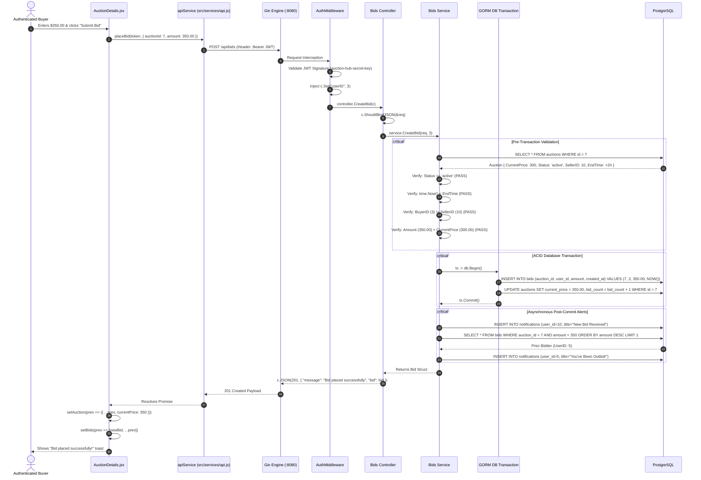

### Concurrency & Locking Analysis
1. **Transaction Atomicity:** The insertion of the new bid and the updating of `auctions.current_price` are executed inside a single GORM transaction block (`s.db.Transaction(...)`). If either statement fails, the entire transaction rolls back.
2. **Missing Pessimistic Row Lock:** The initial read `SELECT * FROM auctions WHERE id = ?` does not currently include a pessimistic lock (`FOR UPDATE`). Under extreme concurrency (two bids of $350 submitted at the exact same millisecond), both might pass the in-memory validation check before writing. Adding `Clauses(clause.Locking{Strength: "UPDATE"})` in GORM would prevent this race condition.

---

# Part 6: Auction Completion and Order Creation (Lazy Evaluation)

In Auction Hub, auctions are not terminated by an asynchronous background daemon or cron ticker. Instead, termination is evaluated **lazily on-demand**.

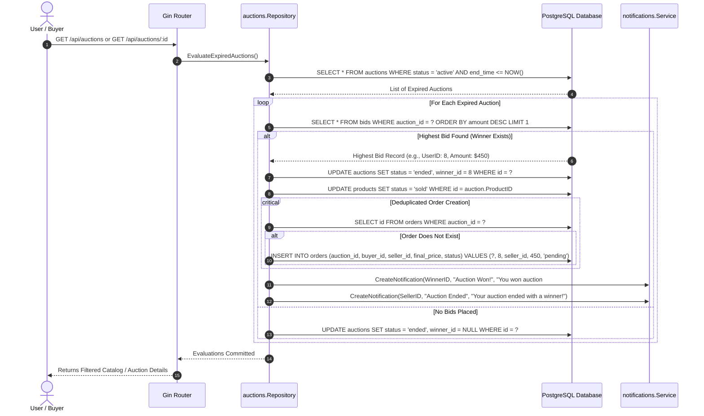

### Architectural Implications of Lazy Evaluation
- **Pros:** No complex cron server setup, worker process, or Celery/Temporal queue needed; resource consumption is 0 when the application is idle.
- **Cons:** If no visitor calls the API for several hours after an auction expires, the auction remains marked `"active"` in the database until the next request arrives.

---

# Part 7: Database Data Flow & Relational Schema

Below is the complete Entity-Relationship diagram showing the 10 models managed in PostgreSQL by GORM.

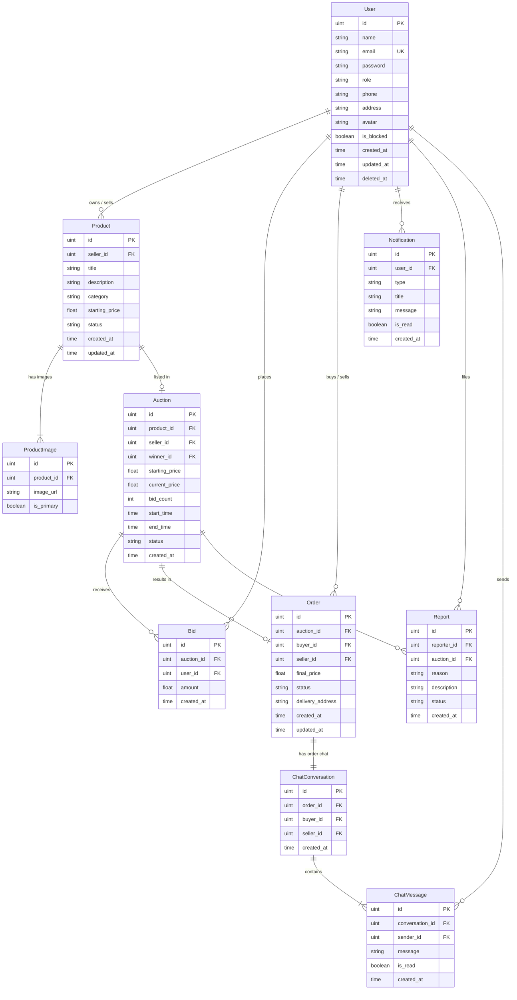

---

# Part 8: Authentication & Authorization Across the Entire Application

Authentication is entirely stateless, utilizing cryptographic JSON Web Tokens (JWT).

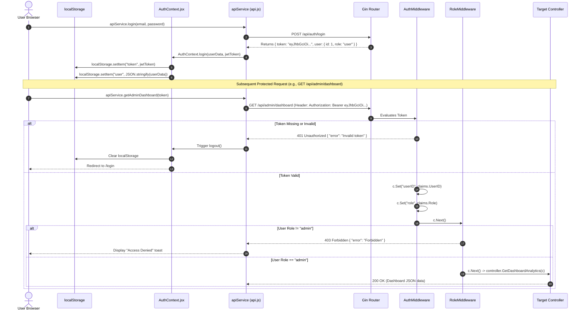

---

# Part 9: Notifications and Chat End-to-End (Polling vs WebSockets)

### Reality Check: No WebSockets
The Auction Hub backend **does not implement WebSockets, Socket.io, or Server-Sent Events (SSE)**. Real-time updates on the frontend are achieved through **active HTTP interval polling**.

### Order Chat Architecture
1. **Drawer Mount:** When a user opens an order in [`OrderDetails.jsx`](file:///c:/Auction_Hub/frontend/src/pages/buyer/OrderDetails.jsx) and toggles the chat drawer (`chatOpen = true`), a `useEffect` hook triggers:
   ```javascript
   useEffect(() => {
     if (chatOpen && order?.auctionId) {
       fetchChat();
       const interval = setInterval(fetchChat, 3000); // Poll every 3 seconds
       return () => clearInterval(interval);
     }
   }, [chatOpen, order?.auctionId]);
   ```
2. **Conversation Lookup:** `GET /api/chat/auction/:auctionId` resolves the conversation ID.
3. **Message Fetching:** Every 3 seconds, `GET /api/chat/conversation/:id/messages` queries the latest messages.
4. **Message Posting:** Submitting a message fires `POST /api/chat/conversation/:id/messages`. The message is inserted into PostgreSQL, and a notification is created for the recipient.

### In-App Notifications Architecture
1. **Background Poller:** [`NotificationContext.jsx`](file:///c:/Auction_Hub/frontend/src/context/NotificationContext.jsx) sets up a polling interval querying `GET /api/notifications/unread-count`.
2. **PascalCase Field Normalization:** The Go `Notification` model lacks JSON struct tags, so GORM serializes fields to PascalCase (`ID`, `UserID`, `Title`, `IsRead`). The frontend passes all raw alerts through a custom normalizer:
   ```javascript
   export function normalizeNotification(item) {
     return {
       id: item.ID ?? item.id,
       title: item.Title ?? item.title,
       message: item.Message ?? item.message,
       isRead: Boolean(item.IsRead ?? item.isRead ?? false),
       createdAt: item.CreatedAt ?? item.createdAt
     };
   }
   ```

---

# Part 10: All Important System Diagrams (12 Diagrams)

### Diagram 1: Overall System Architecture
*(Refer to Part 1 Architecture Diagram)*

### Diagram 2: Frontend Application Startup Flow
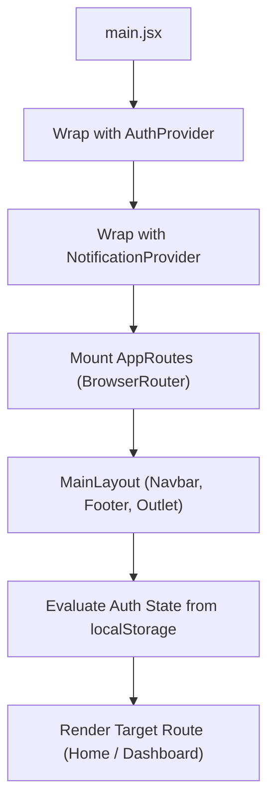

### Diagram 3: Backend Server Startup Flow
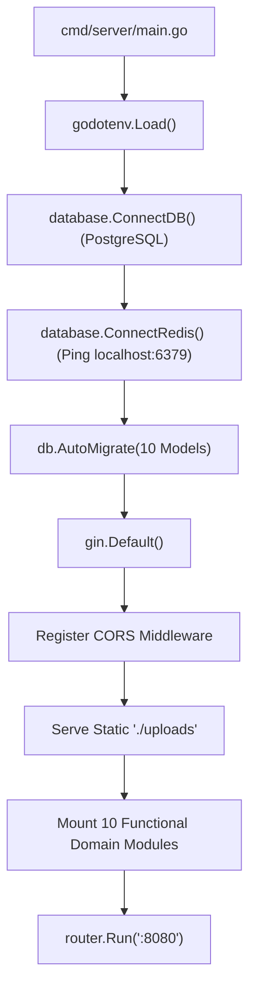

### Diagram 4: Request Lifecycle
*(Refer to Part 3 Sequence Diagram)*

### Diagram 5: Registration & Login Flow
*(Refer to Part 4 Sections 1, 2, and 3)*

### Diagram 6: Auction Creation Sequence
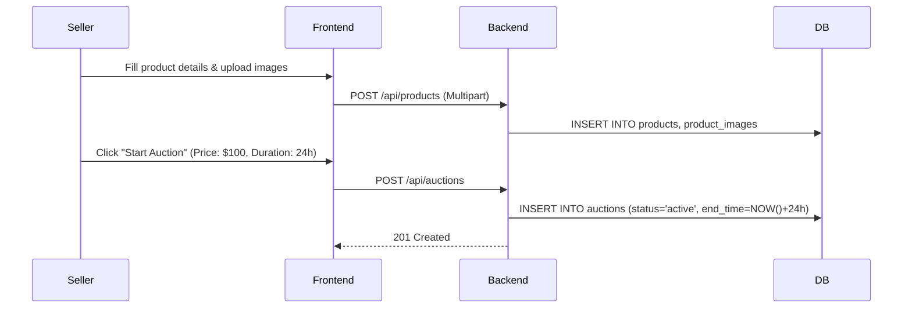

### Diagram 7: Bidding Sequence
*(Refer to Part 5 Sequence Diagram)*

### Diagram 8: Auction Completion & Winner Selection
*(Refer to Part 6 Sequence Diagram)*

### Diagram 9: Order Lifecycle State Machine
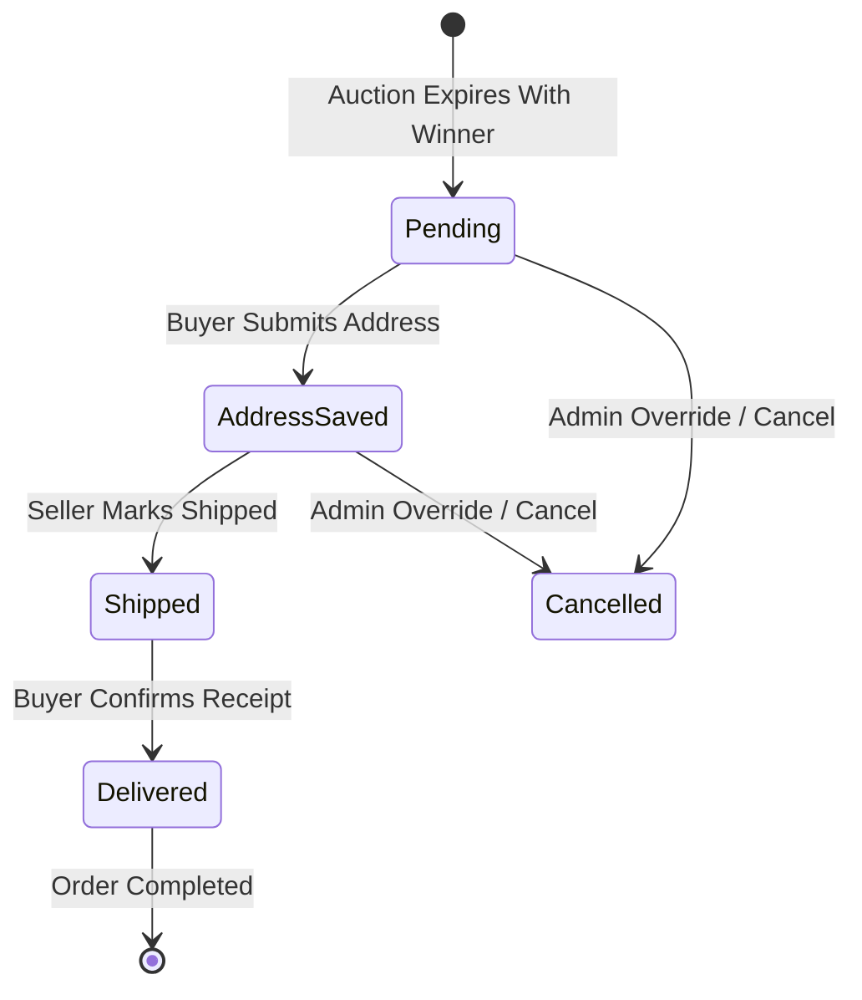

### Diagram 10: Chat Messaging Sequence
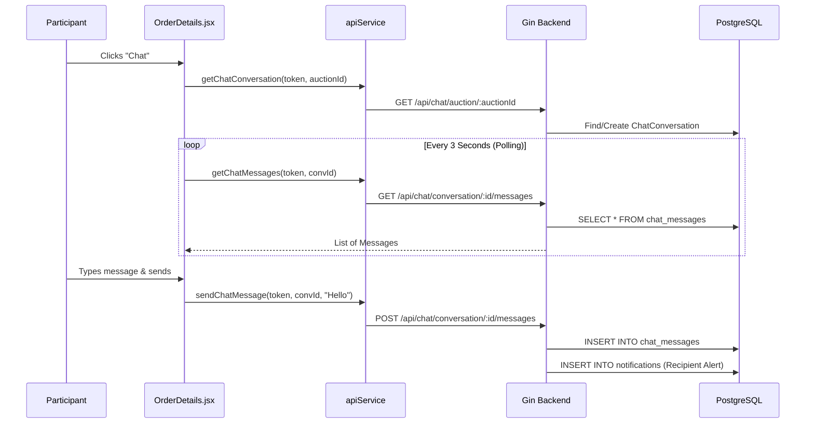

### Diagram 11: Notification Creation and Retrieval Flow
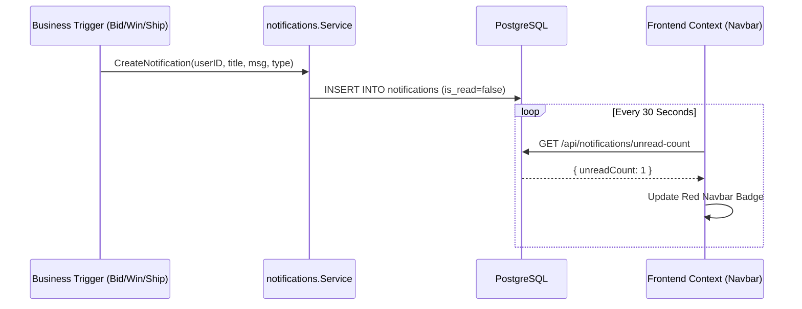

### Diagram 12: Database Entity Relationships
*(Refer to Part 7 ER Diagram)*

---

# Part 11: Complete File-to-File Reference

Below is the direct source trace connecting every major view to its exact code chain.

### 1. Bidding Execution Chain
```
[Frontend View]   frontend/src/pages/buyer/AuctionDetails.jsx
       │
[API Client]      frontend/src/services/api.js (placeBid)
       │
[Router]          backend/cmd/server/main.go (bids.RegisterRoutes)
       │
[Route Def]       backend/modules/bids/routes.go (POST /api/bids)
       │
[Middleware]      backend/middleware/auth.go (AuthMiddleware)
       │
[Controller]      backend/modules/bids/controller.go (CreateBid)
       │
[Service]         backend/modules/bids/service.go (CreateBid)
       │
[Repository]      backend/modules/bids/repository.go (Create)
       │
[Model]           backend/modules/bids/model.go (Bid struct)
       │
[Database Table]  PostgreSQL: bids & auctions tables
```

### 2. Product Creation Chain
```
[Frontend View]   frontend/src/pages/seller/MyProducts.jsx
       │
[API Client]      frontend/src/services/api.js (createProduct)
       │
[Route Def]       backend/modules/products/routes.go (POST /api/products)
       │
[Middleware]      backend/middleware/auth.go (AuthMiddleware)
       │
[Controller]      backend/modules/products/controller.go (CreateProduct)
       │
[Service]         backend/modules/products/service.go (CreateProduct)
       │
[Repository]      backend/modules/products/repository.go (Create)
       │
[Models]          backend/modules/products/model.go (Product, ProductImage)
       │
[Database Tables] PostgreSQL: products, product_images
```

### 3. Order Fulfillment & Delivery Chain
```
[Frontend View]   frontend/src/pages/buyer/OrderDetails.jsx
       │
[API Client]      frontend/src/services/api.js (markOrderDelivered)
       │
[Route Def]       backend/modules/orders/routes.go (PATCH /api/orders/:id/deliver)
       │
[Middleware]      backend/middleware/auth.go (AuthMiddleware)
       │
[Controller]      backend/modules/orders/controller.go (MarkAsDelivered)
       │
[Service]         backend/modules/orders/service.go (MarkAsDelivered)
       │
[Repository]      backend/modules/orders/repository.go (UpdateStatus)
       │
[Model]           backend/modules/orders/model.go (Order)
       │
[Database Table]  PostgreSQL: orders
```

---

# Part 12: Review and Technical Interview Preparation (70 High-Yield Q&As)

### Section A: 30 Full-Stack Core Questions

#### Q1: What happens if the Redis server goes offline while the backend starts up?
**Answer:** The Go backend will crash immediately and fail to start. In [`backend/database/redis.go`](file:///c:/Auction_Hub/backend/database/redis.go#L24), `rdb.Ping()` is checked during `ConnectRedis()`. If an error occurs, it calls `log.Fatalf("Failed to connect to Redis: %v", err)`.

#### Q2: How is user authentication maintained across browser reloads?
**Answer:** In [`frontend/src/context/AuthContext.jsx`](file:///c:/Auction_Hub/frontend/src/context/AuthContext.jsx), initial state reads `localStorage.getItem("token")` and `localStorage.getItem("user")`. On every subsequent API call, [`frontend/src/services/api.js`](file:///c:/Auction_Hub/frontend/src/services/api.js) injects this token into the `Authorization: Bearer <token>` header.

#### Q3: Does the frontend use Axios or native fetch?
**Answer:** It uses the **native browser `fetch` API**, wrapped inside a custom helper `request()` in [`frontend/src/services/api.js`](file:///c:/Auction_Hub/frontend/src/services/api.js#L6).

#### Q4: How does the application prevent sellers from bidding on their own items?
**Answer:** In [`backend/modules/bids/service.go`](file:///c:/Auction_Hub/backend/modules/bids/service.go#L54), the service checks `if auction.SellerID == userID` and returns `errors.New("sellers cannot bid on their own auctions")`, aborting with HTTP 400.

#### Q5: How are product images uploaded and referenced in the database?
**Answer:** The frontend uploads images via `multipart/form-data`. In [`backend/modules/products/controller.go`](file:///c:/Auction_Hub/backend/modules/products/controller.go), files are written to `./uploads/` with unique UUID filenames. GORM creates corresponding `ProductImage` records storing the file path. Gin serves these statically via `router.Static("/uploads", "./uploads")`.

#### Q6: How does the backend prevent duplicate orders when an auction ends?
**Answer:** In [`backend/modules/auctions/repository.go`](file:///c:/Auction_Hub/backend/modules/auctions/repository.go#L95), `EvaluateExpiredAuctions()` queries `orders` by `auction_id`. If an order already exists, it skips order creation.

#### Q7: Why does the frontend notification normalizer exist?
**Answer:** The Go struct in [`backend/modules/notifications/model.go`](file:///c:/Auction_Hub/backend/modules/notifications/model.go) lacks JSON struct tags, so GORM serializes it in PascalCase (`ID`, `UserID`, `Title`, `IsRead`). [`frontend/src/context/NotificationContext.jsx`](file:///c:/Auction_Hub/frontend/src/context/NotificationContext.jsx) uses `normalizeNotification()` to normalize these fields to standard JavaScript camelCase.

#### Q8: What database engine and ORM are used?
**Answer:** **PostgreSQL** using the **GORM (`v1.31.2`)** object-relational mapping library.

#### Q9: How are passwords protected in the database?
**Answer:** They are hashed using `golang.org/x/crypto/bcrypt` with default work factor 10 (`bcrypt.DefaultCost`) in [`backend/utilis/password.go`](file:///c:/Auction_Hub/backend/utilis/password.go). Plain text passwords are never stored.

#### Q10: How are soft deletes implemented?
**Answer:** Models embed `gorm.Model`, which includes `DeletedAt gorm.DeletedAt`. When `db.Delete()` is called, GORM sets a timestamp in `deleted_at` rather than removing the row from disk.

#### Q11: What is the purpose of Redis in this system?
**Answer:** Redis is used exclusively for transient OTP management during user registration and password resets. OTPs are stored with a 5-minute expiration (`time.Minute * 5`).

#### Q12: How is the admin role protected on the frontend?
**Answer:** Via `<AdminRoute>` in [`frontend/src/routes/AppRoute.jsx`](file:///c:/Auction_Hub/frontend/src/routes/AppRoute.jsx). If `user?.role !== "admin"`, it redirects to `/`.

#### Q13: How is the admin role protected on the backend?
**Answer:** Via `RoleMiddleware("admin")` in [`backend/middleware/role.go`](file:///c:/Auction_Hub/backend/middleware/role.go). If the JWT role claim is not `"admin"`, it aborts with HTTP `403 Forbidden`.

#### Q14: How does the buyer-seller chat transport messages?
**Answer:** Through HTTP polling. Every 3 seconds, [`frontend/src/pages/buyer/OrderDetails.jsx`](file:///c:/Auction_Hub/frontend/src/pages/buyer/OrderDetails.jsx) calls `GET /api/chat/conversation/:id/messages`.

#### Q15: What happens when an auction expires with zero bids?
**Answer:** `EvaluateExpiredAuctions()` updates `auction.status = "ended"` with `winner_id = NULL`. No order record is generated.

#### Q16: Who can update the shipping address of an order?
**Answer:** Only the winning buyer (`order.BuyerID == userID`), and only while the order is still in `"pending"` status.

#### Q17: Who can mark an order as shipped?
**Answer:** Only the seller (`order.SellerID == userID`) or an administrator.

#### Q18: Who can mark an order as delivered?
**Answer:** Only the winning buyer (`order.BuyerID == userID`) or an administrator.

#### Q19: Where is the JWT signing key defined?
**Answer:** It is hardcoded as `[]byte("auction-hub-secret-key")` in [`backend/middleware/auth.go`](file:///c:/Auction_Hub/backend/middleware/auth.go) and [`backend/utilis/jwt.go`](file:///c:/Auction_Hub/backend/utilis/jwt.go).

#### Q20: Can an unauthenticated guest view active auctions?
**Answer:** In the frontend, the route `/auctions` is wrapped in `<ProtectedRoute>`, requiring authentication to access the page.

#### Q21: What CORS configuration is active on the server?
**Answer:** In [`backend/cmd/server/main.go`](file:///c:/Auction_Hub/backend/cmd/server/main.go#L81), `AllowOriginFunc` returns `true` for all origins, with `AllowCredentials: true`.

#### Q22: How does the frontend handle token expiration?
**Answer:** When the backend returns a `401 Unauthorized`, [`frontend/src/services/api.js`](file:///c:/Auction_Hub/frontend/src/services/api.js) throws an error, causing `AuthContext` to clear storage and redirect the user to `/login`.

#### Q23: What are the allowed order statuses?
**Answer:** `"pending"`, `"shipped"`, `"delivered"`, and `"cancelled"`.

#### Q24: How does the system inform a user that they have been outbid?
**Answer:** In `bids.Service.CreateBid()`, after committing a new bid, it queries the previous highest bid. If the bidder is different, it creates a `Notification` record in PostgreSQL with `type = "bid"`.

#### Q25: How does the frontend display outbid alerts?
**Answer:** Through the bell icon badge in [`Navbar.jsx`](file:///c:/Auction_Hub/frontend/src/components/common/Navbar.jsx), which polls for unread notifications.

#### Q26: Are category entities managed via an administrative CRUD interface?
**Answer:** No. Category names are stored as free-form strings on `products.category`.

#### Q27: How are live countdown timers implemented on the frontend?
**Answer:** Components calculate the difference between `auction.endTime` and `Date.now()` using a 1-second `setInterval` hook.

#### Q28: How does the Bidding Service guarantee atomicity?
**Answer:** By wrapping both the bid insertion and the auction price update in a GORM transaction: `s.db.Transaction(func(tx *gorm.DB) error { ... })`.

#### Q29: What happens if an image upload exceeds server expectations?
**Answer:** Gin limits default body memory, returning `400 Bad Request` if multipart parsing fails.

#### Q30: What styling framework is used on the frontend?
**Answer:** Pure **Vanilla CSS** with CSS Custom Properties and glassmorphic elevation tokens in [`frontend/src/index.css`](file:///c:/Auction_Hub/frontend/src/index.css).

---

### Section B: 15 Project Architecture Questions

#### Q31: Why is this project described as a "Modular Monolith"?
**Answer:** All modules (`auth`, `bids`, `orders`, `chat`) run inside a single compiled Go binary, but each domain is strictly compartmentalized into its own folder with independent controllers, services, and repositories.

#### Q32: What is the separation of responsibilities between Controller, Service, and Repository?
**Answer:**
- **Controller:** Binds HTTP JSON/multipart input, extracts context, and returns JSON status codes.
- **Service:** Enforces business logic, permissions, and database transaction boundaries.
- **Repository:** Executes GORM queries against PostgreSQL.

#### Q33: How does the backend bootstrap its database tables on launch?
**Answer:** In [`backend/cmd/server/main.go`](file:///c:/Auction_Hub/backend/cmd/server/main.go#L40), `db.AutoMigrate()` automatically inspects the struct definitions and executes `CREATE TABLE IF NOT EXISTS` or `ALTER TABLE` queries.

#### Q34: Why are base tables migrated before dependent tables?
**Answer:** `User`, `Seller`, `Category`, and `Product` are migrated first so that foreign keys in `Auction`, `Bid`, and `Order` reference existing tables.

#### Q35: How are cross-module dependencies wired in Go?
**Answer:** Via constructor injection in `RegisterRoutes()`. For example, `auctions.RegisterRoutes` injects `notifications.NewService()` into `auctionRepo.NotificationService`.

#### Q36: Why is Redis separated from PostgreSQL?
**Answer:** PostgreSQL is optimized for durable relational data (users, bids, orders), while Redis is an in-memory key-value store optimized for transient 5-minute OTP codes that expire automatically.

#### Q37: How does Gin inject user credentials into downstream controllers?
**Answer:** In [`backend/middleware/auth.go`](file:///c:/Auction_Hub/backend/middleware/auth.go), `c.Set("userID", claims.UserID)` stores the parsed ID in Gin's request-scoped context map.

#### Q38: Why does the chat module check order access?
**Answer:** To ensure privacy: only the specific buyer and seller associated with the order can view and send messages.

#### Q39: What architectural benefit does client-side route guarding provide?
**Answer:** It prevents unauthorized UI rendering and unnecessary API requests before a token is verified.

#### Q40: What happens if the frontend sends an unhandled error status?
**Answer:** [`frontend/src/services/api.js`](file:///c:/Auction_Hub/frontend/src/services/api.js#L23) intercepts `!response.ok`, extracts error messages from JSON, and re-throws an `Error` object for local component state handling.

#### Q41: How are static files served in Go Gin?
**Answer:** Via `router.Static("/uploads", "./uploads")`, which maps the `/uploads` URL path to the physical `./uploads` folder on disk.

#### Q42: Is there a database connection pool configured?
**Answer:** GORM maintains a default `database/sql` connection pool configured inside `database.ConnectDB()`.

#### Q43: How does the frontend handle responsive layouts?
**Answer:** Using CSS Flexbox, Grid, and `@media (max-width: 768px)` breakpoints defined in [`frontend/src/index.css`](file:///c:/Auction_Hub/frontend/src/index.css).

#### Q44: How are GORM associations configured between Auctions and Products?
**Answer:** In `Auction`, `ProductID uint` acts as the foreign key, paired with `Product Product gorm:"foreignKey:ProductID"`.

#### Q45: Why does the system use a single binary deployment model?
**Answer:** Go compiles to a standalone, statically linked executable that runs without requiring an external runtime environment.

---

### Section C: 15 End-to-End Execution Flow Questions

#### Q46: Trace the path when a user submits a registration form.
**Answer:** [`Register.jsx`](file:///c:/Auction_Hub/frontend/src/pages/auth/Register.jsx) &rarr; `apiService.sendOTP()` &rarr; `POST /api/auth/send-otp` &rarr; `auth.Controller.SendOTP` &rarr; `auth.Service.SendOTP` &rarr; Redis `SET otp:<email> 123456 EX 300` &rarr; Navigate to `/verify-otp`.

#### Q47: Trace the path when an admin blocks a user.
**Answer:** [`ManageUsers.jsx`](file:///c:/Auction_Hub/frontend/src/pages/admin/ManageUsers.jsx) &rarr; `apiService.blockUser()` &rarr; `PATCH /api/admin/users/:id/block` &rarr; `RoleMiddleware("admin")` &rarr; `admin.Controller.BlockUser` &rarr; `admin.Service.BlockUser` &rarr; `admin.Repo` sets `is_blocked = true` in PostgreSQL.

#### Q48: Trace the path when a buyer confirms delivery.
**Answer:** [`OrderDetails.jsx`](file:///c:/Auction_Hub/frontend/src/pages/buyer/OrderDetails.jsx) &rarr; `apiService.markOrderDelivered()` &rarr; `PATCH /api/orders/:id/deliver` &rarr; `orders.Controller.MarkAsDelivered` &rarr; `orders.Service.MarkAsDelivered` &rarr; updates `status = 'delivered'` in `orders` &rarr; creates notification for seller.

#### Q49: Trace how an active auction's price updates in the browser.
**Answer:** The buyer submits a bid &rarr; `POST /api/bids` succeeds &rarr; the component's `.then()` handler receives the updated bid &rarr; calls `setAuction()` with the new `current_price` &rarr; re-renders the UI with the updated price.

#### Q50: Trace the password reset flow from forgot password to login.
**Answer:** `/forgot-password` requests an OTP via `POST /api/auth/forgot-password` &rarr; Redis stores `otp:<email>` &rarr; user submits OTP and new password to `POST /api/auth/reset-password` &rarr; Redis verifies OTP &rarr; GORM updates the hashed password in `users` &rarr; user redirects to `/login`.

#### Q51: Trace how an image gets from the file input to disk.
**Answer:** File selected in `<input type="file">` &rarr; appended to `FormData` &rarr; sent via `POST /api/products` &rarr; Gin parses multipart form &rarr; `c.SaveUploadedFile()` writes file to `./uploads/<uuid>.<ext>` &rarr; path saved to `product_images` table.

#### Q52: Trace what happens when a user clicks "Mark All as Read".
**Answer:** Notification bell menu &rarr; `handleMarkAllAsRead()` &rarr; `PATCH /api/notifications/read-all` &rarr; `notifications.Controller.MarkAllAsRead` &rarr; GORM executes `UPDATE notifications SET is_read = true WHERE user_id = ?` &rarr; UI sets unread badge count to 0.

#### Q53: Trace the flow of a chat message.
**Answer:** User enters text in `OrderDetails.jsx` chat drawer &rarr; `POST /api/chat/conversation/:id/messages` &rarr; `chat.Controller.SendMessage` &rarr; `chat.Service.SendMessage` inserts message into `chat_messages` &rarr; dispatches alert to recipient &rarr; message appears in conversation drawer.

#### Q54: Trace the evaluation of an expired auction.
**Answer:** Request arrives for `GET /api/auctions` &rarr; `EvaluateExpiredAuctions()` runs &rarr; finds `end_time <= NOW()` &rarr; queries highest bid &rarr; sets `status = 'ended'` and `winner_id` &rarr; creates `Order` with `status = 'pending'` &rarr; notifies winner and seller.

#### Q55: Trace how an admin views system stats.
**Answer:** `/admin` mounts &rarr; `apiService.getAdminDashboard()` &rarr; `GET /api/admin/dashboard` &rarr; `RoleMiddleware("admin")` validates role &rarr; `admin.Service.GetDashboardAnalytics` queries table counts &rarr; frontend renders metrics cards.

#### Q56: Trace the logout flow.
**Answer:** User clicks "Logout" in Navbar &rarr; `AuthContext.logout()` clears `localStorage.removeItem("token")` and `removeItem("user")` &rarr; state sets `token = null`, `user = null` &rarr; redirects to `/login`.

#### Q57: Trace how a user views their own bids.
**Answer:** User navigates to `/my-bids` &rarr; `apiService.getMyBids()` &rarr; `GET /api/bids/my` &rarr; `bids.Controller.GetMyBids` &rarr; GORM queries `bids WHERE user_id = ?` preloading `Auction.Product` &rarr; frontend renders bid history table.

#### Q58: Trace report submission on an auction.
**Answer:** User opens report modal on `/auctions/:id` &rarr; `apiService.createReport()` &rarr; `POST /api/reports` &rarr; `reports.Controller.CreateReport` &rarr; inserts ticket into `reports` table with status `"pending"`.

#### Q59: Trace what happens when an invalid route is entered in the browser.
**Answer:** `AppRoutes.jsx` falls through to `<Route path="*" element={<Navigate to="/" replace />} />`, redirecting the user back to the home page.

#### Q60: Trace how an auction details page loads all required data.
**Answer:** `AuctionDetails.jsx` uses `Promise.all([apiService.getAuctionById(...), apiService.getAuctionBids(...)])` to fetch auction metadata and bid history in parallel.

---

### Section D: 10 Database & Data-Flow Questions

#### Q61: What tables are affected when an auction completes with bids?
**Answer:** Three tables:
1. `auctions`: `status` becomes `'ended'`, `winner_id` is updated.
2. `products`: `status` becomes `'sold'`.
3. `orders`: New row inserted with `status = 'pending'`.

#### Q62: What tables are affected when a bid is placed?
**Answer:** Two tables in an ACID transaction:
1. `bids`: New bid row inserted.
2. `auctions`: `current_price` updated, `bid_count` incremented.
*(Plus `notifications` table for outbid and seller alerts).*

#### Q63: How is the foreign key relationship between Orders and Auctions defined?
**Answer:** `Order` contains `AuctionID uint`, referencing `Auction.ID`.

#### Q64: What happens to linked database records when a product is deleted?
**Answer:** GORM executes a **soft delete** (`deleted_at` timestamp set), preserving historical foreign key integrity for past auctions and orders.

#### Q65: How are product images associated with products in GORM?
**Answer:** `Product` has `Images []ProductImage gorm:"foreignKey:ProductID"`. `ProductImage` has `ProductID uint`.

#### Q66: What index exists on the `users` table?
**Answer:** A `UNIQUE INDEX` on `email`, plus an index on `deleted_at` from `gorm.Model`.

#### Q67: How does GORM handle the 1-to-1 relationship between Orders and ChatConversations?
**Answer:** `ChatConversation` contains `OrderID uint gorm:"uniqueIndex"`, ensuring only one conversation exists per order.

#### Q68: What is the data type of monetary fields in PostgreSQL?
**Answer:** In Go structs, they are declared as `float64`, mapping to `numeric` or `double precision` in PostgreSQL.

#### Q69: How are notifications targeted to specific users?
**Answer:** Via `UserID uint` on the `notifications` table, indexed for fast lookup by user.

#### Q70: How does the database track order delivery history?
**Answer:** Through the `OrderTrackingHistory` table, which logs each status transition with timestamps and notes.

---

# Part 13: Project Limitations, Discrepancies, and Architectural Gaps

1. **Redis Startup Dependency:** [`backend/database/redis.go`](file:///c:/Auction_Hub/backend/database/redis.go#L24) calls `log.Fatalf` if Redis is unreachable on `localhost:6379`. The backend will not start without an active Redis instance.
2. **Hardcoded JWT Secret:** Both [`backend/middleware/auth.go`](file:///c:/Auction_Hub/backend/middleware/auth.go#L11) and [`backend/utilis/jwt.go`](file:///c:/Auction_Hub/backend/utilis/jwt.go#L9) hardcode `[]byte("auction-hub-secret-key")`. This should be read from `os.Getenv("JWT_SECRET")`.
3. **Bidding Concurrency Locking:** `bids.Service.CreateBid()` wraps bid insertion in a transaction, but lacks pessimistic row locking (`SELECT ... FOR UPDATE`). Concurrent identical bids could pass validation simultaneously.
4. **Lazy Auction Expiration:** Auctions are only evaluated when a user requests an auction endpoint. Without active traffic, expired auctions remain marked `"active"`.
5. **Notification Field Serialization:** [`backend/modules/notifications/model.go`](file:///c:/Auction_Hub/backend/modules/notifications/model.go) lacks JSON struct tags, serializing fields in PascalCase (`ID`, `UserID`, `Title`). The frontend compensates using `normalizeNotification()`.
6. **Chat Polling vs WebSockets:** Chat operates via 3-second HTTP polling rather than WebSockets, increasing server request volume during active conversations.
7. **Unmounted Modules:** The `modules/sellers` and `modules/categories` packages exist in the backend tree, but their routes are empty and unmounted in `main.go`.

---

# Part 14: Final Full-Stack Learning Roadmap

Use this structured roadmap to master the codebase for project reviews and technical interviews:

```
Step 1: System Overview & Tech Stack
        ├── Read: Part 1 of this document
        └── Open: go.mod (backend) & package.json (frontend)

Step 2: Server Boot & Infrastructure
        ├── Read: Part 3 & Part 10 (Diagram 3)
        └── Trace: backend/cmd/server/main.go & database/database.go

Step 3: Frontend Startup & Route Guarding
        ├── Read: Part 8 & Part 10 (Diagram 2)
        └── Trace: frontend/src/main.jsx & frontend/src/routes/AppRoute.jsx

Step 4: Authentication & Redis OTP Lifecycle
        ├── Read: Part 4 (Flows 1-3) & Part 8
        └── Trace: backend/modules/auth/service.go & frontend/src/context/AuthContext.jsx

Step 5: Product & Multi-Image Uploads
        ├── Read: Part 4 (Flow 5) & Part 11 (Chain 2)
        └── Trace: backend/modules/products/controller.go & frontend/src/pages/seller/MyProducts.jsx

Step 6: High-Stakes Bidding & ACID Transactions
        ├── Read: Part 5 & Part 10 (Diagram 7)
        └── Trace: backend/modules/bids/service.go & frontend/src/pages/buyer/AuctionDetails.jsx

Step 7: Lazy Expiration & Order Creation
        ├── Read: Part 6 & Part 10 (Diagram 8)
        └── Trace: backend/modules/auctions/repository.go (EvaluateExpiredAuctions)

Step 8: Order Fulfillment State Machine
        ├── Read: Part 4 (Flows 14-18) & Part 10 (Diagram 9)
        └── Trace: backend/modules/orders/service.go & frontend/src/pages/buyer/OrderDetails.jsx

Step 9: Chat Polling & Notification Delivery
        ├── Read: Part 9 & Part 10 (Diagrams 10-11)
        └── Trace: backend/modules/chat/service.go & frontend/src/context/NotificationContext.jsx

Step 10: Technical Interview Rehearsal
        └── Drill: Part 12 (70 Q&As across Core, Architecture, Flows, and Database)
```
